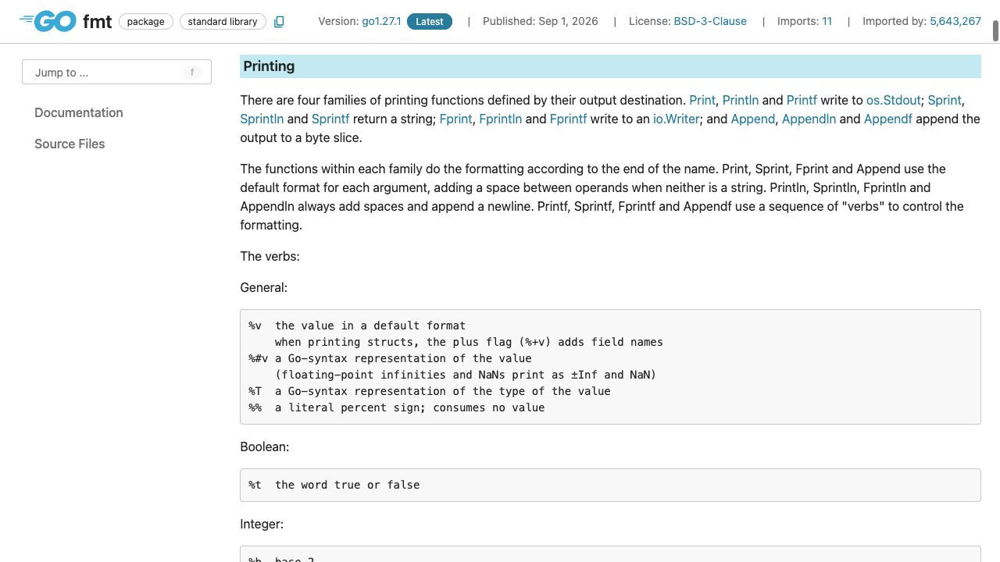
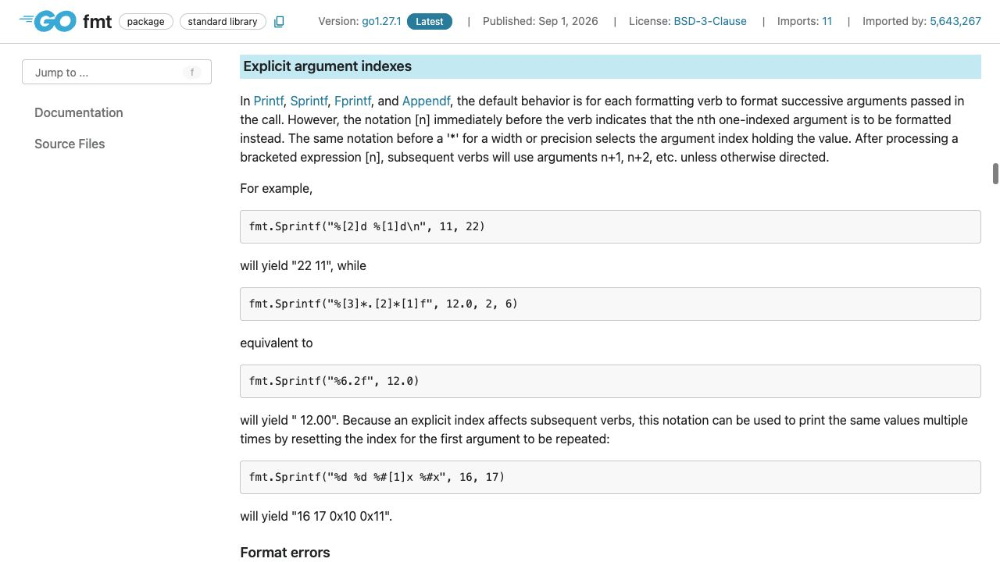

[問題へ戻る](README.md) | [カテゴリの調べ方](../01-packages/README.md)

# 調査から回答までの例

初回調査・画面撮影: 2026-10-02。現行の問題本文との照合・実行結果の再確認: 2026-10-13。最初に問題 README の `<details>` をすべて除いた本文と、[カテゴリの調べ方](../01-packages/README.md)を読みました。既存の答えを開く前に、以下の資料・解釈・実験結果を記録しました。画面は実際のブラウザを撮影したものです。本文の語句検索とリンク確認には、HTTP で取得した同じページの HTML も使っています。画像は確認した節をブラウザで開いて保存しており、HTML 検索をブラウザ操作として記述していません。

実行環境は `go1.27.1 darwin/arm64`、一時モジュールの `go 1.27`、`GODEBUG` 未指定です。問題の既存コードは一時ファイルに保存して `go run .` で実行しました。

---
<a id="question-1"></a>
## 設問 1: 書式全体の約束を探す

**出発点と操作。** 問題にある識別子は `fmt.Printf`、読めない記号は `%v`、`%T`、`#` です。[Go Documentation](https://go.dev/doc/)で Packages の入口を確認し、カテゴリの逆引き手順から [fmt](https://pkg.go.dev/fmt) を開きました。`Printf` の個別説明だけでは記号の一覧がないので、カテゴリのOverviewの案内に従って **Overview → Printing** を読みます。取得した本文を `%v` で検索すると **General** の表に着きました。



**読んだ箇所と解釈。** [Printing](https://pkg.go.dev/fmt#hdr-Printing)の General 表で、`%v` の `default format` は値の既定形式です。`%#v` と `%T` はどちらも `Go-syntax representation` ですが、前者の対象は `value`（値）、後者は `type of the value`（値の型）です。この対象の違いが、問題の `"gopher"` と `string` の違いに対応します。`#` を単独で「型名を出す」と解釈するのは誤りで、ここでは `v` に付くフラグとして読みます。

**次の確認。** 宣言リンクから [print.go](https://cs.opensource.google/go/go/+/refs/tags/go1.27.1:src/fmt/print.go;l=224)へ進み、`Printf` が `Fprintf(os.Stdout, ...)` を呼ぶことを確認しました。同じファイルの `doPrintf` は `#` をフラグとして処理し、`v` の処理で Go 構文用の状態に移します。`printArg` の `T` 分岐は型を文字列にします。これで表の読み方と実装が対応します。

**実験と回答。** [問題コード](https://go.dev/play/p/RTNSvn_p2Ai)の実測は `"gopher" string` でした。さらに値だけを構造体にした[追加実験](https://go.dev/play/p/fbq6AWx_dDE)では次の結果になりました。

```text
struct { Name string }{Name:"gopher"} struct { Name string }
```

前半が値、後半が型です。構造体の表示に型構文も含まれるのは `%#v` の性質で、後半の `%T` と役割を区別できます。

---

<a id="question-2"></a>
## 設問 2: 同じ引数を二度使う仕組みを探す

**手がかりと操作。** `%v` と `%T` だけでは、引数が一つなのに二回使える理由が残ります。未説明の記号 `[1]` を fmt 本文で検索し、Overview の **Explicit argument indexes** へ進みました。



**読んだ箇所。** [Explicit argument indexes](https://pkg.go.dev/fmt#hdr-Explicit_argument_indexes)の `successive arguments` は通常は引数を順番に使うという規則です。それに対して、`[n]` は `immediately before the verb`（verb の直前）に置き、`one-indexed`（1始まり）の番号で使う引数を選びます。今回の n は1なので `value` を選びます。明示後の `subsequent verbs`（後続の verb）は `n+1, n+2` と進みますが、別の指定がある場合はその指定に従います。同じ節の後半には、番号を戻して同じ値を再利用する例もありました。

**解釈と実装確認。** 今回は二つの verb の両方に `[1]` があるので、どちらも第 1 引数を参照します。`print.go` の `argNumber` が角括弧の番号を読み、`doPrintf` がその番号で `a` を参照する処理まで確認しました。単に「引数不足でも繰り返してくれる」と一般化はできません。

**回答。** `%#[1]v` は第 1 引数を Go 構文で、`%[1]T` は同じ第 1 引数の型を表示します。二つ目でも `[1]` を明示しているため、引数が一つで足ります。
