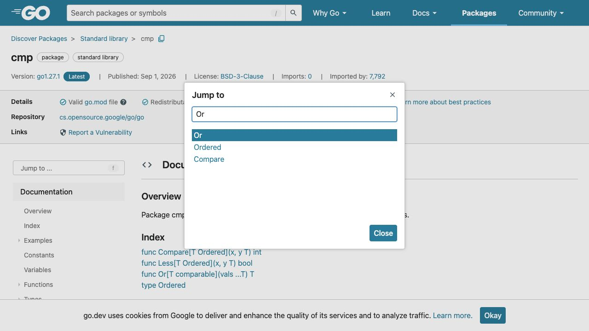
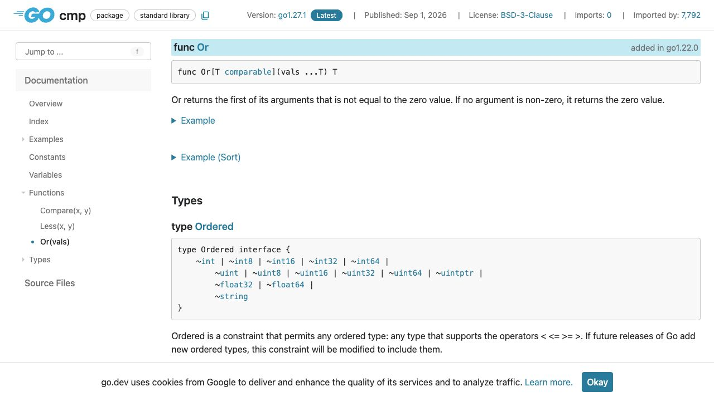

[問題へ戻る](README.md) | [カテゴリの調べ方](../../README.md)

# 調査から回答までの例

初回調査・画面撮影: 2026-10-02。現行の問題本文との照合・実行結果の再確認: 2026-10-13。最初に問題 README の `<details>` をすべて除いた本文と、[カテゴリの調べ方](../../README.md)を読みました。既存の答えを開く前に、以下の資料・解釈・実験結果を記録しました。画面は実際のブラウザを撮影したものです。本文の語句検索とリンク確認には、HTTP で取得した同じページの HTML も使っています。画像は確認した節をブラウザで開いて保存しており、HTML 検索をブラウザ操作として記述していません。

初回調査後に問題の例示値が改訂されたため、説明と問題コードの出力は現行の例に対応させました。画面は同じ API 契約・実装を読む資料として使い、例示値を含む実行結果とは区別しています。

実行環境は `go1.27.1 darwin/arm64`、一時モジュールの `go 1.27`、`GODEBUG` 未指定です。問題の既存コードは一時ファイルに保存して `go run .` で実行しました。

---
<a id="question-1"></a>
## 設問 1: 空文字を読み飛ばす条件を調べる

**出発点と操作。** コードには `cmp.Or` と引数の順序が見えます。ここから調べる語は `cmp` と `Or` に絞れます。[Go Documentation](https://go.dev/doc/) の Packages を確認し、カテゴリのパッケージを開く案内に従って [cmp](https://pkg.go.dev/cmp) を開きました。`f` でダイアログが出なかったため、画面の **Jump to ...** を押し、`Or` を入力して候補の `Or` を選びました。



検索語は問題の識別子そのものです。候補には `Ordered` もありますが、問題の呼び出しと一致する関数 `Or` を選びます。

**読んだ箇所と解釈。** [Or の宣言と説明](https://pkg.go.dev/cmp#Or)では、`first` が引数の順序を、`not equal to the zero value` が選ぶ条件を表します。つまり「ゼロ値と等しくない最初の引数」です。続く `If no argument is non-zero` は、その条件を満たす引数が一つもない場合を指し、そのときはゼロ値を返します。「値が最大のもの」や「最後の設定」を選ぶとは書かれていません。そこで、順序を実装でも確かめるため宣言のソースリンクへ進みました。[go1.27.1 の cmp.go](https://cs.opensource.google/go/go/+/refs/tags/go1.27.1:src/cmp/cmp.go;l=66)では `var zero T`、`range vals`、`val != zero` のとき即座に `return val`、最後に `return zero` という順になっています。

**回答。** 今回は文字列の空値 `""` を飛ばし、次の `"second"` を返します。その後の `"fallback"` は選択に使われません。問題コードの実測も次のとおりでした。

```text
second
all unavailable: ""
```

コード: [問題と同じ Playground](https://go.dev/play/p/WkH9Xink92x)。

---

<a id="question-2"></a>
## 設問 2: 返り値に何の情報があるかを確認する

**次の疑問。** 設問 1 で「全てゼロならゼロ」と分かりました。ここでは検索語を増やすより、同じ宣言の戻り値を読み直します。宣言の `func Or[T comparable](vals ...T) T` では、括弧の中の `vals ...T` が複数の入力、括弧の後の `T` 一つが戻り値です。エラー、選んだ位置、設定の出所を別に返す形ではありません。



**解釈。** 説明の二文目と実装末尾の `return zero` が、観測した空文字を説明します。空文字を「未設定」とする今回のルールなら、結果が空であることから、候補に使用可能な非空設定がなかったと判定できます。一方、この API の説明は未設定時にエラーにするか別の既定値を用意するかを決めていません。

**回答。** 返り値で非空候補の有無は判定できます。候補が利用目的に合うか、未設定をエラー扱いするか、どの設定から採用されたかは別途確認・管理します。ここは API 契約から業務ルールを推測せず、仕様の確認事項として残します。
