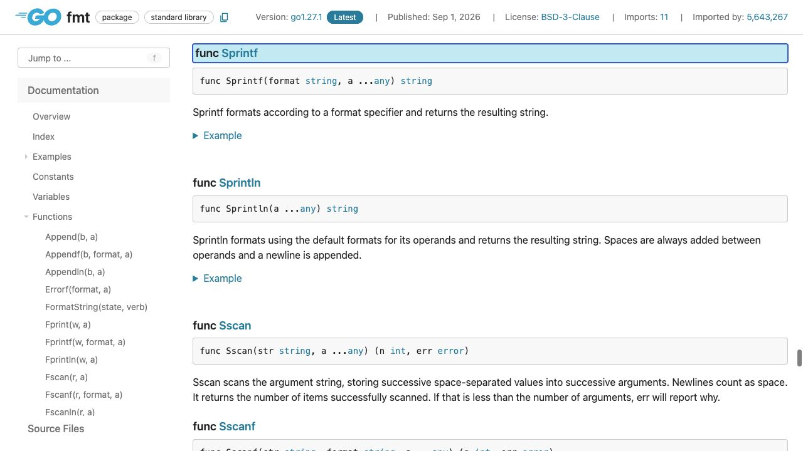
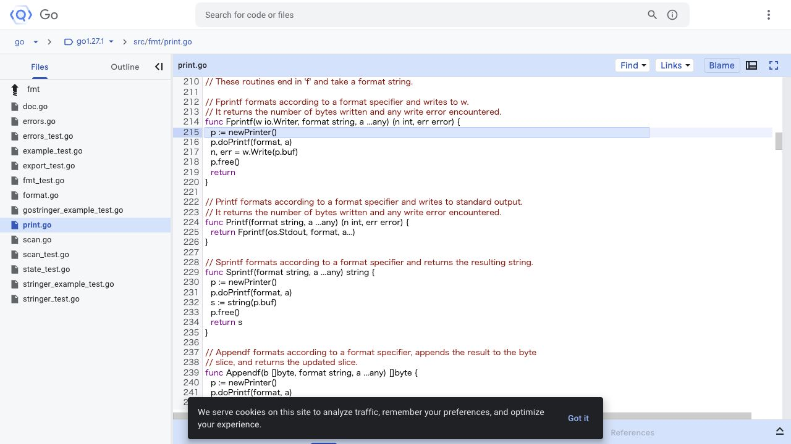

[問題へ戻る](README.md) | [カテゴリの調べ方](../../README.md)

# 調査から回答までの例

初回調査・画面撮影: 2026-10-02。現行の問題本文との照合・実行結果の再確認: 2026-10-13。最初に問題 README の `<details>` をすべて除いた本文と、[カテゴリの調べ方](../../README.md)を読みました。既存の答えを開く前に、以下の資料・解釈・実験結果を記録しました。画面は実際のブラウザを撮影したものです。本文の語句検索とリンク確認には、HTTP で取得した同じページの HTML も使っています。画像は確認した節をブラウザで開いて保存しており、HTML 検索をブラウザ操作として記述していません。

実行環境は `go1.27.1 darwin/arm64`、一時モジュールの `go 1.27`、`GODEBUG` 未指定です。問題の既存コードは一時ファイルに保存して `go run .` で実行しました。

---
<a id="question-1"></a>
## 設問 1: 出力先と戻り値を分けて読む

**出発点と操作。** `msg := fmt.Sprintf(...)` という代入が手がかりです。[Go Documentation](https://go.dev/doc/)からパッケージ資料へ進み、問題文の `fmt` を使って [fmt](https://pkg.go.dev/fmt) を開きました。取得 HTML の Index から `Sprintf` の宣言リンクを見つけ、ブラウザでもその節を開きます。



**読んだ箇所と解釈。** [Sprintf](https://pkg.go.dev/fmt#Sprintf) の戻り値は `string` で、書式に従った結果を返します。Overview の **Printing** に戻ると、Print 系は標準出力、Sprint 系は文字列を返すという分類があります。同じ一覧の String/Integer から `%s` は文字列のバイト列、`%d` は整数の十進表示と読めます。

**次の確認。** 宣言リンクの [print.go](https://cs.opensource.google/go/go/+/refs/tags/go1.27.1:src/fmt/print.go;l=229) では、書式処理後に `s := string(p.buf)` を作り `return s` しています。すぐ上の `Printf` は `os.Stdout` を渡しており、画面への出力と戻り値の違いを実装からも確認できます。



**回答。** `name` を `%s`、次の `points` を `%d` で整形した文字列が `msg` に入ります。画面へ出しているのは後続の `fmt.Println(msg)` です。[問題コード](https://go.dev/play/p/uDdRXVMggVb)を実行すると、文章の後に型名 `string` が表示されました。

---

<a id="question-2"></a>
## 設問 2: 幅・精度・フラグを対応付ける

**手がかりと操作。** 今度のコードには `%5d`、`%-5d`、`%05d`、`%.2f`、`%8.2f` があります。Overview の書式一覧を読み進めると **Width is specified** から始まる段落と **Other flags** が現れました。新しい API を探す必要はなく、同じ [Printing の説明](https://pkg.go.dev/fmt#hdr-Printing)に規則がまとまっています。

**読んだ箇所と解釈。** 幅は verb 前の十進数、精度はピリオドの後の数です。幅は通常「最小幅」であり、切り詰める指定ではありません。`f` の精度は小数点以下の桁数です。フラグ表では `-` が左寄せ、`0` が空白の代わりのゼロ埋めです。先ほどの `print.go` の `doPrintf` でも、フラグ→幅→精度の順で読む処理が見つかります。

**実験と回答。** [設問のコード](https://go.dev/play/p/SMFWIRANv3B)をそのまま実行しました。

```text
[   42]
[42   ]
[00042]
[3.14]
[    3.14]
```

`%5d` は幅 5 の右寄せ、`%-5d` は左寄せ、`%05d` は幅 5 のゼロ埋めです。`%.2f` は小数点以下 2 桁、`%8.2f` はそれに最小幅 8 を加えます。角括弧は幅の外側にあり、空白の位置を見分けるための観測用の文字です。
