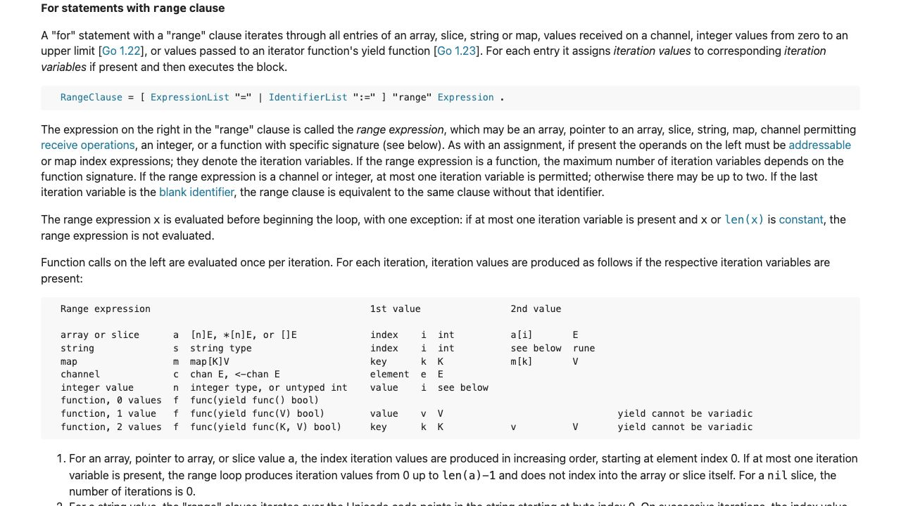
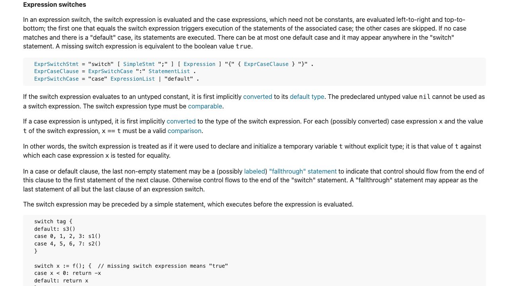

[問題へ戻る](README.md) | [カテゴリの調べ方](../../README.md)

# 調査から回答までの例

初回調査・画面撮影: 2026-10-02。現行の問題本文との照合・実行結果の再確認: 2026-10-13。最初に問題 README の `<details>` をすべて除いた本文と、[カテゴリの調べ方](../../README.md)を読みました。既存の答えを開く前に、以下の資料・解釈・実験結果を記録しました。画面は実際のブラウザを撮影したものです。本文の語句検索とリンク確認には、HTTP で取得した同じページの HTML も使っています。画像は確認した節をブラウザで開いて保存しており、HTML 検索をブラウザ操作として記述していません。

実行環境は `go1.27.1 darwin/arm64`、一時モジュールの `go 1.27`、`GODEBUG` 未指定です。問題の既存コードは一時ファイルに保存して `go run .` で実行しました。

---
<a id="question-1"></a>
## 設問 1: rangeの二つの値を表で読む

**出発点と操作。** 問題はパッケージの機能ではなく `for`、`range`、`_` という構文を尋ねています。[Go Documentation](https://go.dev/doc/) の **Language Specification** から [言語仕様](https://go.dev/ref/spec)へ進みました。カテゴリの手順に従い、取得本文を `for` / `range` で検索し、**For statements** の下位にある **For statements with range clause** を読みました。



**読んだ箇所と解釈。** [range 節](https://go.dev/ref/spec#For_range)の表で `array or slice` 行を見ると、第 1 値は整数の index、第 2 値は `a[i]` です。問題の右辺は `[]string` なので、map や string 行を読む必要はありません。残る `_` は同じ段落にある **blank identifier** というリンクから[その説明](https://go.dev/ref/spec#Blank_identifier)へ進み、匿名のプレースホルダーと確認しました。さらに代入の節は blank identifier への代入が値を捨てると説明しています。

**回答。** `for _, value := range values` では添字を `_` に捨て、要素を `value` に受け取ります。[問題コード](https://go.dev/play/p/bJ7XfrbuNHo)の実測は `a`、次の行が `b` でした。「range は常に添字と要素」という一般則ではなく、今回はスライスの行が根拠です。

---

<a id="question-2"></a>
## 設問 2: switchの制御の移り方を読む

**手がかりと操作。** 問題の `switch x` は値を比較する構文です。同じ仕様本文を `switch` で検索し、**Switch statements** の下位の **Expression switches** へ進みました。ここで初めて `fallthrough` という語を見つけます。



**読んだ箇所と解釈。** [Expression switches](https://go.dev/ref/spec#Expression_switches)には、最初に一致した case を実行し、他の case を飛ばすことが書かれています。その後の段落は、case の最後の空でない文を `fallthrough` にすると次の節の最初へ制御を移す、と定めています。最終 case では使えないという制約も同じ段落にあります。

**実験。** 元の [Playground](https://go.dev/play/p/FhO9_Qu5-ca)は `one` だけでした。そこで `case 1` の `fmt.Println("one")` の直後に `fallthrough` を加えた[追加実験](https://go.dev/play/p/fOZxxOIZNDA)を実行しました。

```text
one
two
```

**回答。** 次の case も実行したい箇所の末尾に `fallthrough` を置きます。`x` は 1 のままで `two` も出たので、「次の条件をもう一度満たす」のではなく、次の case の本体へ進む規則だと分かります。型 switch への一般化はこの設問の根拠外です。
