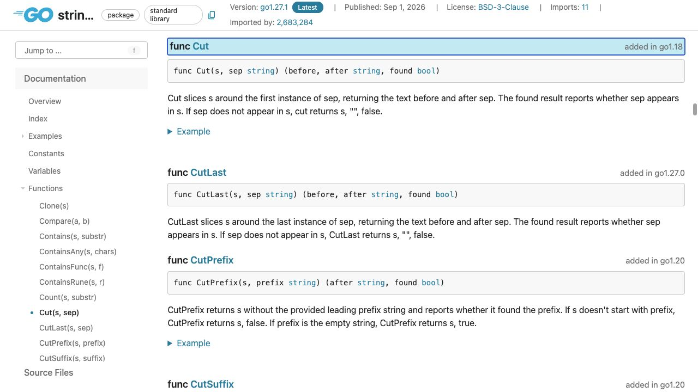
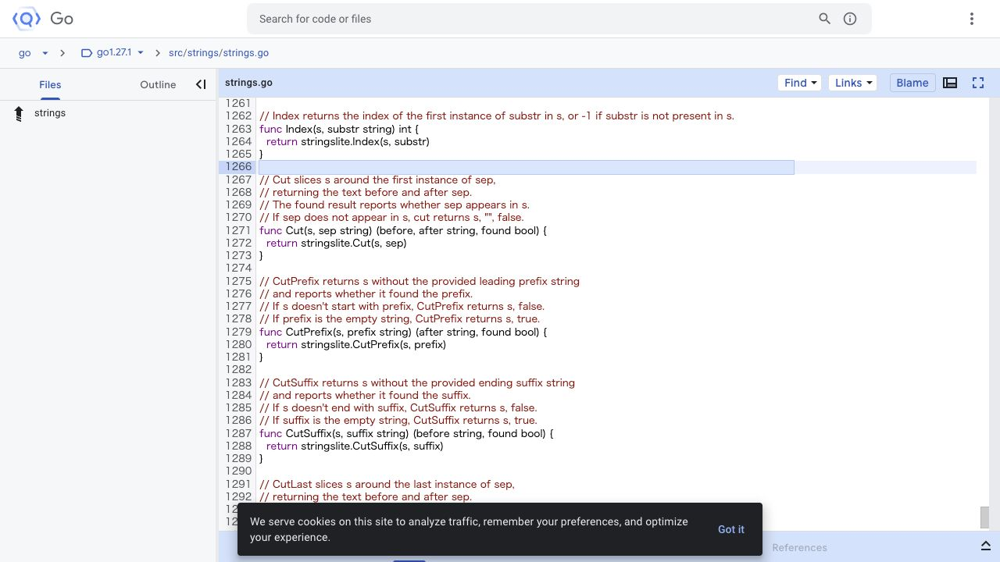

[問題へ戻る](README.md) | [カテゴリの調べ方](../../README.md)

# 調査から回答までの例

初回調査・画面撮影: 2026-10-02。現行の問題本文との照合・実行結果の再確認: 2026-10-13。最初に問題 README の `<details>` をすべて除いた本文と、[カテゴリの調べ方](../../README.md)を読みました。既存の答えを開く前に、以下の資料・解釈・実験結果を記録しました。画面は実際のブラウザを撮影したものです。本文の語句検索とリンク確認には、HTTP で取得した同じページの HTML も使っています。画像は確認した節をブラウザで開いて保存しており、HTML 検索をブラウザ操作として記述していません。

初回調査後に問題の例示値が改訂されたため、説明と問題コードの出力は現行の例に対応させました。画面は同じ API 契約・実装を読む資料として使い、例示値を含む実行結果とは区別しています。

実行環境は `go1.27.1 darwin/arm64`、一時モジュールの `go 1.27`、`GODEBUG` 未指定です。問題の既存コードは一時ファイルに保存して `go run .` で実行しました。

---
<a id="question-1"></a>
## 設問 1: 空値と区切りなしを見分ける

**出発点と操作。** 問題には `strings.Cut` と三つの受け取り変数が出ています。[Go Documentation](https://go.dev/doc/)でパッケージ資料の入口を確認し、カテゴリの逆引きに従って [strings](https://pkg.go.dev/strings) を開きました。取得 HTML の Index から `Cut` を探し、ブラウザで [Cut の節](https://pkg.go.dev/strings#Cut)を開きます。



**読んだ箇所と解釈。** 宣言の戻り値名は `before`、`after`、`found`。説明の `whether sep appears in s` は「区切り `sep` が入力 `s` に現れるか」であり、区切り後の文字数を尋ねていません。`found` はこの有無を表します。`If sep does not appear in s` の条件では `s, "", false` を返すので、問題の `s="left"`、`sep="="` はこの分岐に当たります。ここから「値が空」という観測だけでは区切りの存在を区別できないと考えられます。

**次の確認と回答。** 宣言リンクの [strings.go](https://cs.opensource.google/go/go/+/refs/tags/go1.27.1:src/strings/strings.go;l=1266)でも同じ契約を読み、`stringslite.Cut` への委譲を確認しました。`"left"` では `found=false` です。[現行の問題コード](https://go.dev/play/p/ieMFoFpSNtz)を実行すると次の結果でした。

```text
"left=right" -> before="left" after="right" found=true
"left" -> before="left" after="" found=false
```

区切り後が空でも区切り自体があれば `found=true` になるはずです。初回調査では入力を `"region="` にした[追加実験](https://go.dev/play/p/yLHZJYKnkYJ)で確認しました。

```text
"region=" -> key="region" value="" found=true
"callback=https://example.com/a=b" -> key="callback" value="https://example.com/a=b" found=true
```

値が空かと区切りがあるかは別の情報です。構文としての欠落は `found` で確認します。

---

<a id="question-2"></a>
## 設問 2: 複数の区切りがある入力に当てはめる

**手がかりと操作。** 新しい入力では `=` が二回現れます。先ほどの説明に戻り、どの位置を選ぶのかを表す **first instance of sep** に注目しました。`first` は「最初の」、`sep` は今回の `"="` です。`before and after sep` と合わせると、最初の `=` の前後を返し、それより後の `=` は後半に残る、と読めます。この段階で、Split 系など別の API を探す必要はありません。



**読んだ範囲と限界。** [Cut のソース](https://cs.opensource.google/go/go/+/refs/tags/go1.27.1:src/strings/strings.go;l=1266)には同じ契約と委譲がありました。この画面だけでは内部検索アルゴリズムまでは分かりませんが、区切る位置の API 契約は確認できます。上の追加実験もその解釈を支持します。

**回答。** 問題の `"left=middle=right"` は最初の `=` で切れるので、`before` は `"left"`、`after` は `"middle=right"`、`found` は `true` です。初回の追加実験では、同じ性質を URL を含む文字列でも確認しました。後半の `=` は残るため、二つ以上の区切りをすべて分割する操作とは区別できます。
