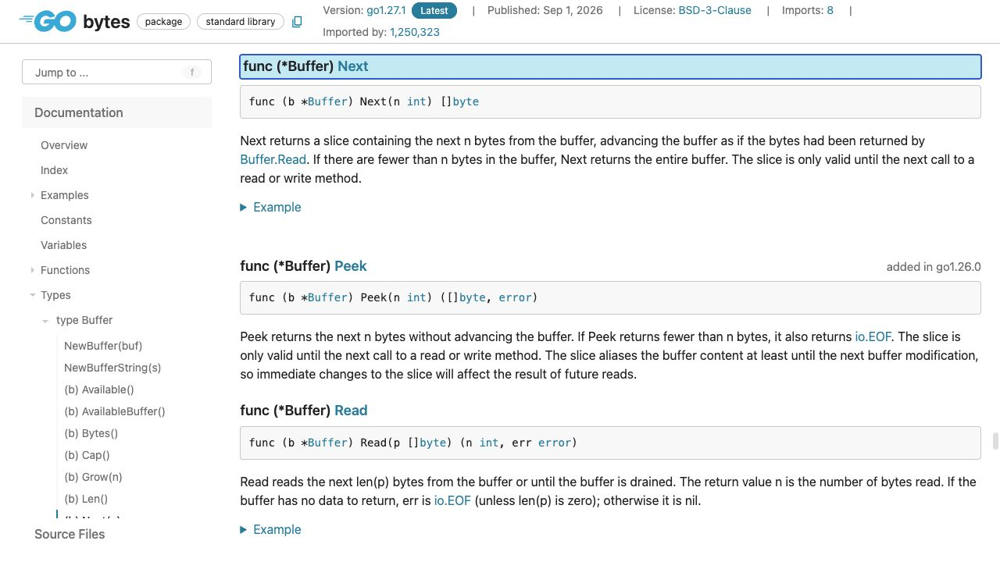
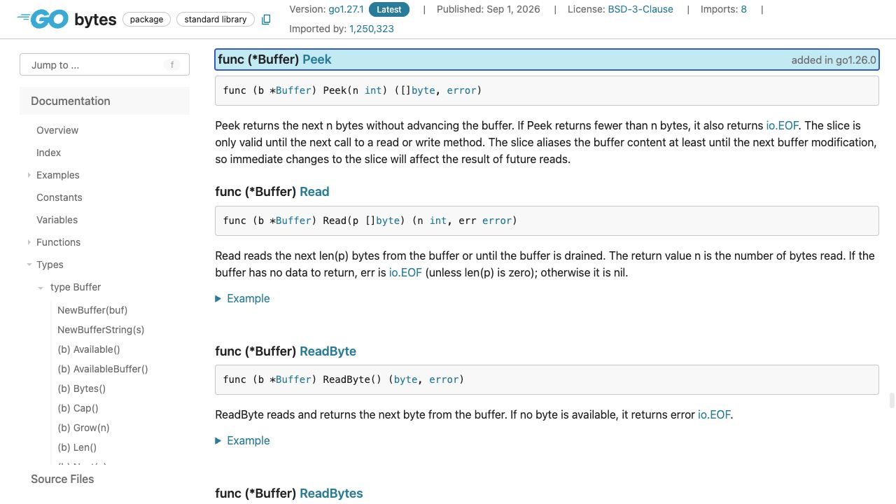
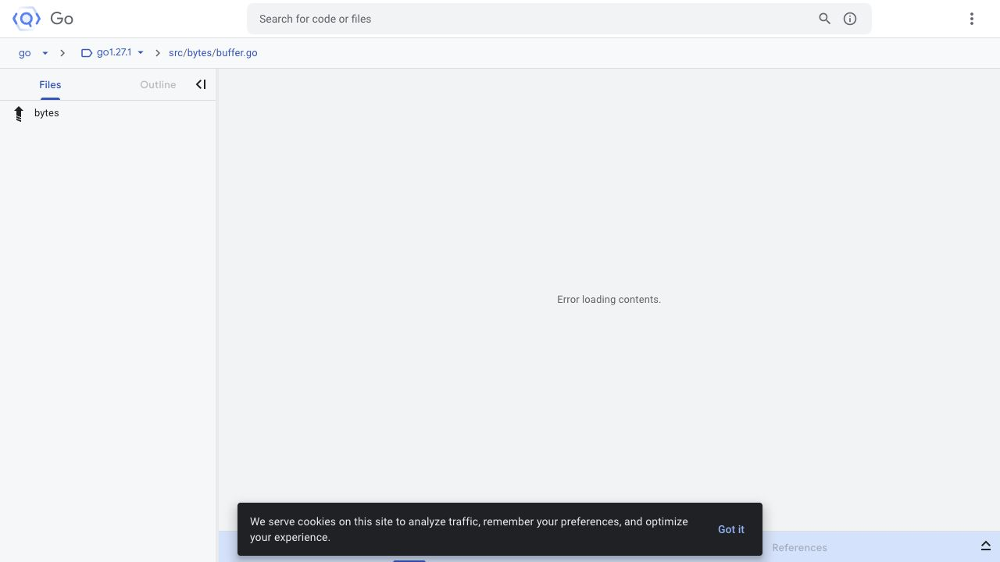

[問題へ戻る](README.md) | [カテゴリの調べ方](../../README.md)

# 調査から回答までの例

画面撮影: 2026-10-02。現行の問題本文との照合・資料・実行結果の再確認: 2026-10-13。問題本文とカテゴリ README にある名前・リンクを出発点に、資料から得た新しい語を次の検索に使う例です。答えを知っていることを前提にした検索語は使いません。画像は初回調査で保存した実際のブラウザ画面です。再確認では同じページの HTML と、宣言リンクで特定した Go 1.27.1 のソースも読みました。以下は読み方と判断を整理した記録で、すべての操作をブラウザで行ったという意味ではありません。

初回調査後に問題の例示値が改訂されたため、説明と問題コードの出力は現行の例に対応させました。画面は同じ API 契約・実装を読む資料として使い、例示値を含む実行結果とは区別しています。

実行環境は `go1.27.1 darwin/arm64`、一時モジュールの `go 1.27`、特記がなければ `GODEBUG` 未指定です。掲載する出力は、リンク先の問題コードを `go run .` で再実行した結果です。

---

<a id="question-1"></a>
## 設問 1: 「先読み」を読み取り位置の変化として調べる

**最初の手がかり。** 問題は `bytes.Buffer.Peek` を指定し、`Next` と比較しています。カテゴリの入口から [bytes](https://go.dev/pkg/bytes/) を開き、メソッド名で [Peek](https://pkg.go.dev/bytes@go1.27.1#Buffer.Peek) と [Next](https://pkg.go.dev/bytes@go1.27.1#Buffer.Next) を探します。名前の印象で判断せず、両方の説明の主語と動詞を比べました。



**読んだ内容と解釈。** Peek はバッファを進めず、Next は Buffer.Read と同じように進める、と書かれています。「返されたデータが同じか」と「後から読む位置が同じか」は別の問いだと分かります。[問題の観測コード](https://go.dev/play/p/OdJEVvlBSbf)の実行でも、先頭を返した後に全体が残りました。

```text
prefix="ABCD" err=<nil> remaining="ABCDrest"
after mutation remaining="aBCDrest"
short="XY" err=EOF
```

**回答。** 先頭を確認した後もバッファ全体を残すなら Peek を使います。Next では先頭4バイトを消費するため、同じ目的にはなりません。

---

<a id="question-2"></a>
## 設問 2: エラーの有無と返されたデータを別々に読む

**残った疑問。** 出力は `EOF` なのに `"XY"` も返しています。Peek の戻り値は `([]byte, error)` なので、「エラーならデータは空」という前提を置かず、条件文を読み直しました。



**次に進む理由。** 説明の「要求数より少ない場合」から、何を返す分岐なのかを確認するため宣言リンクの [buffer.go](https://cs.opensource.google/go/go/+/refs/tags/go1.27.1:src/bytes/buffer.go;l=85) に進みます。初回は次のようにソース表示が失敗したので、表示できたとは扱いません。同じ版・同じパスのローカル Go ソースで、`b.Len() < n` の場合に残りのスライスと `io.EOF` を一緒に返すことを確認しました。



**回答。** 2バイトしかなければその2バイトと EOF が返ります。この EOF は現在のバッファが要求を満たさないという意味で、通信相手が今後送信しないとまでは分かりません。4バイトが必要な処理なら、返された長さとエラーを確認し、必要なデータが揃うまでその処理を始めません。

---

<a id="question-3"></a>
## 設問 3: 有効期間と共有を実装に対応させる

**手がかり。** 問題の `prefix[0]` の変更がバッファにも現れました。Peek の説明の有効期間と alias の文を読みます。ソースの返り値も新しい配列へのコピーではなく `b.buf[b.off : b.off+n]` でした。これで「別の変数に入れたので独立したデータ」という解釈を捨てられます。

**回答。** スライスはバッファと内容を共有し、次の読み書きメソッドまでしか有効ではありません。その場で読むだけなら共有して使えますが、後段が保持・変更するなら、バッファを次に操作する前に独立したコピーを作ります。

**さらに調べるなら。** 同じ bytes の Index で候補の説明を見比べると、コピーを返すと説明された [Clone の契約と例](https://pkg.go.dev/bytes@go1.27.1#Clone)が見つかります。宣言先の [bytes.go](https://cs.opensource.google/go/go/+/refs/tags/go1.27.1:src/bytes/bytes.go;l=1391) も読むと、元の配列から別の領域へ複製することを確認できます。今回必要なのは「全部コピー」ではなく、保持する先頭部分の所有権を分ける判断です。
