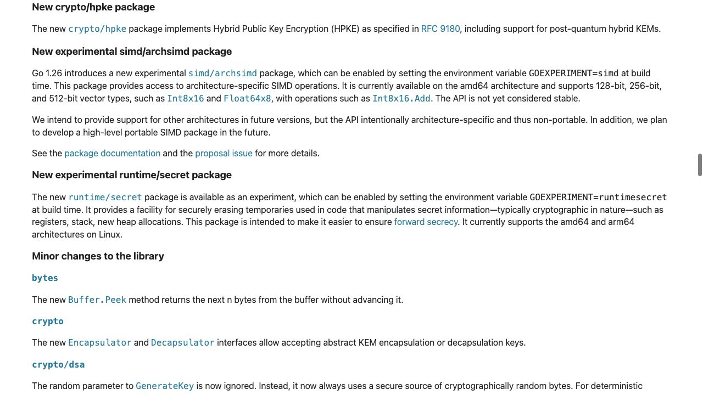
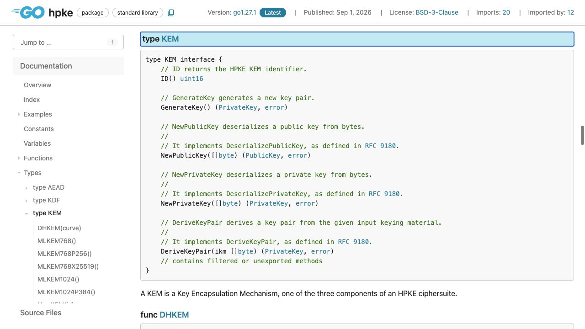

[問題へ戻る](README.md) | [カテゴリの調べ方](../../README.md)

# 調査から回答までの例

画面撮影: 2026-10-02。現行の問題本文との照合・資料・実行結果の再確認: 2026-10-13。問題本文とカテゴリ README にある名前・リンクを出発点に、資料から得た新しい語を次の検索に使う例です。答えを知っていることを前提にした検索語は使いません。画像は初回調査で保存した実際のブラウザ画面です。再確認では同じページの HTML と、宣言リンクで特定した Go 1.27.1 のソースも読みました。以下は読み方と判断を整理した記録で、すべての操作をブラウザで行ったという意味ではありません。

初回調査後に問題の例示値が改訂されたため、説明と問題コードの出力は現行の例に対応させました。画面は同じ API 契約・実装を読む資料として使い、例示値を含む実行結果とは区別しています。

実行環境は `go1.27.1 darwin/arm64`、一時モジュールの `go 1.27`、特記がなければ `GODEBUG` 未指定です。掲載する出力は、リンク先の問題コードを `go run .` で再実行した結果です。

---

<a id="question-1"></a>
## 設問 1: 変数の略称を宣言の戻り値型から読む

**入口。** 問題が Go 1.26 の追加機能と明示しているので、カテゴリの版別資料の案内から [Go 1.26 リリースノート](https://go.dev/doc/go1.26)で `crypto/hpke` を探します。Go 1.27 のリリースノートも確認し、導入された版と調査に使う版を分けました。



**読んで分かったこと。** リリースノートだけでは `kem`・`kdf`・`aead` の分担までは分かりません。掲載リンクから [hpke](https://pkg.go.dev/crypto/hpke@go1.27.1) へ進み、問題にある三つの関数とその戻り値型を対応させます。

| 問題の呼び出し | 宣言・型の説明から分かった役割 |
| --- | --- |
| `MLKEM768X25519()` | KEM。鍵カプセル化機構。実装は MLKEM768-X25519（X-Wing） |
| `HKDFSHA256()` | KDF。鍵導出。実装は HKDF-SHA256 |
| `AES256GCM()` | AEAD。認証付き対称暗号。実装は AES-256-GCM |

宣言から進める [kem.go](https://cs.opensource.google/go/go/+/refs/tags/go1.27.1:src/crypto/hpke/kem.go)、[kdf.go](https://cs.opensource.google/go/go/+/refs/tags/go1.27.1:src/crypto/hpke/kdf.go)、[aead.go](https://cs.opensource.google/go/go/+/refs/tags/go1.27.1:src/crypto/hpke/aead.go) の説明も確認しました。三つを独立した暗号処理の呼び出し順と考えるのではなく、HPKE が使う暗号スイートの選択と読み取れます。

---

<a id="question-2"></a>
## 設問 2: Seal/Openからリンクされたコンテキストへ進む

**手がかり。** 問題のコードにある [Seal](https://pkg.go.dev/crypto/hpke@go1.27.1#Seal) と [Open](https://pkg.go.dev/crypto/hpke@go1.27.1#Open) の引数型を比較しました。前者は PublicKey、後者は PrivateKey です。さらに説明中の NewSender / NewRecipient を読むと、`info` は両者で一致すべき追加の公開情報と分かります。

**なぜ一致が必要か。** 「一致する必要がある」で止めず、宣言先の [hpke.go](https://cs.opensource.google/go/go/+/refs/tags/go1.27.1:src/crypto/hpke/hpke.go;l=135)で NewSender / NewRecipient の共通の呼び出し先 `newContext` を読みました。今回の HKDF では `info` からハッシュを作り、それを鍵導出のコンテキストへ入れています。単なるログ用の注釈ではないため、片側だけ変更すると復号に必要な状態も一致しません。

[問題のコード](https://go.dev/play/p/ONc5q75dM5t)の再実行結果です。

```text
received="message"
different info rejected: true
```

**回答。** 送信側は受信者の公開鍵、受信側は対応する秘密鍵を使います。KDF・AEAD・`info` も合意して一致させます。`info` は秘密にする鍵ではありません。なお、この実験が示すのは当該 API の一致条件であり、公開鍵が本当に受信者のものかの確認まで自動化するものではありません。

---

<a id="question-3"></a>
## 設問 3: 鍵を読む型と暗号スイートを分ける

**残った疑問。** `NewPublicKey` がパッケージ直下ではなく `kem` のメソッドなのはなぜか。戻り値の PublicKey から KEM の宣言へ戻り、バイト列を復元する操作の所属を読みます。



**解釈。** [KEM](https://pkg.go.dev/crypto/hpke@go1.27.1#KEM) は鍵の生成だけでなく、特定の KEM の形式で鍵を復元する役割を持っています。PublicKey にも `KEM()` があり、鍵と KEM の対応が保持されます。さらに hpke.go の `suiteID` は KEM・KDF・AEAD の識別子を合わせており、鍵の形式だけで後の二つが決まるわけではありません。

**もう一段確かめる。** 型の契約だけでなく、問題で選んだ `MLKEM768X25519` の宣言先 [pq.go](https://cs.opensource.google/go/go/+/refs/tags/go1.27.1:src/crypto/hpke/pq.go;l=20) を読むと、戻り値は `hybridKEM` です。同じファイルでその `NewPublicKey` を探すと、長さを検証してからML-KEM部分と楕円曲線部分を分けて復元しています。一般的なKEMの説明から、今回の鍵形式を扱う実装まで結び付きました。

**回答。** 合意した KEM で鍵を復元し、復元時のエラーを確認します。それとは別に KDF・AEAD を含む組み合わせを両者で一致させます。「読めるバイト列だから任意の組み合わせでよい」とは判断できません。

**続きの調査。** 鍵形式そのものが疑問なら KEM の説明が参照する [RFC 9180](https://www.rfc-editor.org/rfc/rfc9180.html) の DeserializePublicKey へ進む、という次の目的を立てられます。今回は Go API と実装の対応までを回答範囲とします。
