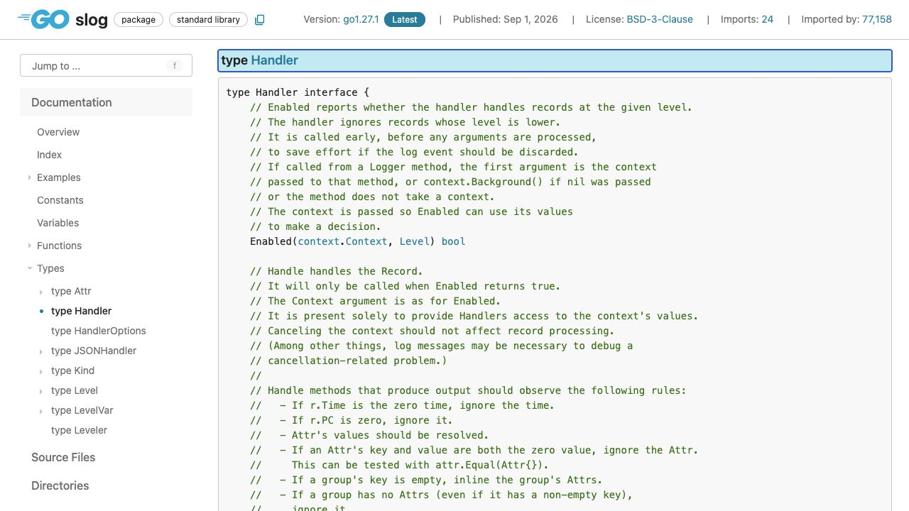
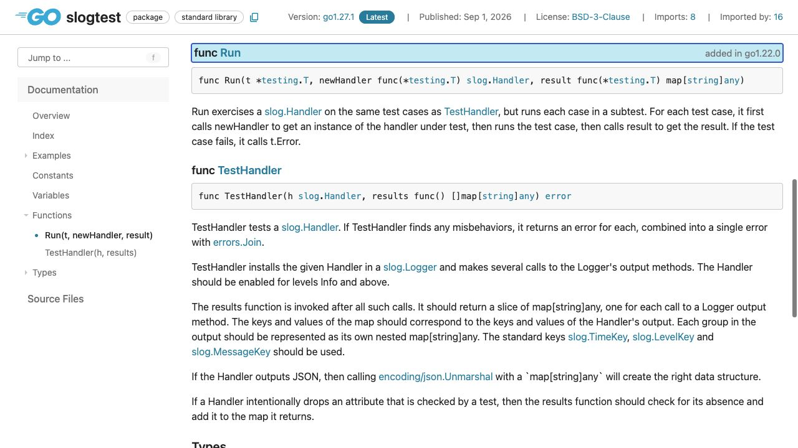

[問題へ戻る](README.md) | [カテゴリの調べ方](../../README.md)

# 調査から回答までの例

画面撮影: 2026-10-02。現行の問題本文との照合・資料・実行結果の再確認: 2026-10-13。問題本文とカテゴリ README にある名前・リンクを出発点に、資料から得た新しい語を次の検索に使う例です。答えを知っていることを前提にした検索語は使いません。画像は初回調査で保存した実際のブラウザ画面です。再確認では同じページの HTML と、宣言リンクで特定した Go 1.27.1 のソースも読みました。以下は読み方と判断を整理した記録で、すべての操作をブラウザで行ったという意味ではありません。

実行環境は `go1.27.1 darwin/arm64`、一時モジュールの `go 1.27`、特記がなければ `GODEBUG` 未指定です。掲載する出力は、リンク先の問題コードを `go run .` で再実行した結果です。

---

<a id="question-1"></a>
## 設問 1: インタフェースをログの流れに並べる

**入口と読み方。** 問題に出た `slog.Handler` をカテゴリの案内に従って [log/slog](https://go.dev/pkg/log/slog/) の Index から探しました。[Handler](https://pkg.go.dev/log/slog@go1.27.1#Handler) の説明は長いので、まずメソッド名を拾い、次に各メソッドが受け取るものを比べます。



| メソッド | 説明中の手がかり | 問題への読み替え |
| --- | --- | --- |
| `Enabled` | `before any arguments are processed` | 引数の処理前に指定レベルを受け付けるか決める |
| `Handle` | `only ... when Enabled returns true` | Enabled が true の場合に Record を受け取る。今回のログを出力する中心 |
| `WithAttrs` | `returns a new Handler` | 属性を加えた別の Handler を返す。ここで1件のログを出力するわけではない |
| `WithGroup` | `all subsequent attributes` | 指定したグループ名は後続の属性に作用する。グループを追加した Handler を返す |

同じページの型一覧に [TextHandler](https://pkg.go.dev/log/slog@go1.27.1#TextHandler) と [JSONHandler](https://pkg.go.dev/log/slog@go1.27.1#JSONHandler) があり、4つのメソッドも確認できます。同じ一覧の [MultiHandler](https://pkg.go.dev/log/slog@go1.27.1#MultiHandler) も実装型で、複数ハンドラーへ渡すものです。[DiscardHandler](https://pkg.go.dev/log/slog@go1.27.1#DiscardHandler) は型ではなくパッケージ変数なので、分類を区別します。宣言先の [handler.go](https://cs.opensource.google/go/go/+/refs/tags/go1.27.1:src/log/slog/handler.go;l=31) と、Logger の [logger.go](https://cs.opensource.google/go/go/+/refs/tags/go1.27.1:src/log/slog/logger.go;l=248) を読むと、Enabled を確認してから Record を作り Handle に渡す流れに対応します。

---

<a id="question-2"></a>
## 設問 2: 「実装できた」と「契約を守る」を分ける

**次に進む理由。** 4メソッドの型が揃っても、ログ内容が正しい保証にはなりません。Handler の説明から [handler guide](https://go.dev/s/slog-handler-guide) を開き、Handle と属性の処理を読みました。属性値は表示前に Resolve する必要があり、空の属性・空グループ・空名のグループにも別々の扱いが指定されています。

**問題の観測を解釈する。** [問題コード](https://go.dev/play/p/wXj_QdVwc19)の再実行では次の結果になりました。

```text
embedded handler panicked: true
without Resolve: secret
with Resolve: REDACTED
```

最初の panic は nil の Handler を埋め込み、Enabled などを実装していないためです。「埋め込みという構文はいつでも禁止」と一般化はしません。非 nil の別ハンドラーへ委譲する設計でも、WithAttrs / WithGroup が返す値で自分の処理が失われないかを確認する必要があります。

二つ目は問題の password 型が [LogValuer](https://pkg.go.dev/log/slog@go1.27.1#LogValuer) を実装していることに対応します。[Value.Resolve](https://pkg.go.dev/log/slog@go1.27.1#Value.Resolve) の `repeatedly calls LogValue` と `while it implements LogValuer` を読むと、値が LogValuer である間 LogValue を呼び、その結果を返す処理だと分かります。問題の password 型なら LogValue が返す `"REDACTED"` を得るための操作です。宣言先の [value.go](https://cs.opensource.google/go/go/+/refs/tags/go1.27.1:src/log/slog/value.go) でもこの繰り返しを確認しました。Any を直接表示すると、この変換を経由しません。

**回答に含める注意。** 全メソッドが並行に呼ばれ得ること、属性・グループの契約、元のハンドラーを変更しない派生ハンドラー、Resolve を適用する場所を確認します。今回の表示変換だけ直しても、この契約すべてを満たしたことにはなりません。

---

<a id="question-3"></a>
## 設問 3: テストの入口を呼び出し形から比較する

**手がかり。** guide の Testing には、契約確認に [testing/slogtest](https://pkg.go.dev/testing/slogtest@go1.27.1) を使うリンクがあります。問題にある TestHandler / Run の引数と結果を比べ、[slogtest.go](https://cs.opensource.google/go/go/+/refs/tags/go1.27.1:src/testing/slogtest/slogtest.go;l=267) で同じケース集合を走査することを確認しました。



**原文と呼び出し形の対応。** TestHandler の `results func() []map[string]any` は複数件の結果を返す形です。説明も `after all such calls` とあるので、Logger の呼び出しがすべて終わってから結果を集めます。一方 Run は `For each test case` の下で newHandler → 実行 → result の順を定め、`result func(*testing.T) map[string]any` は各ケースの1件を返します。

**回答。** TestHandler は一つのハンドラーへ複数ログを送り、まとめた結果を `[]map[string]any` で受け取り、失敗を結合した error を返します。Run は同じ検査をサブテストごとに行い、ケースごとに newHandler を呼び、結果1件を受け取って `t.Error` で失敗を報告します。

**YAMLへ当てはめる判断。** 検査するのは出力形式の綴りではなくログの意味なので、YAMLを読み取った結果を指定の map 構造に変換する部分が必要です。これとは別に、YAMLとして読めるかや並行出力を壊さないかも確認対象になります。標準の契約テストに通ることだけを、すべての品質保証と解釈しないようにします。
