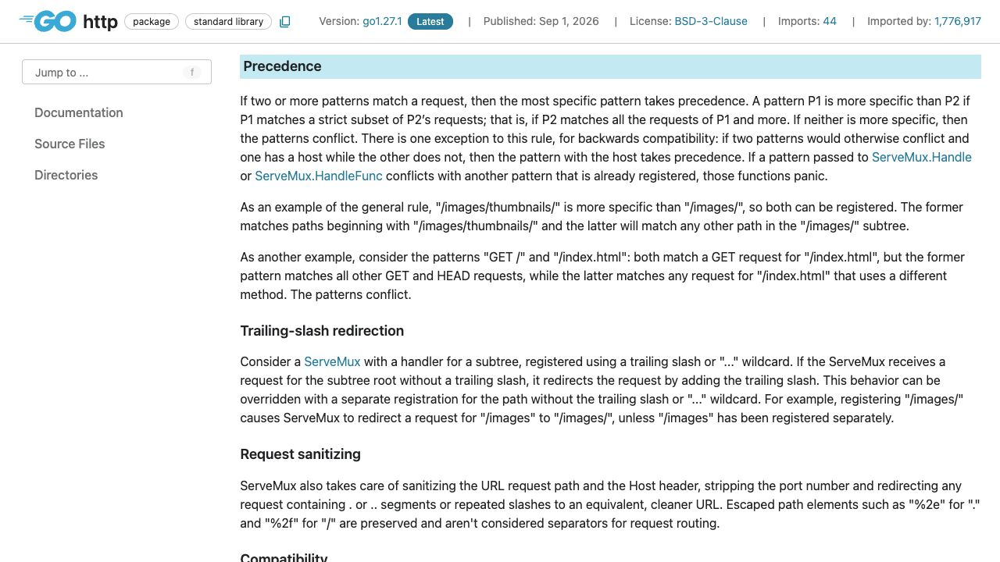
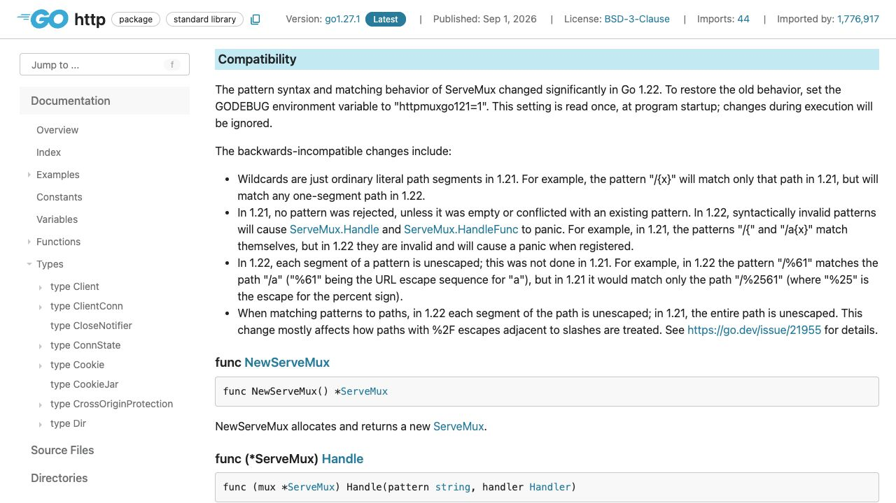

[問題へ戻る](README.md) | [カテゴリの調べ方](../../README.md)

# 調査から回答までの例

画面撮影: 2026-10-02。現行の問題本文との照合・資料・実行結果の再確認: 2026-10-13。問題本文とカテゴリ README にある名前・リンクを出発点に、資料から得た新しい語を次の検索に使う例です。答えを知っていることを前提にした検索語は使いません。画像は初回調査で保存した実際のブラウザ画面です。再確認では同じページの HTML と、宣言リンクで特定した Go 1.27.1 のソースも読みました。以下は読み方と判断を整理した記録で、すべての操作をブラウザで行ったという意味ではありません。

初回調査後に問題の例示値が改訂されたため、説明と問題コードの出力は現行の例に対応させました。画面は同じ API 契約・実装を読む資料として使い、例示値を含む実行結果とは区別しています。

実行環境は `go1.27.1 darwin/arm64`、一時モジュールの `go 1.27`、特記がなければ `GODEBUG` 未指定です。掲載する出力は、リンク先の問題コードを `go run .` で再実行した結果です。

---

<a id="question-1"></a>
## 設問 1: more specific を strict subset の定義から読む

**入口。** 問題にある `ServeMux` を [net/http](https://go.dev/pkg/net/http/) で探し、型の説明の Patterns と Precedence を読みます。「長い文字列が勝つ」という経験則は持ち込まず、資料の定義を問題のパターンへ当てはめます。



**解釈。** [Precedence](https://pkg.go.dev/net/http@go1.27.1#hdr-Precedence) の `more specific` は、パターンの見た目ではなく `strict subset`（真部分集合）で定義されています。原文の P1 を `GET /x/fixed`、P2 を `GET /x/{value}` に置くと、P1 が受け付ける全リクエストを P2 も受け付け、さらに P2 だけが受け付けるものがある、という条件です。例えば `GET /x/other` は P2 だけが受け付けます。この定義で P1 の方が more specific と判定できるため、fixed のハンドラーが登録順によらず選ばれます。

**405を確認する理由。** 優先順位だけでは、どれにも一致しない場合は説明できません。宣言先の [server.go](https://cs.opensource.google/go/go/+/refs/tags/go1.27.1:src/net/http/server.go) で `findHandler` をたどると、メソッド・ホスト・パスに一致するハンドラーが見つからないときに別メソッドなら一致するものを調べ、存在すれば Allow を付けて405、それもなければ404とする分岐があります。

[問題コード](https://go.dev/play/p/DhW53RiIwwY)の再実行結果です。

```text
GET /x/fixed -> 200 "fixed"
GET /x/other -> 200 "value=other"
POST /x/other -> 405
```

**回答。** 今回の POST はパスが GET 用ルートに一致する一方、POST 用の一致先がないので405です。すべてのメソッドを受ける別の catch-all があれば、そちらへ届き得ます。「GETルートがあればPOSTは必ず405」とは言えません。

---

<a id="question-2"></a>
## 設問 2: 包含関係の反例を一つずつ探す

**手がかり。** 次の組ではメソッドを省略した `/x/fixed` が出てきます。Patterns に戻ると、`no method` のパターンは `every method` に一致すると書かれています。これはメソッドを省略した `/x/fixed` の条件です。続く `both GET and HEAD` はメソッドを GET と書いたパターンの条件なので、`GET /x/{value}` に適用します。この差を含めて比較します。

| リクエスト例 | `GET /x/{value}` | `/x/fixed` |
| --- | --- | --- |
| `GET /x/fixed` | 一致 | 一致 |
| `GET /x/123` | 一致 | 不一致 |
| `POST /x/fixed` | 不一致 | 一致 |

**解釈と実測。** 両方に一致するものがあるのに、一方だけが受けるものもそれぞれあるため、包含関係が成立しません。[競合実験](https://go.dev/play/p/-wtRzMO5UHB)は登録時に panic し、診断には次の理由が含まれました。

```text
/x/fixed matches more methods than GET /x/{value}, but has a more specific path pattern
```

診断の `more methods` は `/x/fixed` が GET 以外も受け付けること、`more specific path pattern` はパスを fixed に限定することです。メソッドでは広く、パスでは狭いという二方向の違いが、表の反例に対応します。これは元の問題にある `go 1.22` でも、今回の `go 1.27` でも新しい規則が有効になる条件です。同じプログラムを `GODEBUG=httpmuxgo121=1` で再実行すると `registered` が出ました。差を「実験に失敗した」と片付けず、次の互換性の節を読む理由にします。

---

<a id="question-3"></a>
## 設問 3: 同じ文字列を古い版がどう解釈したか読む

**次の資料。** ServeMux の [Compatibility](https://pkg.go.dev/net/http@go1.27.1#hdr-Compatibility) の `ordinary literal path segments in 1.21` は、波括弧付きの文字列も Go 1.21 ではそのままのパス要素だったという意味です。新しい wildcard の規則と比較すると、同じ登録文字列でも一致するリクエストが変わると分かります。また互換設定を読む時点は `read once, at program startup` なので、起動時の一回です。



**回答。** `{id}` が文字列そのものからワイルドカードへ変わり、不正なパターンの登録拒否や、パスの区間ごとのエスケープ解除にも変更があります。既存の文字列パターンが新しい意味を持つ以上、関数シグネチャが同じでも互換性の調査が必要です。

実行条件はツールチェーン版だけでなく、mainモジュールの `go` 行と GODEBUG も記録します。`httpmuxgo121=1` は旧動作との比較に使えますが、起動後の設定変更は読まれません。移行時には全登録パターン、衝突、ワイルドカードとして扱いたくない波括弧、エスケープを含むリクエスト、404/405を確認します。

---

<a id="question-4"></a>
## 設問 4: 提案の意図と現行実装を照合する

**背景への入口。** 「なぜこの優先順位か」は現行APIだけでは判断できません。問題の入口にある [Go 1.22 リリースノート](https://go.dev/doc/go1.22#enhanced_routing_patterns) の該当節を読み、カテゴリの手順でページHTMLのコメントにある `go.dev/issue/61410` を確認しました。番号を既知の知識から検索したわけではありません。

**議論の読み方。** 調査チームで [提案 #61410](https://github.com/golang/go/issues/61410) の本文と全177コメントを読み、初案・修正・採用を区別しました。例えば [HEADの扱いの追加](https://github.com/golang/go/issues/61410#issuecomment-1668403461) と [採用](https://github.com/golang/go/issues/61410#issuecomment-1699638460) は別の段階です。途中の発言だけを今の仕様として扱わず、最終の規則を先ほどのAPI説明へ戻って確認します。

**実装へ進む動機。** 登録時に分かる衝突をどう扱うのか、HandleFunc の宣言先から `registerErr` を追いました。同じ [server.go](https://cs.opensource.google/go/go/+/refs/tags/go1.27.1:src/net/http/server.go;l=2961) に、候補との衝突を調べてから登録する処理があります。そこで現れた `conflictsWith` を同じパッケージ内で探すと、[pattern.go](https://cs.opensource.google/go/go/+/refs/tags/go1.27.1:src/net/http/pattern.go;l=219) の `rel == equivalent || rel == overlaps` が競合判定です。直前の定義では、`equivalent` は同じリクエストに一致する関係、`overlaps` は両方に一致するリクエストはあるがどちらも more specific ではない関係です。設問2の表は後者に対応します。ホストありを優先する互換性上の例外も確認します。

**チームへの回答。** 登録順で挙動が変わらないので、各チームが別ファイルでルートを追加しても順番が暗黙の仕様になりません。どちらを優先すべきか規則から決まらない組は、登録時に両方の登録箇所と理由を示して失敗します。ただし「これで全ての業務上の誤配信が防げる」という保証ではなく、意図するパターンとリクエストのテストは別に必要です。
