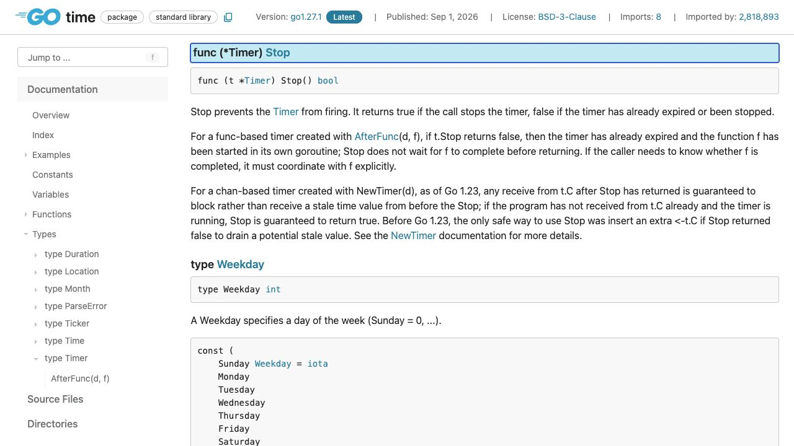
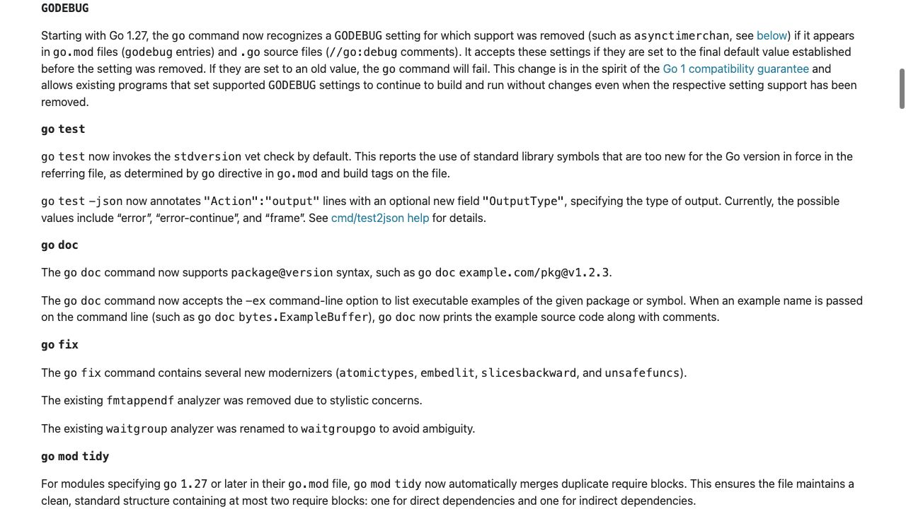

[問題へ戻る](README.md) | [カテゴリの調べ方](../../README.md)

# 調査から回答までの例

画面撮影: 2026-10-02。現行の問題本文との照合・資料・実行結果の再確認: 2026-10-13。問題本文とカテゴリ README にある名前・リンクを出発点に、資料から得た新しい語を次の検索に使う例です。答えを知っていることを前提にした検索語は使いません。画像は初回調査で保存した実際のブラウザ画面です。再確認では同じページの HTML と、宣言リンクで特定した Go 1.27.1 のソースも読みました。以下は読み方と判断を整理した記録で、すべての操作をブラウザで行ったという意味ではありません。

実行環境は `go1.27.1 darwin/arm64`、一時モジュールの `go 1.27`、特記がなければ `GODEBUG` 未指定です。掲載する出力は、リンク先の問題コードを `go run .` で再実行した結果です。

---

<a id="question-1"></a>
## 設問 1: 容量の数字からAPIの保証へ進む

**入口。** 問題は `time.NewTimer` と `Stop` / `Reset` を指定しています。カテゴリの入口から [time](https://go.dev/pkg/time/) を開き、[NewTimer](https://pkg.go.dev/time@go1.27.1#NewTimer) の説明を読むと、Go 1.23 前後の違いが明記されています。そこで型のメソッド一覧から Stop / Reset の保証へ進みました。



**解釈。** [Stop](https://pkg.go.dev/time@go1.27.1#Timer.Stop) の説明は、返った後の受信が古い時刻を受け取らずブロックすることを保証します。[Reset](https://pkg.go.dev/time@go1.27.1#Timer.Reset) 後の受信も、変更前の設定に対応した古い時刻を受け取りません。ここで読んでいるのはチャンネル式のタイマーであり、AfterFuncのコールバック完了待ちまで保証するものではありません。

[導入コード](https://go.dev/play/p/F4r40BDO4dv)の再実行結果です。

```text
channel capacity: 0
stop before firing: true
reset timer fired
```

**回答。** 容量0という観測は、新しい意味論の手がかりです。再試行処理で大切なのは、Stop / Reset が戻った後に以前の期限の通知を誤って受け取らないという保証です。

---

<a id="question-2"></a>
## 設問 2: falseの意味に「未受信」を勝手に加えない

**残る疑問。** Stop の false を「チャンネルに値が残っている」と読めるでしょうか。説明は期限切れや停止済みを含めており、受信済みかどうかとは別です。問題の2本目は、すでに受信した後に Stop を呼んでいます。

[ドレイン実験](https://go.dev/play/p/X_a-_2PuQoV)の再実行結果です。

```text
stop=false cap=0
unconditional drain would block
```

**回答。** false だけを根拠に無条件受信すると、受信済みや停止済みのタイマーで待ち続ける可能性があります。この実験は受信済みの場合の反例であり、Go 1.23以降に初めて危険になったケースだとは言いません。古い方式でドレインが必要だった条件には「まだ受信していない」「他のgoroutineが受信しない」といった前提がありました。

**次の調査。** 古いGoも対象なら、APIの文章だけで現行動作を全環境へ適用せず、対応版・通知を読む担当・再利用する状態を決めます。ここからモジュール版や互換設定を読む必要が生まれます。

---

<a id="question-3"></a>
## 設問 3: 歴史資料の切り替え方法を現行版へ持ち込まない

**入口を分ける。** 問題にある [Go 1.23 Timer Channel Changes](https://go.dev/wiki/Go123Timer) には、mainモジュールの `go 1.23` 以上で新動作になり、`asynctimerchan` で切り替えられたことが書かれています。この説明だけで止まらず、[Go 1.26](https://go.dev/doc/go1.26) の削除予告と [Go 1.27](https://go.dev/doc/go1.27#runtime) の削除を確認しました。



**条件ごとの読み分け。** Go 1.27 の [go command のGODEBUG説明](https://go.dev/doc/go1.27) は、`go.mod` の godebug と `//go:debug` に既定値を残す場合は受理し、旧値は拒否すると書いています。HTMLの Issue 番号から [#79422](https://github.com/golang/go/issues/79422)、そこから [提案 #76163](https://github.com/golang/go/issues/76163) へ進みました。調査チームで両Issueの本文と全コメントを確認し、起動時の環境変数とソースの指定を区別しました。

| 指定方法 | Go 1.27での意味 |
| --- | --- |
| 環境変数 `GODEBUG=asynctimerchan=0` | 新しい動作のまま起動できる |
| 起動前に環境変数で `=1` または `=2` | 起動時にfatal error。容量1には戻らない |
| `go.mod` の godebug / `//go:debug` に `=0` | 最終既定値として受理される |
| 同じビルド設定に `=1` または `=2` | go command が拒否する |

環境変数の旧値は `go run` 自体の起動時にも拒否されました。`=1` の実測ではプログラムの出力より先に、次の診断が出ます（スタック部分省略）。

```text
fatal error: removed GODEBUG "asynctimerchan" set to old value "1" in environment (https://go.dev/doc/godebug#go-127)
```

実行開始後の環境変数変更でpanicさせる案は [最終決定](https://github.com/golang/go/issues/76163#issuecomment-4672701492) では採られていません。起動時の拒否と混同しないようにします。ソース側も [削除設定表](https://cs.opensource.google/go/go/+/refs/tags/go1.27.1:src/internal/godebugs/table.go;l=110) にRemoved 27と旧値1・2が記録されています。

**回答。** 互換設定は移行期間の比較に使えましたが、永続的なAPIではありません。現在のツールチェーンで旧版相当の実験をするには、フラグをそのまま再利用せず、対象の旧ツールチェーンを用意する必要があります。

---

<a id="question-4"></a>
## 設問 4: 保証を強めた理由から影響箇所の探し方へ

**提案に進む理由。** 問題は古い通知が残る背景を尋ねています。Wikiとリリース資料の変更点を手がかりに [提案 #37196](https://github.com/golang/go/issues/37196) を読み、本文と全39コメントを確認しました。最初はStopから戻る前に送信を終える案でしたが、議論は「同期チャンネルとして見せ、Stop / Reset後の古い受信を防ぐ」保証へ進んでいます。

**具体的に読んだ判断材料。** [利用コード調査](https://github.com/golang/go/issues/37196#issuecomment-641698749) は、受信したかを記録せずlenで調べるコードや、Reset後のドレインが新しい通知まで捨てるコードを挙げています。[意味論の整理](https://github.com/golang/go/issues/37196#issuecomment-1988468916) では、内部の最適化と利用者から見える同期性を分けています。

**実装との照合。** NewTimerの宣言先 [sleep.go](https://cs.opensource.google/go/go/+/refs/tags/go1.27.1:src/time/sleep.go;l=111) には内部容量1の生成があり、観測したcap=0だけでは内部表現までは説明できません。提案で出た `chanlen` / `chancap` を [runtime/chan.go](https://cs.opensource.google/go/go/+/refs/tags/go1.27.1:src/runtime/chan.go;l=818) で探すと、タイマーチャンネルは0を返し送信を取り消せるようにするコメントがあります。[runtime/time.go](https://cs.opensource.google/go/go/+/refs/tags/go1.27.1:src/runtime/time.go;l=1171) も、Stop / 変更で進める番号を送信前に照合し、古い設定の送信を抑止しています。

**影響箇所を探す続き。** WikiのDebuggingから問題で指定された [Hash-Based Bisect Debugging](https://research.swtch.com/bisect) を読みます。`git bisect` が変更履歴のどの版から失敗するかを絞るのに対し、ここでの `bisect` は呼び出しスタックの集合を分け、その呼び出しで新旧のどちらを使うと失敗するかを絞ります。記事のタイマー例では、見えていた1分のタイムアウトをテスト用の層が1nsへ変更していたことがスタックから分かりました。

**チームへの回答。** 変更の目的は利用側が「通知は来たか・誰が読んだか・古い送信がまだ途中か」を組み合わせて補正する負担を減らすことです。移行中のGo 1.23〜1.26で全体切り替えに差が出たら、bisectで具体的な呼び出しを絞れます。試行結果が揺らぐと無関係な場所を指し得るので、記事の `-count` による反復確認も読みます。この旧設定での切り替えを、削除後のGo 1.27で実行できる手順とは扱いません。ここでは対象の不安定なテストスイートがないため、bisectを実行した結果は記載していません。
