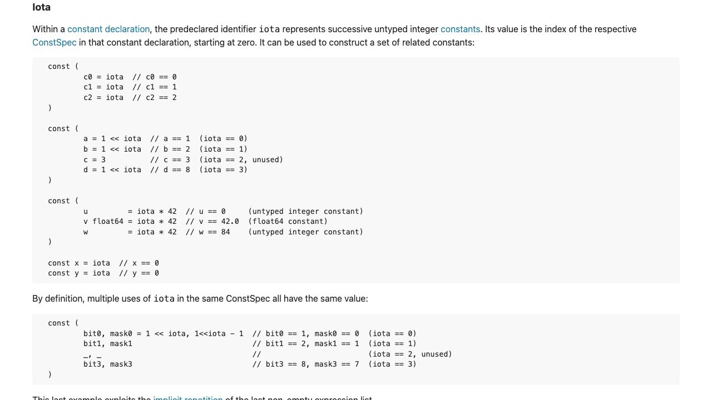
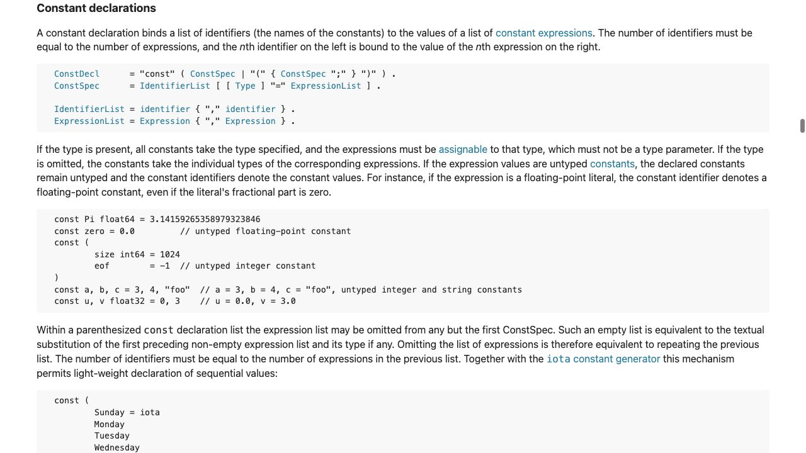

[問題に戻る](README.md) | [カテゴリの調べ方](../../README.md) | [シナリオ一覧](../../../SCENARIOS.md)

# `iota` を知らないところから調べる例

これは唯一の正解ルートではなく、問題文から疑問を作り、資料を読み分けた調査の一例です。2026-10-02 に、問題 README のヒント・答え・こぼれ話を除いた本文とカテゴリ README から開始しました。画面は実際に開いたページのキャプチャーです。

## 最初に分かっていること

問題には `const`、`iota`、`Red / Green / Blue` と、出力 `0 1 2` があります。ここから「`iota` の意味」と「式がない行にも値が付く理由」の二つを調べます。まだ `iota` が値を増やす関数なのか、宣言の特別なルールなのかは決めません。

カテゴリ README の「言語仕様・文法ルールを知りたい」の変数・定数の案内に、仕様書で `Constant declarations`、`Iota` を探す案内があります。この二つの語はそこから得ました。

---

<a id="question-1"></a>

## 設問1: 名前の意味と、数える単位を確認する

**操作。** [言語仕様の入口](https://go.dev/ref/spec)を開き、目次の **Iota** を選びました。[Iota 節](https://go.dev/ref/spec#Iota)の最初の段落を、主語・値の種類・値の決まり方に分けて読みます。



**読んだ内容。** 主語は事前宣言された識別子 `iota`。表すものは型なし整数定数。値は定数宣言中の `ConstSpec` の位置で、最初はゼロです。関数呼び出しとして説明されていません。

**問題への当てはめ。** この問題では `Red`、`Green`、`Blue` の各宣言が順に位置 0、1、2 に対応します。ただし「ソースの行番号が値になる」と一般化しません。本文が数えているのは `ConstSpec` で、同じ節の後半には一つの宣言で複数の `iota` を使う例があります。

**ここまでの回答。** `iota` は関数やキーワードではなく、定数宣言内で型なし整数定数を表す事前宣言識別子です。問題の1番目では0、3番目では2になります。

**まだ残る疑問。** この定義は `iota` を評価した場合の値を説明しています。しかし `Green` と `Blue` には `iota` 自体がありません。定義だけで省略を説明し切ったことにせず、冒頭の **constant declaration** リンクを次に開きます。

---

<a id="question-2"></a>

## 設問2: 値のコピーか、式の繰り返しかを読む

**操作。** Iota 節の **constant declaration** から [Constant declarations 節](https://go.dev/ref/spec#Constant_declarations)へ進みました。構文定義だけで止めず、例の後にある省略規則の段落まで読みます。



**読んだ内容。** 丸括弧で囲んだ定数宣言では、先頭以外の宣言の式リストを省略できます。省略された位置には、直前の空でない式リストと、型があればその型を文章上繰り返したものとして扱います。

**解釈。** ここで繰り返す対象は評価済みの値ではなく「式と型」です。問題なら `Green` と `Blue` にも `Color = iota` があると読み直せます。その各位置で設問1の規則を適用するため、0をコピーするのではなく1、2になります。

| 宣言 | 省略を補った読み方 | `iota` の位置 | 値 |
| --- | --- | --- | --- |
| `Red` | `Red Color = iota` | 0 | 0 |
| `Green` | `Green Color = iota` | 1 | 1 |
| `Blue` | `Blue Color = iota` | 2 | 2 |

**実行との照合。** 問題文の[共有コード](https://go.dev/play/p/mBjgkLshasU)のソースを取得し、ローカルの `go1.27.1 darwin/arm64` で `go run` しました。実際の出力は次のとおりでした。画面から読んだ仕様と、手元での実行確認は別の証拠です。

```text
0 1 2
```

**ここまでの回答。** 式の省略を許す定数宣言の規則と、宣言位置で値が決まる `iota` の規則を組み合わせると説明できます。

**さらに調べるなら。** Iota 節の複数識別子の例に戻ると、「同じ宣言で使う二つの `iota` は同じ値か」という次の問いを作れます。また、Constant declarations 節の型の説明から「`Color` も省略時に繰り返されるか」を照合できます。新しい検索語を持ち込まず、読んだ例と本文の語から問いを広げる方法です。
