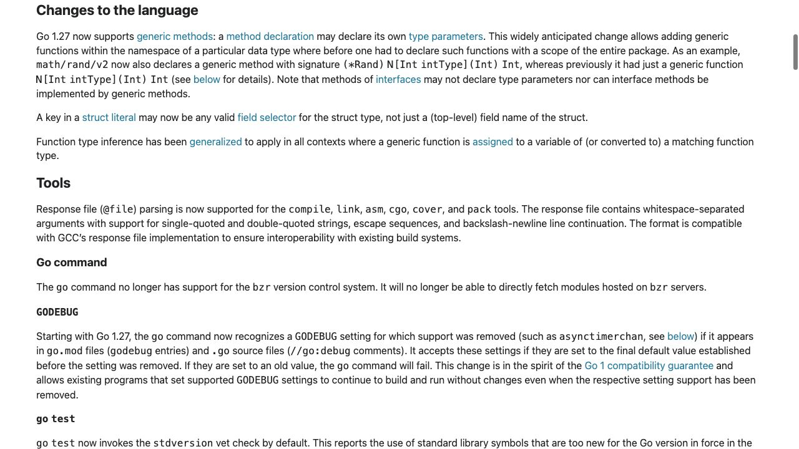
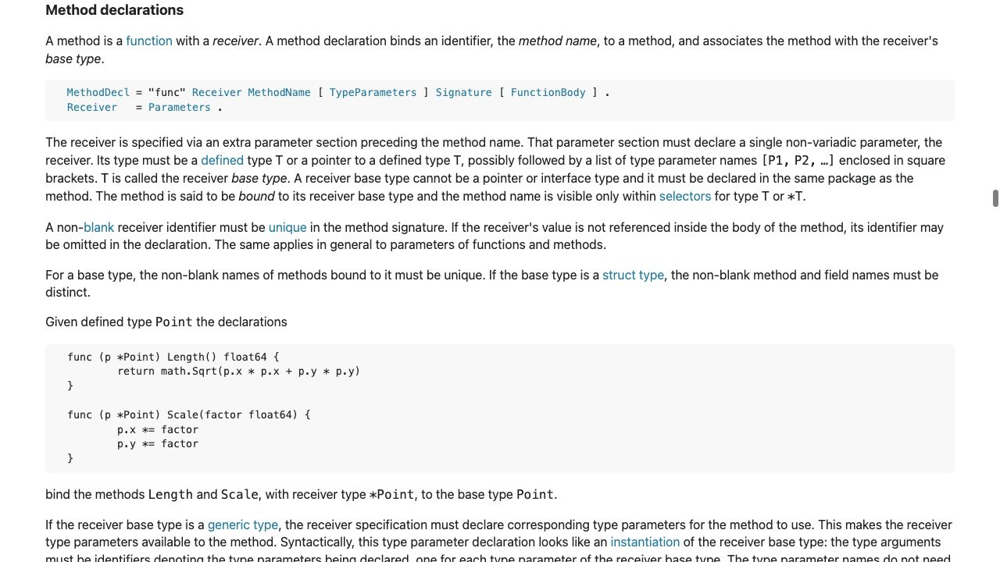
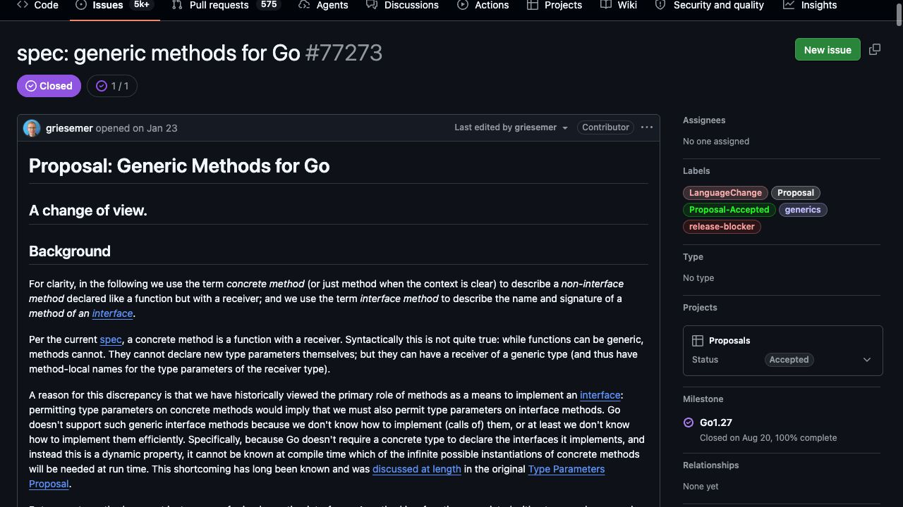
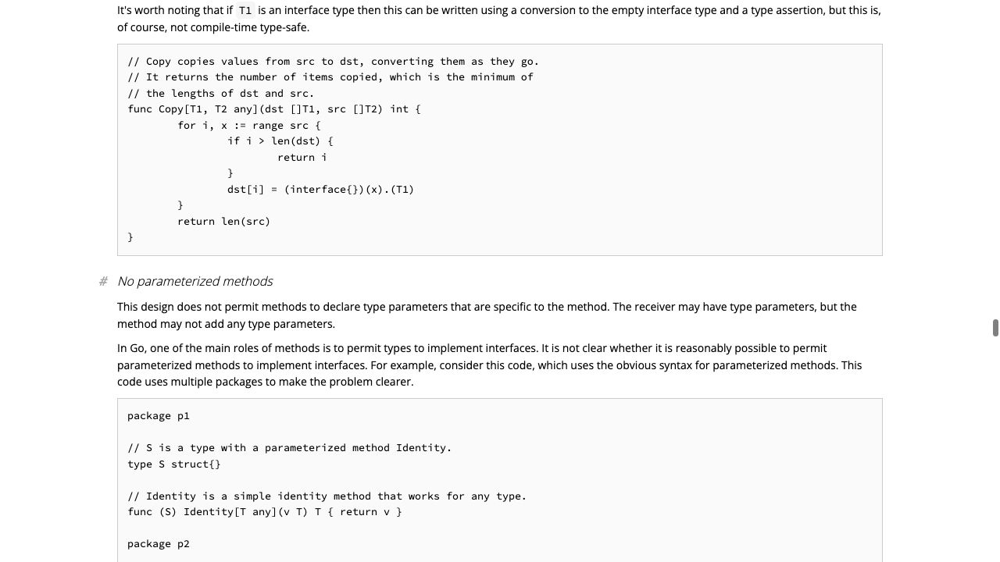
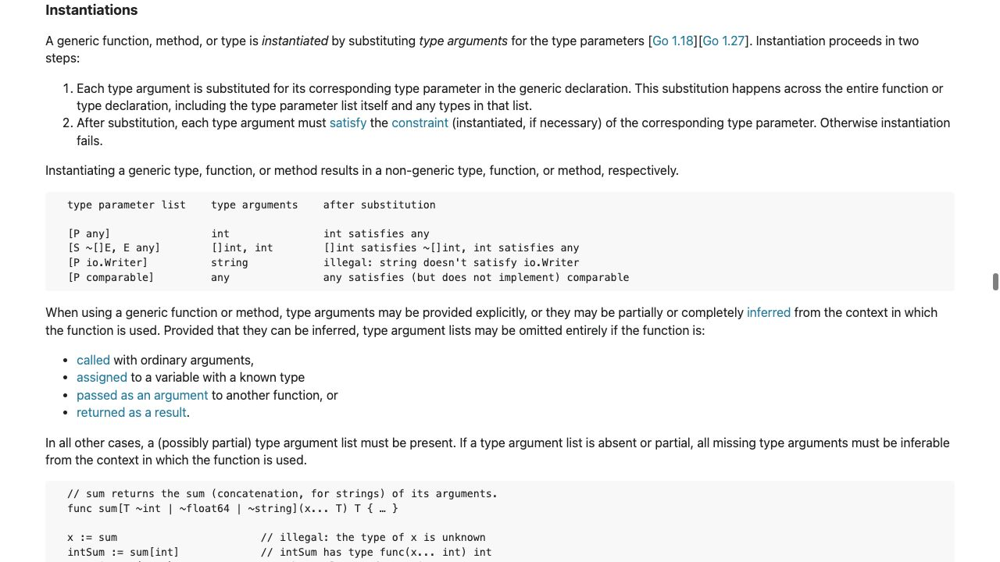

[問題に戻る](README.md) | [カテゴリの調べ方](../../README.md) | [シナリオ一覧](../../../SCENARIOS.md)

# ジェネリックメソッドを、変更点から調べる例

2026-10-02 に、問題文とカテゴリ README を読み、ヒント・答え・こぼれ話を開かずに調査を始めました。以下は到達先の一覧ではなく、読んだ記述をどう問題に対応付け、次の疑問を作ったかの記録です。画像は実際のブラウザー画面です。コマンドによる確認は別記しています。

## 出発点を絞る

問題文から得たのは `Slice[T]`、`Map[F any]`、Go 1.26 のエラー、Go 1.27 での変更、インタフェースに関する制限です。この時点では「型パラメータ付きの型」と「メソッド自身の型パラメータ」を同じ機能と決めつけません。

カテゴリの「最新バージョンの機能を調査したい」に従い、[Go 1.27 リリースノート](https://go.dev/doc/go1.27)を開きます。問題にある語に対応する **Changes to the language** の generic methods を読みます。[Go 1.26](https://go.dev/doc/go1.26)も確認しましたが、旧版の構文については変更の紹介だけで決めず、後述の提案にある旧構文と実測を照合します。

---

<a id="question-1"></a>

## 設問1: 変更の紹介から、実際の構文へ進む

**原文と意味の対応。** [言語の変更の段落](https://go.dev/doc/go1.27#language)では、`method declaration`（メソッド宣言）が `may declare`（宣言してよい）と説明され、その対象が `its own type parameters`（メソッド自身の型パラメータ）です。`own` を読み落とすと、レシーバーの型パラメータを使えることまで今回の変更だと誤解します。同じ段落の `Note that` 以降には、インタフェースについての制限もあるので、そこまで読みます。



**次へ進む理由。** 紹介文では `Map[F any]` のどこが構文上許されるのか分からないため、段落内の **method declaration** リンクを開きました。

[Method declarations](https://go.dev/ref/spec#Method_declarations)の構文では、`MethodName` の直後に任意の `TypeParameters` が置かれています。末尾の例は、レシーバーの `List[E]` とメソッドの `Apply[F any]` を別々に宣言しています。



**読み分け。** `Slice[T]` 側の `T` はレシーバーの型の要素を表し、`Map[F any]` 側の `F` はそのメソッドが新しく宣言する型パラメータです。今回の変更を「ジェネリック型にメソッドを持たせられるようになった」と広く言い換えると、以前から可能だった部分まで新機能と誤認します。

**旧版との比較。** リリースノートの **generic methods** から [提案 #77273](https://go.dev/issue/77273)へ進むと、Proposal 節に旧構文と新構文があります。旧構文にはメソッド名とシグネチャの間の型パラメータ宣言がありません。現在の仕様は、提案中に併記された構文統合案ではなく、`MethodDecl` を残した形になっています。提案の例をそのまま現行仕様とみなさず、両者を見比べました。

同じ完成コードをGo 1.26.4でも実行すると、終了コード1で `syntax error: method must have no type parameters` となりました。旧版の実測と現在の成功を対にして確認しています。

**回答。** Go 1.27 では、具体型のメソッド名の直後に、そのメソッド独自の型パラメータを宣言できます。問題の `Map[F any]` がこれに当たります。

---

<a id="question-2"></a>

## 設問2: 仕様の制限から、設計上の問いへ進む

**原文の制限を二つに分ける。** `methods of interfaces` は「インタフェースに宣言するメソッド」を指し、`may not declare` がその型パラメータ宣言を禁止します。続く `nor` は別の禁止事項を加えています。後半の `interface methods` が `be implemented by generic methods` と結ばれるので、「具体型のジェネリックメソッドでインタフェースのメソッドを満たすこと」も禁止と読みます。前半だけを「インタフェースには書けない」と訳して済ませると、問題の代入が失敗する理由が抜けます。

**次の疑問。** この二つの禁止は確認できましたが、「なぜその境界か」はまだ説明し切れていません。同じ場所から到達した #77273 の **Background** を読みます。



**読んだ内容と解釈。** 提案では、メソッドをインタフェース実装のためだけでなく、型に関連する機能をまとめる手段として捉え直しています。一方、インタフェース越しの呼び出しでは、実行時にどの具体型・型引数の組み合わせが必要になるかをコンパイル時に決める難しさを挙げています。「新機能が入ったからこの難しさも解決した」とは読めません。

**根拠をさらに読む。** Background の **discussed at length** リンクから、[旧 Type Parameters Proposal の No parameterized methods](https://go.googlesource.com/proposal/+/refs/heads/master/design/43651-type-parameters.md#No-parameterized-methods)へ進みました。



この節は別々のパッケージを使う例の後に、リンク時に必要な実体化を調べる案、実行時に処理する案、インタフェースを実装しない案を比較しています。例の型名を覚えるより、**呼び出す側が具体型を知らないのに、どこで実体化するのか**という問いを拾います。現在の提案は、最後の案にもコード整理上の価値があると判断したものです。「永久に実装不可能」とは結論しません。

**実験。** 問題文の[インタフェース代入のコード](https://go.dev/play/p/Lqn-PC8jg9E)を取得し、Go 1.27.1 で `go run` しました。終了コードは1。診断の型比較部分は次のとおりです。

```text
have Read[E any]([]E) (int, error)
want Read([]byte) (int, error)
```

**回答。** 具体型に汎用操作を置くことは許されましたが、インタフェース側の型パラメータ宣言と、そのメソッドをジェネリックメソッドで満たすことは許されていません。`Read` という名前が同じでも、汎用の宣言と `[]byte` を受け取る通常メソッドは同じシグネチャではありません。

**議論で説明を確かめる。** 2026-10-13 に #77273 の本文と全199コメントを取得して再確認しました。[提案者の補足](https://github.com/golang/go/issues/77273#issuecomment-3808469395)は、`any` に格納された値を別のパッケージでインタフェースへ型アサーションする例まで広げています。代入箇所だけで型引数を推論すれば済む、という説明では足りないと分かります。[方針変更の説明](https://github.com/golang/go/issues/77273#issuecomment-3837455237)では、ジェネリクス導入後の利用経験から、インタフェースを満たせなくても型に操作をまとめる価値を認めたと述べています。

**続きを調べる入口。** 同じ議論の[採用決定](https://github.com/golang/go/issues/77273#issuecomment-3962618141)と[実装・文書化の報告](https://github.com/golang/go/issues/77273#issuecomment-4548762103)は別の段階です。型引数の固定やラッパーを提案するコメントもありますが、すべてが採用されたわけではありません。提案本文・代案・決定・実装報告を分け、現行仕様へ戻って答えを確定します。

---

<a id="question-3"></a>

## 設問3: 仕様の例を問題の型へ写し、推論を確かめる

**何を手掛かりに書くか。** 現在の問題にある[関数版の共有コード](https://go.dev/play/p/MpoXrhxatOW)を開き、2026-10-13 に実行しました。設問1で読んだ Method declarations の `List[E].Apply[F any]` の例は、入力の各要素に関数を適用して、出力側の型を持つ入れ物を返しています。これを問題の `items []T` を持つ構造体へ対応付け、`MapSlice` の宣言をレシーバー付きの `Map` へ変えます。二つの呼び出しも `nums.Map(...)`、`labels.Map(...)` に変え、本体は維持します。

入力の長さだけ `[]F` を作り、各要素を変換して `Slice[F]` として返します。レシーバーの `T` を書き換えるのではなく、別の要素型 `F` の結果を作る、と読めます。仕様本文の **instantiated** リンクから [Instantiations](https://go.dev/ref/spec#Instantiations) へ進みます。`instantiated`（実体化される）は、型パラメータへ型引数を代入し、制約を満たすか確認することです。同じ節の **inferred** リンクから [Type inference](https://go.dev/ref/spec#Type_inference) へ進むと、`inferred`（推論される）は、その型引数を呼び出し側などの型の関係から求めることだと分かります。型引数を省略できる条件と、実体化に必要な条件を区別し、提案の呼び出し説明とも照合します。



[この調査で作ったコードを Playground で開く](https://go.dev/play/p/A8uBKhXcqSA)

```go
package main

import (
	"fmt"
	"strings"
)

type Slice[T any] struct {
	items []T
}

func (s Slice[T]) Items() []T { return s.items }

func (s Slice[T]) Map[F any](f func(T) F) Slice[F] {
	out := Slice[F]{items: make([]F, len(s.items))}
	for i, v := range s.items {
		out.items[i] = f(v)
	}
	return out
}

func main() {
	nums := Slice[int]{items: []int{1, 2, 3}}
	labels := nums.Map( func(n int) string { return fmt.Sprintf("v%d", n) })
	lengths := labels.Map( func(s string) int { return len(s) })

	fmt.Println(strings.Join(labels.Items(), ","))
	fmt.Println(lengths.Items())
}
```

**ローカルの実測。** 関数版と書き換えたメソッド版を Go 1.27.1 で `go run` し、どちらも終了コード0と次の同じ出力を確認しました。Playground のリンクはソースを共有するためのもので、この出力の測定場所はローカルです。

```text
v1,v2,v3
[2 2 2]
```

**回答。** 一つ目は変換関数が `int` を受けて `string` を返すため `F` を `string`、二つ目は `string` を受けて `int` を返すため `F` を `int` と推論できます。型引数を明示せず、元の関数版と同じ値になりました。「どんな呼び出しでも型引数を省略できる」とまでは、この実験から言えません。

**さらに深掘りするなら。** 同じ仕様の Instantiations / Type inference で、引数から型の情報が得られない場合の条件を読みます。提案の Libraries and tools 節からは、言語の採用とは別に周辺ツールへの対応が必要だと分かります。問題文にあるツール追随 Issue へ進む場合も、機能の採用と個々のツールの対応完了を分けて確認できます。
