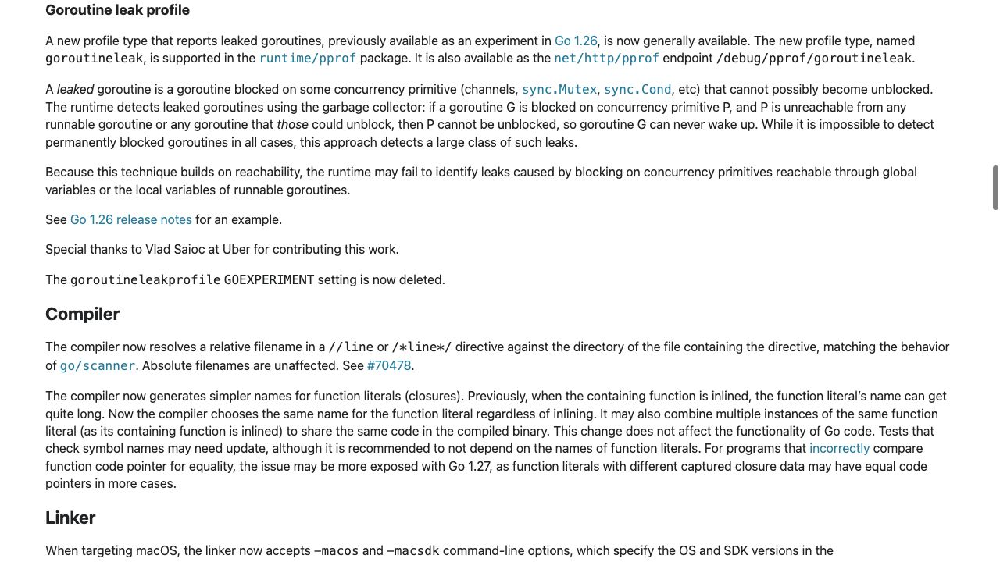
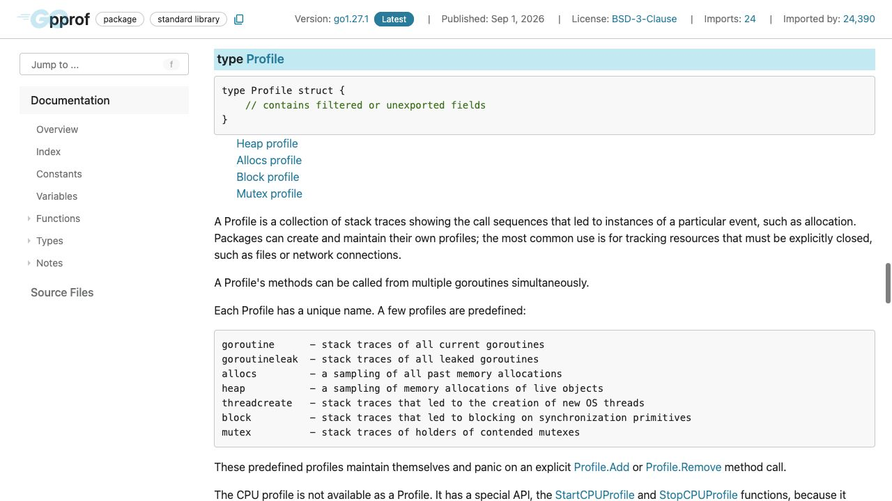
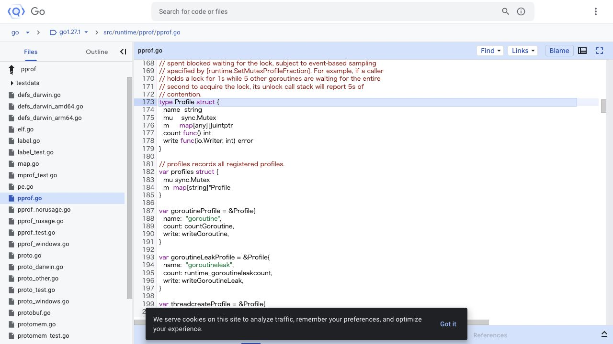
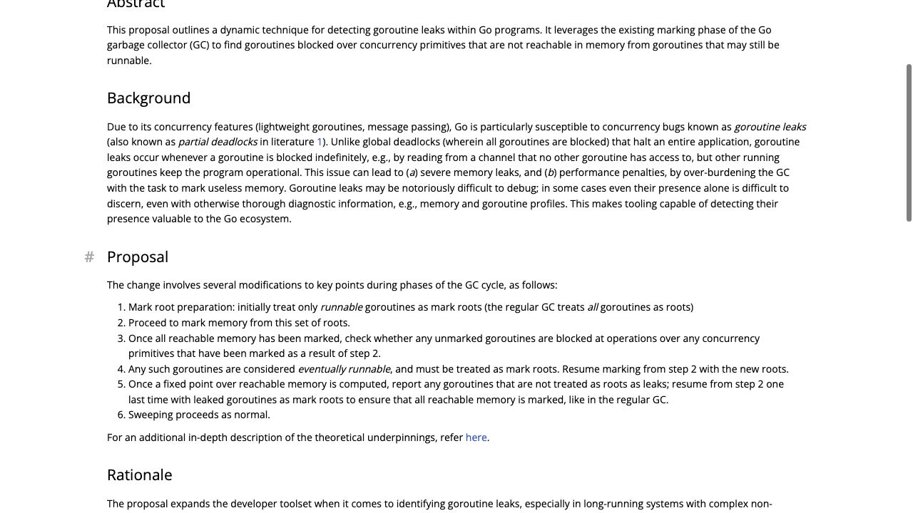
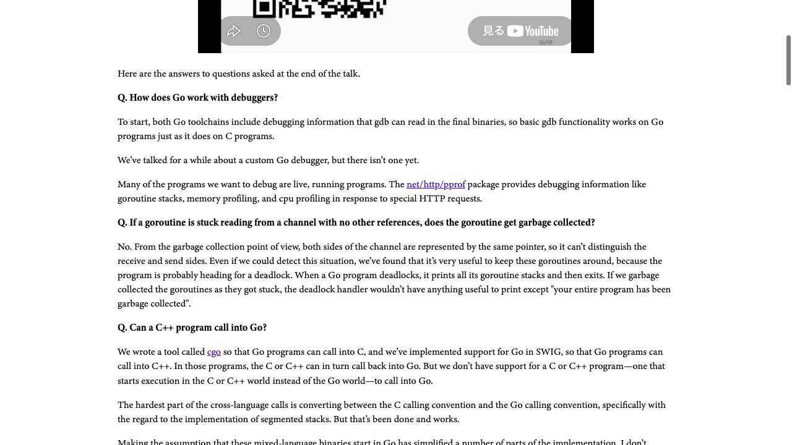

[問題に戻る](README.md) | [カテゴリの調べ方](../../README.md) | [シナリオ一覧](../../../SCENARIOS.md)

# `goroutineleak` を、観測から設計まで調べる例

2026-10-02 に、問題文とカテゴリ README だけを出発点として調査しました。既存のヒント・答え・こぼれ話は調査前に除外しています。画面は実際に開いたページです。HTTPでの本文取得、Issueの全コメント取得、ローカルのコード実行は、ブラウザー操作と区別して記します。

## 最初の疑問

問題には `goroutine` と `goroutineleak` の件数、`chan send`、Go 1.27 という語があります。まず「何を数えているか」を確かめ、それから「なぜその分類ができるか」を調べます。件数の差だけで、回収されたgoroutineの数だとは判断しません。

カテゴリの新機能の調べ方に従い、[Go 1.27 リリースノート](https://go.dev/doc/go1.27)を開きました。問題の機能名に対応する **Goroutine leak profile** 節を読みます。そこからリンクされている [Go 1.26 の同じ節](https://go.dev/doc/go1.26#goroutineleak-profiles)も読み、実験版と正式版の説明を分けました。

---

<a id="question-1"></a>

## 設問1: 名前の似た二つのプロファイルを読み分ける

**リリースノートで確認したこと。** [Go 1.27 の該当節](https://go.dev/doc/go1.27#goroutineleak-profiles)には、起きる可能性のない待機を検出すること、GCを利用すること、検出できない場合もあることが続けて書かれています。最初の紹介文だけで止めません。



**次に進んだ理由。** `goroutineleak` の紹介だけでは既存の `goroutine` との対比が不足します。節内の **runtime/pprof** リンクからパッケージを開き、Indexで **type Profile** を見つけ、その説明を開きました。[予約されたプロファイル名の一覧](https://pkg.go.dev/runtime/pprof@go1.27.1#Profile)を読みます。



**解釈。** `goroutine` はその時点で存在するgoroutineのスタック、`goroutineleak` はリークと判定されたもののスタックです。この問題の `main` は採取処理を実行しており、残った4個は送信から進めません。差の1個は、単なる待機時間の長短で分けられているわけではありません。

**実装でも確認。** `Profile` の宣言リンクが指す `src/runtime/pprof/pprof.go` を開き、画面の版を `go1.27.1` に固定しました。宣言の周囲に、各プロファイルと書き出し関数の対応があります。



同じファイル内で、そこで得た `writeGoroutineLeak` を検索すると、書き出し前に `runtime_goroutineLeakGC()` を呼び、その後に対象を絞ることが分かります。[関数と前後の実装](https://cs.opensource.google/go/go/+/refs/tags/go1.27.1:src/runtime/pprof/pprof.go;l=777)を読むと、`debug >= 2` では通常の全スタック出力へ進む分岐もあります。問題の `WriteTo(..., 1)` という条件は省略できません。

**実測。** 問題の[共有ソース](https://go.dev/play/p/UwYB3wyRxe9)を取得し、ローカルのGo 1.27.1で `go run` しました。標準出力・標準エラーを合わせた結果から、版と件数の行を抜き出すと次のとおりです。終了コードは0です。

```text
go version: go1.27.1
processWorkItems err: boom
=== goroutine profile ===
goroutine profile: total 5
=== goroutineleak profile ===
goroutineleak profile: total 4
```

**回答。** 5は採取中の `main` と送信待ち4個、4は後者のリークです。二回の採取はコード上で順番に呼ばれるため、厳密に同一時刻のスナップショットではありません。この例の件数が一致したことと、任意の実行で同じ数になることも区別します。

---

<a id="question-2"></a>

## 設問2: 「GCを使う」を判定の手順へ分解する

**残った疑問。** リリースノートには到達可能性を使うとありますが、止まっているgoroutineを全部除くだけでよいのかはまだ分かりません。起きられるgoroutineが別のgoroutineを起こす連鎖も考える必要がありそうです。これは本文の「そこから起こせるgoroutine」という条件から得た問いです。

**提案への動線。** カテゴリにあるリリースノートのHTML確認手順に従い、該当節の直前を確認しました。今回はHTMLをHTTPで取得して読み、`go.dev/issue/74609` というコメントを見つけました。[#74609](https://go.dev/issue/74609)の本文と全33コメントを取得して読み、本文の **Design document** へ進みます。Issue番号を記憶から入力した経路ではありません。

[設計文書](https://go.googlesource.com/proposal/+/master/design/74609-goroutine-leak-detection-gc.md)の **Proposal** は手順を番号で示しています。



**自分の言葉への置き換え。** 実行できるgoroutineを出発点にメモリを辿る。待ち対象へ到達できたgoroutineも、起きる可能性がある側に加えてさらに辿る。加えられるものがなくなるまで繰り返し、残った待機をリークとして報告する、という流れです。「一度マークされなかったら即リーク」ではありません。

**現行実装への照合。** 設問1で見つけた `runtime_goroutineLeakGC` を、手元の同版Goソースで検索しました。リンク名の宣言から `runtime/mgc.go` の `goroutineLeakGC` に到達し、そのファイルの漏れ検出の分岐から `findGoroutineLeaks`、`findMaybeRunnableGoroutines`、`isMaybeRunnable` を読みました。[同じタグの実装](https://cs.opensource.google/go/go/+/refs/tags/go1.27.1:src/runtime/mgc.go;l=1157)では、待ち理由に応じて対象のマークを確認し、新しく起きる可能性のあるgoroutineが見つかればマーキングを再開します。

**回答。** 将来の命令を予言する仕組みではなく、待ち対象にアクセスして起こし得る側からの到達可能性を繰り返し計算し、そこから外れた待機を検出します。GCの仕組みを使うことと、goroutineを回収することは別です。設計文書は報告後に残りもマークする手順を明記しています。

**続けて読むなら。** 設計文書の **Hiding pointers from the GC** へ進むと、ランタイム内部が待ち対象への参照を持っていることと、利用者のgoroutineから起こせることを混同しないための工夫が説明されています。そこで出てくる識別子から実装へ進めます。内部の型名を知っている前提で最初から検索する必要はありません。

---

<a id="question-3"></a>

## 設問3: 検出されないことから何を言えるか

**読み戻した箇所。** 設問2の手順を理解してから、[リリースノートの到達可能性の但し書き](https://go.dev/doc/go1.27#goroutineleak-profiles)と、設計文書の **Rationale** を読み直しました。図1の下側に、グローバル変数やrunnableなgoroutineのローカル変数から辿れる場合の限界があります。

**解釈。** 参照を持っていることから、将来必ず送信・解除するとは言えません。しかし参照が残っている以上、この到達可能性だけの検査では「絶対に解除できない」とも言い切れません。到達可能性と、実際に解除する制御フローの有無を別の条件として読みます。

| 資料から分かること | そこからは言えないこと |
| --- | --- |
| この方法で判定できる待機を報告する | アプリケーションのすべてのリークを検出する |
| 起こせる可能性を到達可能性で残す | 参照を持つgoroutineが必ず起こす |
| 結果が0件だった | サービスにリークがない |

**回答。** 起きる可能性を否定できないものを、この判定ではリークと断定しないためです。検出漏れがあることは、設計文書が述べる判定の確実さと矛盾しません。また、検出された待機が利用者にとって意図したものかどうかは、プログラムの目的も見て判断する必要があります。

**次の調査。** まだ増え続けるgoroutineが残るなら、元の `goroutine` プロファイルに戻り、待っている場所と参照がどこから残るかを調べる問いを作れます。`goroutineleak` の空の結果を調査終了の根拠にはしません。

---

<a id="question-4"></a>

## 設問4: 2012年の説明、2015年の案、現在の設計を分ける

**歴史へ戻る理由。** 現在の判定を確認できたので、問題文が指定する [2012年の A Tour of Go](https://research.swtch.com/gotour)へ移りました。Q&Aで、ほかに参照のないchannelを待つgoroutineがGCされるかという質問を探します。



**当時の説明。** 送受信の側を同じポインタから区別できないという話と、デッドロック時のスタックを残す価値という話があります。2012年の記事を、現在も検出できない証拠としては使いません。

**次に読む番号の由来。** #74609 のコメントに先行議論 [#13759](https://go.dev/issue/13759) がありました。本文と全9コメントを取得して読むと、[GCを使った到達可能性の案](https://github.com/golang/go/issues/13759#issuecomment-167843380)、停止時間や到達可能性の扱いへの懸念、詳細な実装案を求めるやり取りがあります。[受け入れのコメント](https://github.com/golang/go/issues/13759#issuecomment-262067120)は、機能への賛意を示しつつ、チーム自身が実装を予定しているわけではないと述べています。acceptedを、その年に実装が完成したという意味には読みません。

**現在の選択。** #74609 の[設計上のフィードバック](https://github.com/golang/go/issues/74609#issuecomment-3119676873)は、メモリ以外にファイル・接続などの資源が残ること、finalizer/cleanupの安全性、GCの停止時間などを挙げ、まず検出器として提供する方針を説明しています。同Issueの後半には、`main` が `select{}` で止まる場合の報告除外も議論され、Go 1.27.1の `findGoroutineLeaks` の末尾に対応処理があります。提案の最初の説明だけで最終挙動を固定しない例です。

**回答。** 検出可能な範囲と診断情報を残す価値を切り分けたうえで、現在は利用者が要求したときに調べるプロファイルとして提供されています。2015年の案には実装・性能・意味付けの課題があり、2025年の提案では実装と実験結果が示されています。ただし、これらの資料だけから「10年以上の期間すべてが一つの技術的難題の解消に費やされた」とは断定できません。未着手期間や優先順位まで推測して埋めない回答にします。

**さらに調べるなら。** #74609 の実装報告からCLへ進み、変更ファイルと対象タグを比べると、提案の採用、実験版への導入、正式化の三段階を追えます。設計文書に残る古い実験フラグ名を実行条件へ流用せず、現在のリリースノートへ戻って確認してください。
