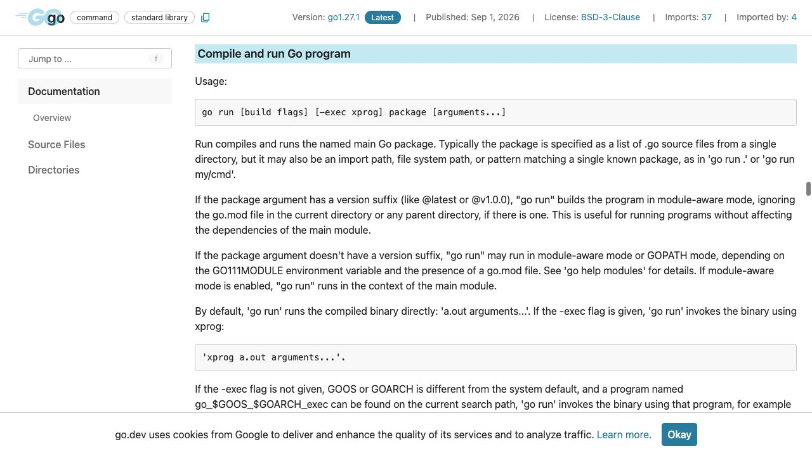
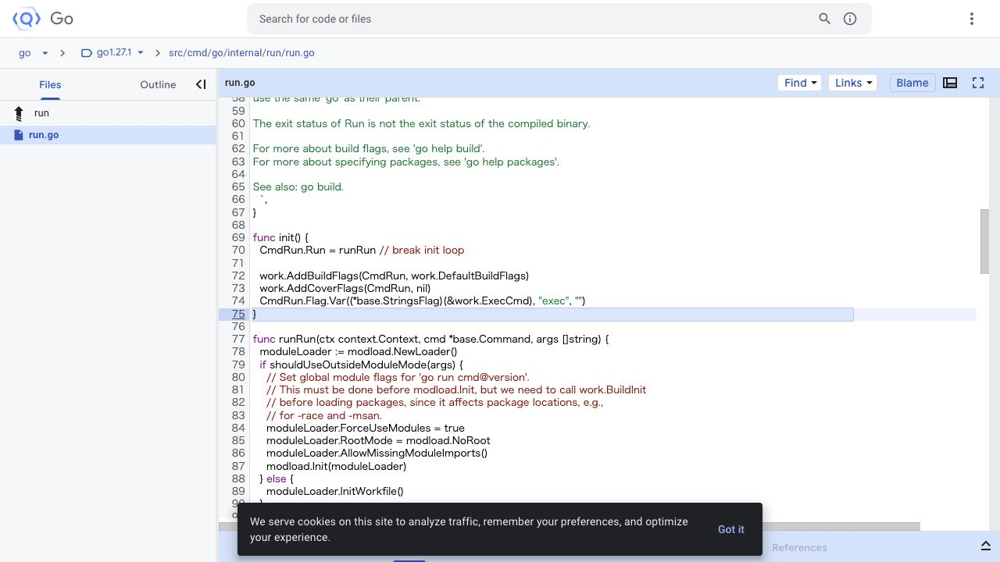

[問題へ戻る](README.md) | [カテゴリの調べ方](../../README.md)

# 調査・回答例: go run のビルドと後片付け

問題文とカテゴリ README の入口から、疑問が残った箇所を順に調べた例です。唯一の正解ルートではありません。先に問題を解き、資料から何を読み取ったかを比べるために使ってください。

画面は 2026-10-02 に実際のページを撮影したものです。本文・ソース・実行結果は 2026-10-13 に再確認しました。画面に写る範囲と、その後本文や手元で確認した範囲を分けて記します。実測は Go 1.27.1 / darwin/arm64 です。

## 設問 1: 「実行する」の前に何をしているか

**出発点。** 問題文にある名前は `go run`。カテゴリの「公式ヘルプを読む」に従い [Go Command](https://go.dev/cmd/go/) の `go run [` を探した。知らない内部関数名はまだ使わない。

**読んだ箇所と解釈。** Usage の直下の `compiles and runs` は、主語の `Run`（`go run`）がコンパイルと実行を行うという説明である。続く `compiled binary` は実行対象がコンパイル済みバイナリであることを示す。直接実行の説明には `By default` が付くため、`-exec` を使う場合の起動方法とは分けて読む。「ソースを渡してすぐ動く」という使い勝手から、逐次解釈しているとは判断できない。見出しだけでなく実行対象が binary であるところまで読むと、動作の説明になる。

**次の疑問。** 本当にコンパイラが動いたかを見たい。Usage の `[build flags]` を手がかりに、カテゴリの「フラグで覗く」と `go help build` を読んだ。`-x` は実行コマンドの表示、`-n` は実行しない表示なので、今回は `go run -x main.go` を選んだ。

問題の [main.go](main.go) を専用の空のビルドキャッシュで実行すると、コンパイラ・リンカの呼び出しと `hello, gotan` が出た。直後に同じコマンドを再実行すると、`WORK=...` とキャッシュ内の実行ファイルの起動だけになった。**コンパイルする仕組みと、毎回コンパイラを起動することは別**だと、ここで疑問を更新した。

---

## 設問 2: 一時ファイルとキャッシュを分けて考える

**何を確かめるか。** 前の出力には一時ディレクトリとキャッシュの二種類のパスがある。片方の消滅から「実行ファイルはどこにも残らない」とは言えない。

`go help build` の `-work` は `temporary work directory` を表示し、`when exiting`、つまりコマンド終了時にも削除しない指定だった。残す対象はこの一時作業ディレクトリであり、カレントディレクトリやビルドキャッシュではない。通常の `-x` 実行と `-work -x` 実行を比べる観測方法がここから得られる。実行ファイルのキャッシュについては、問題の入口にある [Go 1.24 の Go command](https://go.dev/doc/go1.24#go-command) を読み、`go run` がビルドした実行ファイルもキャッシュするようになった版だと確認できる。

**回答。** 通常の作業ディレクトリは後片付けされる。`-work` を指定すると保持される。一方、ビルドキャッシュに保存された実行ファイルは別に扱われ、次回に再利用できる。`-work` の説明はキャッシュ全体の寿命を説明してはいない。

---

## 設問 3: 出力から呼び出し元へ戻る

**次に進む根拠。** まだ作成・片付けの担当は分からない。カテゴリの「実装まで踏み込みたい」に従って `internal/run/run.go` を対象版へ切り替え、`CmdRun`、登録先の `runRun` の順に読む。

[Go 1.27.1 の run.go](https://cs.opensource.google/go/go/+/refs/tags/go1.27.1:src/cmd/go/internal/run/run.go) では、`work.NewBuilder` が現れ、その後の `LinkAction` に `CacheExecutable = true` が設定されていた。実行 action の依存先がリンク action なので、並び順だけでなく依存関係として「ビルドしてから実行」と読める。`buildRunProgram` はその成果物 `BuiltTarget()` を `base.RunStdin` に渡す。

`NewBuilder` という今見つけた名前を [action.go](https://cs.opensource.google/go/go/+/refs/tags/go1.27.1:src/cmd/go/internal/work/action.go) で探すと、`os.MkdirTemp` による作成と `Close` による削除が見つかった。削除は `!cfg.BuildWork` の条件付きなので、先ほどの `-work` の説明と一致する。

**キャッシュで省略される範囲。** キャッシュ利用時も `NewBuilder` は先に呼ばれ、今回の二回目の実行にも `WORK=...` が出ていた。省略されるのは不要なコンパイルやリンクであり、一時ディレクトリの作成まで省略されるとは言えない。

**さらに深掘りするなら。** `CacheExecutable` の参照先をたどり、[buildid.go](https://cs.opensource.google/go/go/+/refs/tags/go1.27.1:src/cmd/go/internal/work/buildid.go) と [exec.go](https://cs.opensource.google/go/go/+/refs/tags/go1.27.1:src/cmd/go/internal/work/exec.go) のキャッシュ照合・保存を読む。「何が変わると再ビルドか」という次の問いに対しては、単なる実行時間の比較より action ID の材料が根拠になる。

---

[問題へ戻る](README.md)
