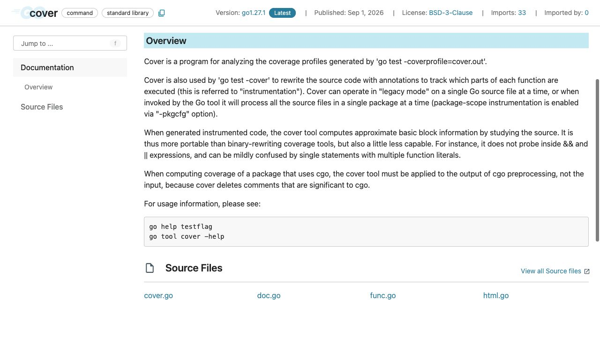
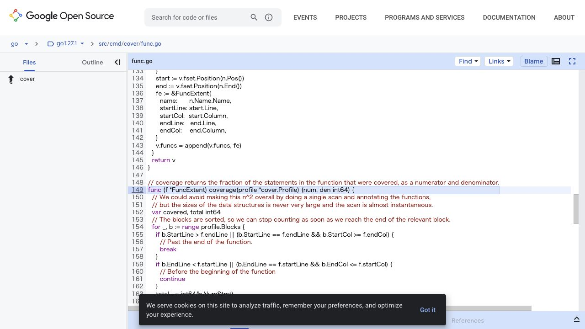

[問題へ戻る](README.md) | [カテゴリの調べ方](../../README.md)

# 調査・回答例: カバレッジの分母と未実行箇所

問題文とカテゴリ README の入口から、疑問が残った箇所を順に調べた例です。唯一の正解ルートではありません。先に問題を解き、資料から何を読み取ったかを比べるために使ってください。

画面は 2026-10-02 に実際のページを撮影したものです。本文・ソース・実行結果は 2026-10-13 に再確認しました。画面に写る範囲と、その後本文や手元で確認した範囲を分けて記します。実測は Go 1.27.1 / darwin/arm64 です。

## 設問 1: 数字の単位から読み始める

問題の出力には `statements` と関数名 `calculate` がある。問題の「調査の入り口」から [コマンド一覧](https://go.dev/doc/cmd) の `cover` を開き、[Overview](https://pkg.go.dev/cmd/cover) を読んだ。

**読み取ったこと。** `go test -coverprofile` が作る記録を cover が解析する。Overview の `instrumentation` は、各関数のどこが実行されたかを追跡するため、元のコードへ計測用の注釈を加えることを指す。`approximate basic block` はソースから近似した基本ブロックという意味で、続く `does not probe inside` の対象が `&&` と `||` である。したがって、これらの式の内部の実行状況まで区別する計測ではない。「テストが正しい確率」でも「すべての条件の組み合わせ」でもない。

**まだ足りないこと。** Overview だけでは関数ごとの分母が分からない。案内されている `go tool cover -help` の `-func` と、Source Files の `func.go` を読む。関数名・位置を集める処理に続く `coverage` では、対象関数に重なるブロックの `NumStmt` を `total` に足し、`Count > 0` のときだけ `covered` にも足している。加える値は実行回数 `Count` ではなく文の数 `NumStmt` なので、分母は対象の文数、分子は一度以上実行されたブロックに属する文数と読める。これが問題の出力の `statements` に対応する。

根拠: [Go 1.27.1 の func.go](https://cs.opensource.google/go/go/+/refs/tags/go1.27.1:src/cmd/cover/func.go)。画面下で隠れている加算部分も、同じ版のソース本文で確認した。

**実測と回答。** 問題に同梱されたファイルを一時ディレクトリへコピーし、`go run main.go` の `30` を確認した後、`go test -coverprofile=cover.out` と `go tool cover -func=cover.out` を実行した。`calculate 80.0%`、`main 0.0%`、全体 `66.7%` を再現した。全体には `main` も含まれるので、全体値を `calculate` の値に読み替えられない。

---

## 設問 2: 数字の改善をテストの目的に結び付ける

**次の操作を選んだ理由。** `-func` は関数単位でしか場所が分からない。ヘルプにある `-html` を使えば行・ブロックへ降りられる。`go tool cover -html=cover.out -o cover.html` で作る表示と、問題のテスト入力 `0`、`3` を照合する。

問題コードの条件を順に当てはめると、どちらも `n >= 10` の分岐にある `n * 8` の計算を実行しない。そこで追加するケースは `input: 10, want: 80` とした。境界値 10 を選んだのは条件式に現れているからで、百分率だけから選んだわけではない。

再実行では `calculate 100.0%`、`main 0.0%`、全体 `83.3%` となった。10 以上の分岐の計測ブロックが通り、期待する値もテストで照合したことが根拠になる。全体値を 100% にするために `main` を呼ぶことと、計算仕様を確かめることは別の目的である。

**続きの問い。** 入力 10 だけで計算全体の正しさを保証できるか。Overview の計測限界に戻ると、カバレッジは未実行箇所を探す補助と分かる。境界の手前・直後や不正入力の期待値は、入力と出力の仕様から別途決める必要がある。

---

[問題へ戻る](README.md)
