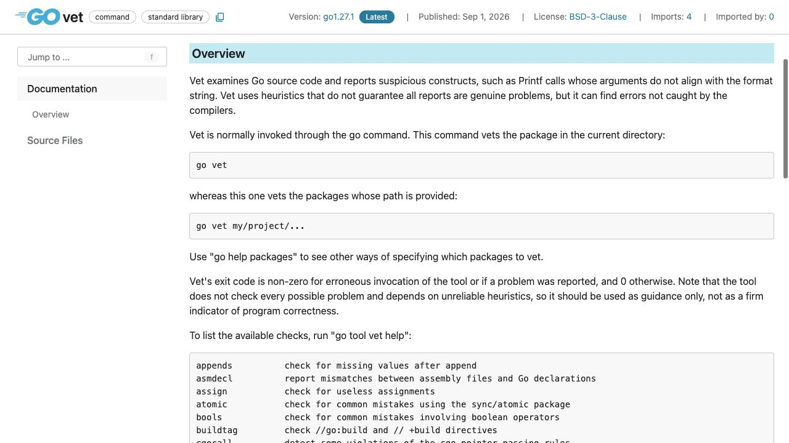
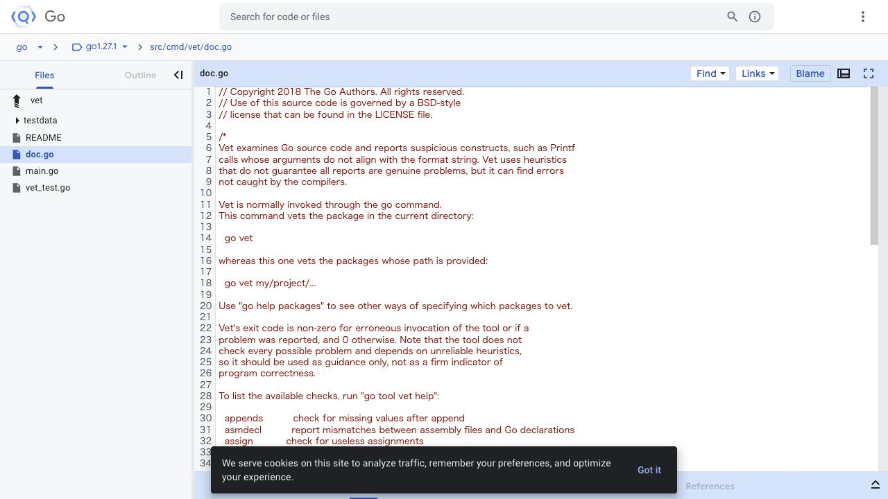

[問題へ戻る](README.md) | [カテゴリの調べ方](../../README.md)

# 調査・回答例: コンパイル成功と vet の指摘を分ける

問題文とカテゴリ README の入口から、疑問が残った箇所を順に調べた例です。唯一の正解ルートではありません。先に問題を解き、資料から何を読み取ったかを比べるために使ってください。

画面は 2026-10-02 に実際のページを撮影したものです。本文・ソース・実行結果は 2026-10-13 に再確認しました。画面に写る範囲と、その後本文や手元で確認した範囲を分けて記します。実測は Go 1.27.1 / darwin/arm64 です。

## 設問 1: 例の文字列に説明を対応させる

カテゴリの [Go Command](https://go.dev/cmd/go/) から `go vet [` を探し、そこで案内される [cmd/vet](https://pkg.go.dev/cmd/vet) の Overview を読む。問題の `Printf` と同じ例が冒頭にあるため、まずこの段落を選ぶ。

**読み方。** 「怪しい構造を報告する」という役割に続いて、ヒューリスティックなので指摘が必ず本当の問題とは限らず、すべての問題を検出するわけでもないと書かれている。成功したら正しいプログラムだ、とは読まない。

問題の [main.go](main.go) を実行すると `hello, %!d(string=gopher)` だった。`go vet ./...` では `fmt.Printf format %d has arg name of wrong type string` と指摘され、終了コードは 1 だった。コードが実行できることと、書式文字列の意図が引数の型に合っていることを分けて説明できる。

**回答。** コンパイラが受け付けるプログラムにも、呼び出しの文脈から推定できる間違いがある。vet はそれを探す静的解析であり、実行テストの代わりになる万能な正当性判定ではない。

---

## 設問 2: 一覧を暗記せず、今のツールに尋ねる

Overview に `go tool vet help` が一覧取得の方法として載っていた。問題の診断に `Printf` が含まれるので、一覧の `printf` を選び、`go tool vet help printf` へ進む。この順なら最初から analyzer 名を知っている必要がない。

**読んだ箇所。** 個別ヘルプでは Printf 系関数の書式と引数の整合性、Print 系の使い方などが説明される。単純に「文字列に `%d` が含まれたら警告する」のではなく、呼び出しの種類と引数を解析していることが分かる。

**深掘りの動線。** Source Files の [Go 1.27.1 の main.go](https://cs.opensource.google/go/go/+/refs/tags/go1.27.1:src/cmd/vet/main.go) で `unitchecker.Main` に渡される analyzer 群を読む。ここで `printf.Analyzer` とその import が見つかるので、[同梱版 printf.go](https://cs.opensource.google/go/go/+/refs/tags/go1.27.1:src/cmd/vendor/golang.org/x/tools/go/analysis/passes/printf/printf.go) へ進める。入口の `Run` から書式検査へたどると、検査を登録する側と実施する側を区別できる。

**回答と続き。** 一覧は全体のヘルプ、詳細は analyzer 名付きヘルプで確認する。新しい版で何が増えたかを知りたければ、その時点でリリースノートへ進む。今回の `%d` と string の不整合を説明するために、別の版の新しい検査内容を混ぜる必要はない。

---

[問題へ戻る](README.md)
