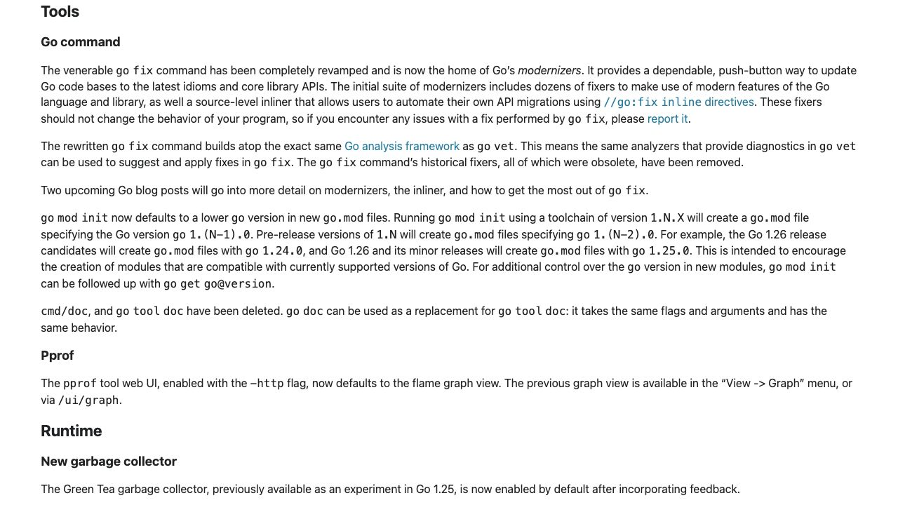
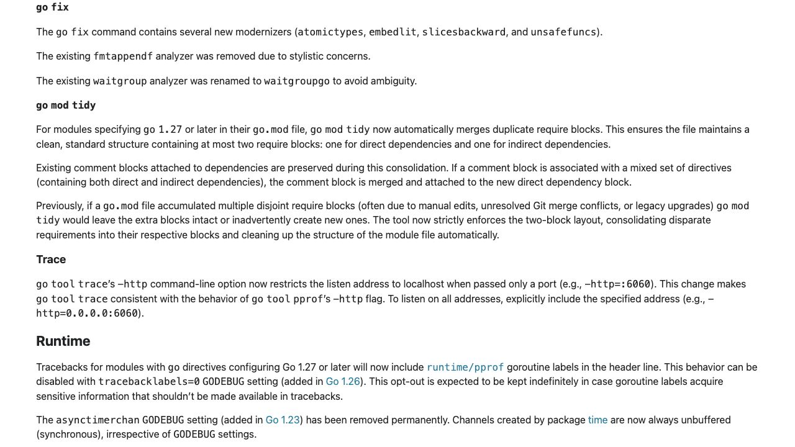

[問題へ戻る](README.md) | [カテゴリの調べ方](../../README.md)

# 調査・回答例: リリース説明と自分のコードの差分を照合する

問題文とカテゴリ README の入口から、疑問が残った箇所を順に調べた例です。唯一の正解ルートではありません。先に問題を解き、資料から何を読み取ったかを比べるために使ってください。

画面は 2026-10-02 に実際のページを撮影したものです。本文・ソース・実行結果は 2026-10-13 に再確認しました。画面に写る範囲と、その後本文や手元で確認した範囲を分けて記します。実測は Go 1.27.1 / darwin/arm64 です。

## 設問 1: 刷新された版から位置づけを読む

問題が Go 1.26 の変更を明示しているので、問題の「調査の入り口」にある [Go 1.26 リリースノート](https://go.dev/doc/go1.26#go-command) の `go fix` を読む。

**解釈。** modernizer と自作 API 移行用の inliner が導入され、古い fixer 群は削除された。`go vet` と同じ解析基盤を使うという説明だけでは両者の役割が同じとは言えないため、問題の入口の [解説記事](https://go.dev/blog/gofix) の “The Go analysis framework” へ進んだ。vet は間違いらしい箇所を診断し、fix は適用可能な修正を行う、という違いまで確認する。

**出典を一段深く読む。** カテゴリのリリースノート調査の案内に従い HTML の関連番号を確認すると [#75432](https://github.com/golang/go/issues/75432) がある。本文と全 10 コメントでは、構造化された標準出力が標準エラーと混ざる問題、出力ファイル経由で分離する変更、fix/vet 統合の CL がつながっていた。これは基盤統合の裏付けであり、個々の modernizer の安全性を保証する証明とは読まない。

**版の違いを確認。** 次に [Go 1.27](https://go.dev/doc/go1.27#go-fix) の同じコマンドを読む。

記事の古い一覧をそのまま使わず、追加、`fmtappendf` の削除、`waitgroupgo` への改名を確認した。HTML で見つけた [#77581](https://github.com/golang/go/issues/77581) の本文と全 3 コメントでは、周辺文脈を含めるとより適した変更があること、可読性との兼ね合い、無効化する変更が読めた。「短くなる置き換えはすべて望ましい」とは言い切れない例になっている。

---

## 設問 2: 一覧・選択・差分を一つずつ確かめる

**操作の根拠。** 記事の “Running go fix” に一覧と個別ヘルプ、`-diff` が案内されている。そこで `go tool fix help` で手元の一覧を取得し、目的の analyzer を選んで個別ヘルプを読む。特定のものだけなら `-名前`、一部だけ除外するなら `-名前=false` という指定を確認した。

問題の `main.go` を別ディレクトリへコピーして実行すると `0 1`、`1 2`、`2 3` が出た。`go fix -diff ./...` では `sort.Slice` から `slices.Sort`、添字ループから `range xs` への差分が表示され、終了コードは 1 だった。これは差分があったという結果であり、変更済みという意味ではない。

**深掘り。** 記事の説明と実際の一覧をつなぐため、問題の入口の [fix suite](https://cs.opensource.google/go/go/+/refs/tags/go1.27.1:src/cmd/vendor/golang.org/x/tools/go/analysis/suite/fix/fix.go) を読む。`buildtag`、`hostport`、`inline` と `modernize.Suite` が結合される。コメントには候補と却下理由もあり、診断できるものを何でも自動修正へ採用するわけではないことを確認できる。

**回答。** 版と一覧を記録し、必要な analyzer を選んで `-diff` を確認してから適用する。記事が注意するように、一度の実行は一つのビルド条件しか解析せず、修正同士の意味上の衝突もありうる。適用後はコードレビューとプロジェクトの既存テストで振る舞いを確認する。

---

## 設問 3: 「自分のテスト」の条件を実装まで読む

問題に `//go:fix inline` があるので、一覧から `go tool fix help inline` を開いた。関数に指示を付けて呼び出し側を展開する説明に加え、引数評価順を守るための制約と、対象関数自身のテストは残すという例外がある。

**まだ足りないこと。** 「自身のテスト」が名前・ファイル・パッケージのどれで決まるかは短い説明だけでは分からない。そこで問題の同梱例を使い、`go test ./...` 成功後に `go fix -inline -diff ./...` を実行した。

| 呼び出しを含む関数 | 今回の差分 |
| --- | --- |
| `TestHello`、`TestHello_withSuffix` | `Hello()` が残る |
| `BenchHello`、`ExampleHello` | `Hello()` が残る |
| `BenchmarkHello`、`TestSomethingElse` | `"hello"` へ展開される |
| `UseHello` | `"hello"` へ展開される |

予想しにくい `Bench` と `Benchmark` の違いを説明するため、[同梱版 inline.go](https://cs.opensource.google/go/go/+/refs/tags/go1.27.1:src/cmd/vendor/golang.org/x/tools/go/analysis/passes/inline/inline.go) の呼び出しの除外判定へ進む。`withinTestOf` は対象パッケージかその外部テストパッケージ（パス末尾の `_test` を除いて比較）、`_test.go`、レシーバーのない関数であることを調べ、`Test`・`Example`・`Bench` と対象名の組み合わせを判定する。Go の benchmark 自動検出と同じ判定だと推測すると間違える。

**回答と続き。** 非推奨関数のラッパーに指示を付けて移行できるが、無条件にすべての呼び出しが消えるわけではない。ここで確認した例外は Go 1.27.1 の実装である。別の版へ更新したときは同じ小さな例と差分を再確認し、期待する移行対象と残すテストを照合する。

---

[問題へ戻る](README.md)
