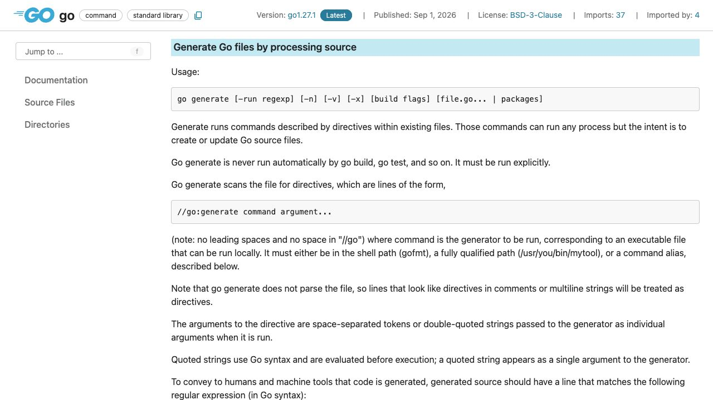
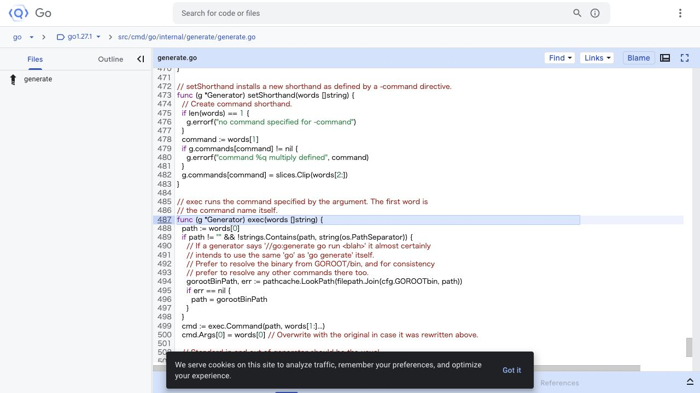

[問題へ戻る](README.md) | [カテゴリの調べ方](../../README.md)

# 調査・回答例: 任意コマンドの実行と生成の責任

問題文とカテゴリ README の入口から、疑問が残った箇所を順に調べた例です。唯一の正解ルートではありません。先に問題を解き、資料から何を読み取ったかを比べるために使ってください。

画面は 2026-10-02 に実際のページを撮影したものです。本文・ソース・実行結果は 2026-10-13 に再確認しました。画面に写る範囲と、その後本文や手元で確認した範囲を分けて記します。実測は Go 1.27.1 / darwin/arm64 です。

<a id="question-1"></a>
## 設問 1: 「生成」の名前より Usage と制約を読む

問題に書かれた `go generate` を、カテゴリの [Go Command](https://go.dev/cmd/go/) で探した。`go generate [` に続く説明には、既存のソースを走査し、特定の形式のコメントからコマンドを実行するとある。



**解釈。** 実行ファイルが PATH か指定パスに見つかればよいので、コード生成専用のプログラム名に制限されているわけではない。`go build` が自動で generate を呼ばない、という注意も一緒に読む。自由度と、自動実行されるタイミングは別の問いである。

[問題の main.go](main.go) に `go generate -n main.go` を実行するとコマンドだけを表示し、`-x` ではコマンドと実際の出力の両方を確認できた。通常出力に相当する部分は次のとおりだった。

```text
hello from go generate
darwin
arm64
GOFILE=main.go GOLINE=5 GOPACKAGE=main
-command による別名も使える
```

OS とアーキテクチャの二行は実行環境で変わる。変数の一覧は同じヘルプの環境変数の節にあり、`GOFILE`、`GOLINE`、`GOPACKAGE` をコード内の位置と対応させて読める。

---

<a id="question-2"></a>
## 設問 2: コマンド文字列がプロセスになる境界を探す

**次の疑問。** ヘルプの「実行する」はどの API なのか。カテゴリの「実装まで踏み込みたい」に従い [generate.go](https://cs.opensource.google/go/go/+/refs/tags/go1.27.1:src/cmd/go/internal/generate/generate.go) を開き、`CmdGenerate` の登録先 `runGenerate`、ファイルごとの `Generator`、ディレクティブから切り出した `words` の使用先とたどる。



**読んだ箇所。** `Generator.exec` は最初の語をコマンド名、残りを引数として `exec.Command` に渡す。画面下の続きには、標準出力・標準エラー、作業ディレクトリ `g.dir`、環境変数を設定した後の `cmd.Run()` がある。import を確認すると `exec` は `os/exec` だった。

**回答。** 任意の外部コマンドを子プロセスとして起動する。一般のシェル構文を自動で解釈する実装ではない。問題の `sh -c` が動いたのは、明示的に起動した `sh` がその引数を解釈したからだ。変数展開の処理と、シェルのパイプやリダイレクトの処理を混同しない。

---

<a id="question-3"></a>
## 設問 3: できることの広さを、設計の目的から読み直す

実装から動作は説明できたが、なぜ依存解析を持たないかは分からない。問題の入口の [提案文書](https://go.googlesource.com/proposal/+/refs/heads/master/design/go-generate.md) を、Introduction → Non-goal → Design → Discussion の順に読んだ。

Introduction はビルド前の生成処理の例を挙げ、Non-goal は汎用ビルドシステムや依存解析を目的としないとする。Discussion は、パッケージ作者が生成結果を含めて配布すれば、利用者に生成ツールやその実行環境を要求しなくて済む、と説明する。

**回答。** 作者が自由に生成ツールを選び、明示的に実行するための薄い仕組みである。「何でも実行できるから通常ビルド時に何でも自動実行させる」という読み方は、Discussion の利用者と作者の区別に反する。

**次に調べるなら。** 自分たちの生成物をコミットするか、生成ツールの版をどう固定するかを決める。これは generate 自身が解決してくれる契約ではないため、使う生成ツールの文書へ、問題で使うコマンド名を手がかりに進む。

---

[問題へ戻る](README.md)
