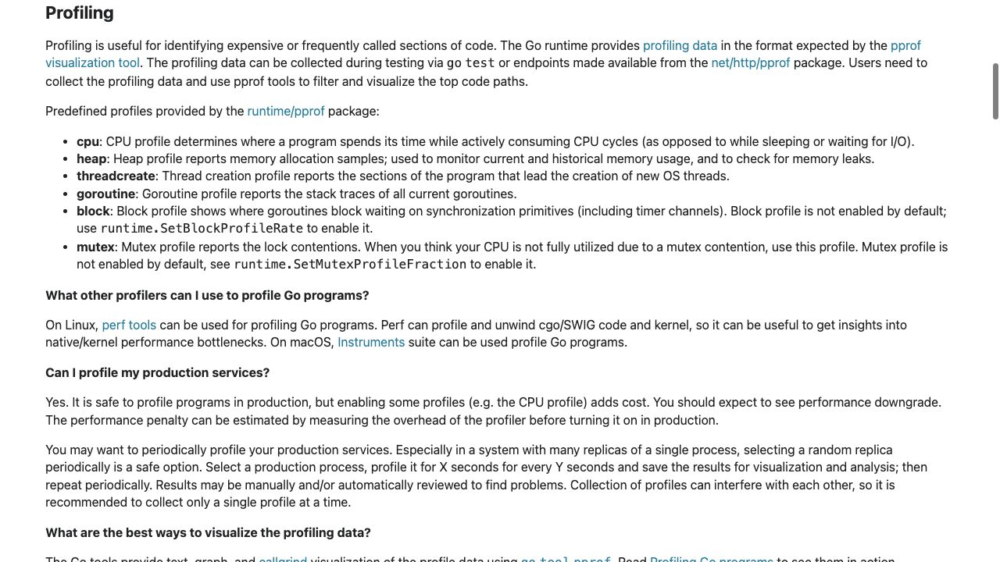
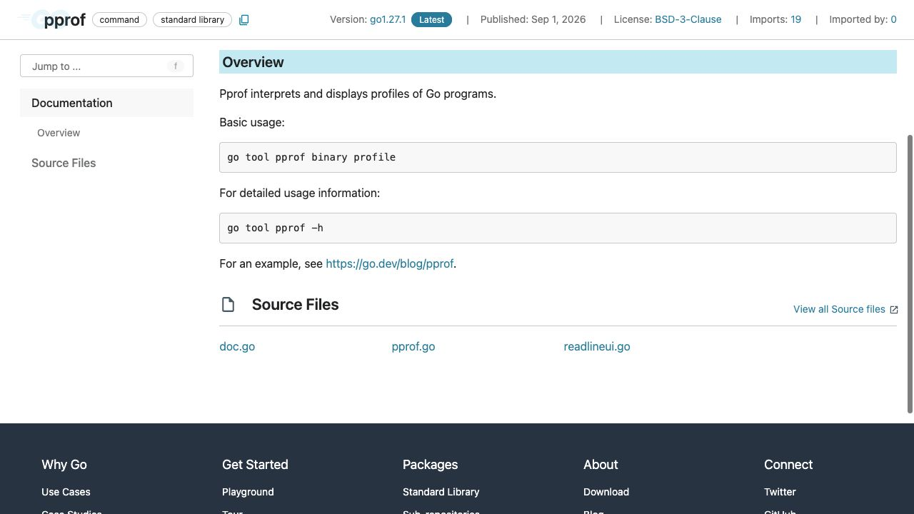

[問題へ戻る](README.md) | [カテゴリの調べ方](../../README.md)

# 調査・回答例: CPU profile から変更の根拠へ

問題文とカテゴリ README の入口から、疑問が残った箇所を順に調べた例です。唯一の正解ルートではありません。先に問題を解き、資料から何を読み取ったかを比べるために使ってください。

画面は 2026-10-02 に実際のページを撮影したものです。本文・ソース・実行結果は 2026-10-13 に再確認しました。画面に写る範囲と、その後本文や手元で確認した範囲を分けて記します。実測は Go 1.27.1 / darwin/arm64 です。

## 設問 1: 何を観測しているかを先に決める

問題は CPU 時間を使う場所を知りたいと言っている。カテゴリの [Diagnostics](https://go.dev/doc/diagnostics) で Profiling を読み、CPU profile と block・mutex などの profile の用途を比べた。

**解釈。** Profiling の `cpu` の説明は、プログラムが `actively consuming CPU cycles`、つまり CPU を使っている間を対象とし、`sleeping or waiting for I/O`、つまりスリープ中や入出力待ちと区別している。したがって、この記録からネットワーク待ちの経過時間をそのまま復元することはできない。問題の対象が CPU であることを確認した上で、入口の `go help testflag` の `-cpuprofile` を読むと、profile の保存に加えテストバイナリも残すと分かる。

[cmd/pprof](https://go.dev/cmd/pprof/) の基本形は `binary profile` だが、これだけで常にバイナリ必須とは決めない。案内された `go tool pprof -h` と、問題にある [同梱版の詳細文書](https://github.com/google/pprof/blob/92041b743c96/doc/README.md) を読み、シンボル・ソース位置・機械語を分ける。

**実測。** 問題のファイルで profile を採り、バイナリを一時的に別名へ動かして同じ profile を読んだ。`top` と `list` は今回も読めた。一方 `disasm` は対応バイナリを発見できず逆アセンブルできなかった。`-raw` の記録には関数とソース位置があり、この違いを説明できる。一般化する前に [Go 1.27.1 の proto.go](https://cs.opensource.google/go/go/+/refs/tags/go1.27.1:src/runtime/pprof/proto.go) の位置情報生成も照合した。

**回答。** この profile とソースがあれば今回の `top`・`list` は読める。対応バイナリは機械語の表示などに必要なので保存する。「いつでも不要」とは言わず、必要な表示と profile の内容で判断する。

---

## 設問 2: `top` の関数名から `list` の行別サンプルへ進む

詳細文書の “Top Functions” の表では、`flat` はその関数自身のサンプル、`cum` はその関数と呼び出し先を含むサンプルを指す。`top` の上位名 `transform` を、ヘルプで見つけた `-list` に渡した。関数の合計からソースのどの行にサンプルが付いたかへ、表示の単位を変えるためである。今回の実測では全サンプル 460ms 中、`transform` の flat は 400ms。行表示ではループの行に 100ms、更新式に flat 300ms が割り当てられていた。時間は環境・実行ごとに変わるため、問題の数値と一致することを成功条件にしない。

**読んだ結果の解釈。** これは「このループ付近に CPU サンプルが集中した」という観測である。`main.go` を読み返すと、反復ごとに次の値が更新されているため、単に回数を減らせば別の計算結果になりうる。profile はホットスポットの根拠にはなるが、出力互換性を保つ変更の根拠は与えない。

**回答。** `go tool pprof -list=transform cpu.out` で行へ降り、出力の互換性を守る改善案を考える。まだ変更していないので「速くなった」とは報告しない。

---

## 設問 3: 正しさと速さに別の証拠を用意する

問題の `main_test.go` を読み直すと、`TestTransform` は既知の結果を照合し、`BenchmarkTransform` は繰り返し実行する構造になっている。そこで問題に載る `go test -run '^$' -bench '^BenchmarkTransform$' -benchmem -count=3` を使い、計測値の揺れも残した。

**回答の書き方。** 変更前後のコードの版、Go の版・OS・CPU、同一コマンド、複数回の `ns/op`・`B/op`・`allocs/op` を記録する。テストの成功はその入力での期待値の確認で、benchmark の短縮とは別の証拠である。異なる入力すべての互換性を一つのテストから保証しない。

**深掘りする動線。** 計測後も CPU を使う場所が変わったか知りたければ、同じ採取条件で profile を取り直す。待機が支配的になったなら Diagnostics の別の profile や execution tracer の説明に戻って道具を選び直す。最初に選んだ道具を固定したまま全てを説明しようとしない。

---

[問題へ戻る](README.md)
