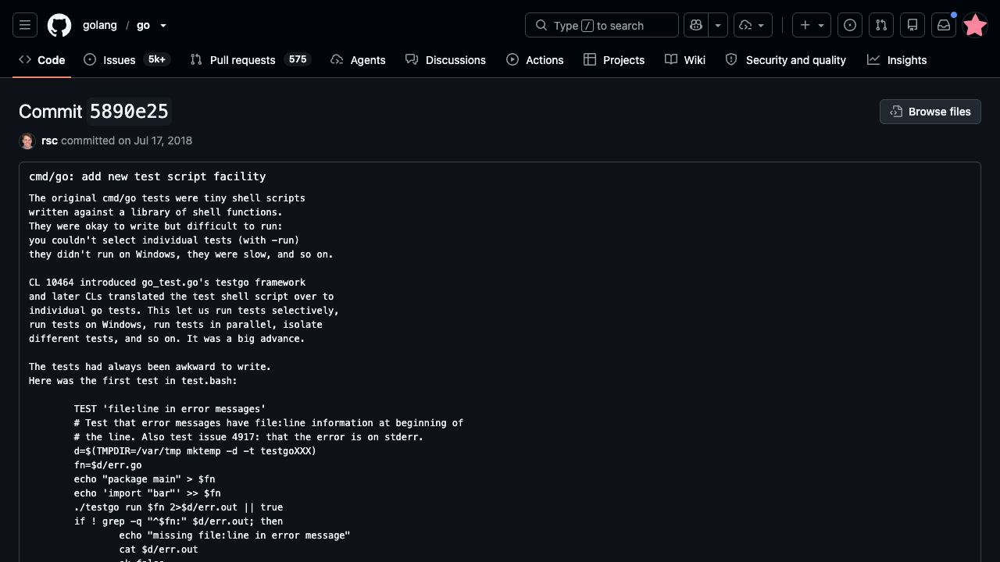
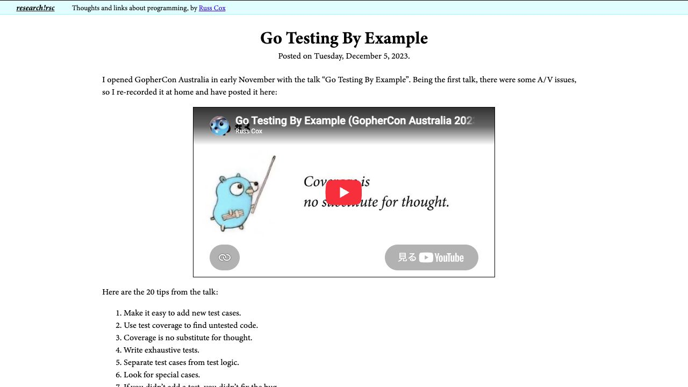

[問題へ戻る](README.md) | [カテゴリの調べ方](../../README.md)

# 調査・回答例: テキストからファイルとテストを組み立てる

問題文とカテゴリ README の入口から、疑問が残った箇所を順に調べた例です。唯一の正解ルートではありません。先に問題を解き、資料から何を読み取ったかを比べるために使ってください。

画面は 2026-10-02 に実際のページを撮影したものです。本文・ソース・実行結果は 2026-10-13 に再確認しました。画面に写る範囲と、その後本文や手元で確認した範囲を分けて記します。実測は Go 1.27.1 / darwin/arm64 です。

<a id="question-1"></a>
## 設問 1: 区切り線を誰が解釈するか

問題の入口は [Go Command](https://go.dev/cmd/go/) の Source Files。問題にファイル名 `script_test.go` と `TestScript` が提示されているので、その名前で探す。最初から外部の似たライブラリは探さず、まず今使われている runner を読む。

[Go 1.27.1 の script_test.go](https://cs.opensource.google/go/go/+/refs/tags/go1.27.1:src/cmd/go/script_test.go) では、`testdata/script/*.txt` を列挙し、拡張子を外した名前で `t.Run`、各ケースで `t.Parallel` を呼んでいた。続いて作業ディレクトリを作り、`txtar.ParseFile`、`ExtractFiles`、`scripttest.Run` と進む。

**名前の意味を呼び出し先で確認。** [txtar の Parse](https://cs.opensource.google/go/go/+/refs/tags/go1.27.1:src/internal/txtar/archive.go) は最初の区切りより前を `Archive.Comment`、以降を名前付き `Files` に分ける。[ExtractFiles](https://cs.opensource.google/go/go/+/refs/tags/go1.27.1:src/cmd/internal/script/state.go) は `Files` の内容を書き出す。一方 `scripttest.Run` へ渡す入力は `a.Comment` だった。だから上半分はファイルにならず、コマンド列として解釈される。

**実測。** 手元の Go 1.27.1 で `go test cmd/go -run '^TestScript$/^run_hello$' -count=1 -v` を実行した。抜粋すると次のとおりだった（環境変数と一時パスは省略）。

```text
=== RUN   TestScript/run_hello
> go run hello.go
[stderr]
hello world
> stderr 'hello world'
matched: hello world
--- PASS: TestScript/run_hello (0.76s)
```

単独選択できたことと、標準エラーを照合したことを、ファイル名由来の subtest 名と対応させて説明できる。問題は Go 1.27.0 を指定しているため、ここではパッチ版の異なる再確認であることも残しておく。

---

<a id="question-2"></a>
## 設問 2: 今のコードからは分からない導入理由を読む

**次の疑問。** 現在の runner だけでは、なぜこの形式を選んだかは分からない。問題が提示する [2018年の導入 commit](https://github.com/golang/go/commit/5890e25b7ccb2d2249b2f8a02ef5dbc36047868b) のメッセージを先に読み、その後に差分を見る。



旧 shell script は Windows、個別選択、実行速度などに課題があった。Go のテストへ移したことで実行上の問題は改善したが、準備コードが多く読みづらかった。新形式は短い script と txtar の読みやすさを戻し、subtest・隔離・並列実行の利点を残す、と説明されている。ここで初めて「bash に戻した」のではなく小さな専用言語を導入した理由が分かる。

次に、カテゴリの歴史表にある [Go Testing By Example](https://research.swtch.com/testing) を読む。



画面は記事の入口で、下へ続く Tip 13〜17 は txtar、既存形式を使った小さなテスト言語、parser/printer、テスト品質、script という順だった。これらは今回の設計を説明する視点になる。ただし記事は 2023 年であり、2018 年の変更の直接の原因として引用しない。導入の動機は当時の commit、読み方の整理は後年の記事、と出典を分ける。

---

<a id="question-3"></a>
## 設問 3: 形式・runner・公開範囲を分けて持ち帰る

**疑問の根拠。** 問題とソースの import に `internal` が含まれる。カテゴリの Go Command で Internal packages の説明を探すと、その親ディレクトリ以下からに import を制限する規則がある。Go 本体で使っていることだけで、自分の module から公開 API として使えるとは判断できない。

必要なのがファイルの束なら、問題の入口の [golang.org/x/tools/txtar@v0.47.0](https://pkg.go.dev/golang.org/x/tools/txtar@v0.47.0) を読む。`Archive`、`Parse`、`Format` はテキストの格納形式を扱い、[公開版 archive.go](https://cs.opensource.google/go/x/tools/+/refs/tags/v0.47.0:txtar/archive.go) を読んでもコマンドを実行する機能ではない。

script 実行も必要なら、記事と問題の両方からたどれる [rsc.io/script@v0.0.2](https://pkg.go.dev/rsc.io/script@v0.0.2) の Engine、State、scripttest を確認する。Source Files の [engine.go](https://github.com/rsc/script/blob/v0.0.2/engine.go) では Engine がコマンドと条件の表を持ち、[state.go](https://github.com/rsc/script/blob/v0.0.2/state.go) は作業ディレクトリと環境、ファイル展開を扱っていた。これは標準ライブラリではなく外部 module である。Go 本体の `cmd/internal/script` をそのまま import する案とは分け、必要なコマンドやテスト運用に合うか評価する。

**回答。** 1枚に収まるのは txtar が冒頭コメントと複数ファイルを保持するため、個別実行できるのは runner が各ファイルを subtest にするためである。保存形式だけ欲しいのか実行も欲しいのかで依存先を選ぶ。見た目が似ているだけで公開範囲や API 互換性まで同じだとは扱わない。

---

[問題へ戻る](README.md)
