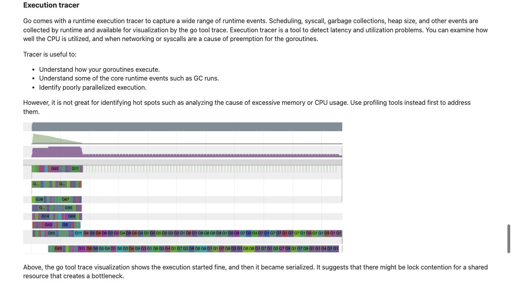
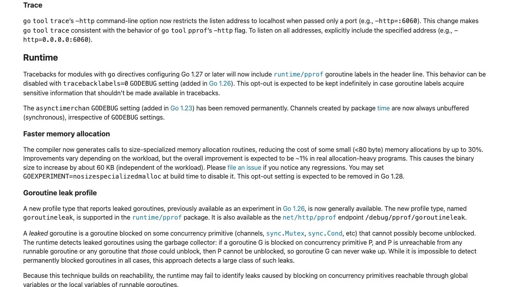

[問題へ戻る](README.md) | [カテゴリの調べ方](../../README.md)

# 調査・回答例: 待ち時間を観測し、採取の設計までたどる

問題文とカテゴリ README の入口から、疑問が残った箇所を順に調べた例です。唯一の正解ルートではありません。先に問題を解き、資料から何を読み取ったかを比べるために使ってください。

画面は 2026-10-02 に実際のページを撮影したものです。本文・ソース・実行結果は 2026-10-13 に再確認しました。画面に写る範囲と、その後本文や手元で確認した範囲を分けて記します。実測は Go 1.27.1 / darwin/arm64 です。

<a id="question-1"></a>
## 設問 1: CPU が使われていない時間は何で見るか

問題に「CPU 使用率は低い」とあるので、カテゴリの [Diagnostics](https://go.dev/doc/diagnostics) で Profiling と Execution tracer の使い分けを読む。



実行 tracer はスケジューリングや syscall、GC などの出来事を記録し、並列化がうまくいかない状況の調査にも使える。一方 CPU profile は CPU の活動を示す。次に問題が指定する [2013年の CPU profiler 記事](https://research.swtch.com/pprof) を読み、周期的なスタックの標本から処理の分布を得る考え方を確認した。

**回答。** CPU が動いている箇所の標本だけでは、ロックで待つ時間の経過を十分に説明できない。古い記事の OS ごとの実装の細部を現在の仕様として写さず、今回必要なのは実行・待機の時間関係だと整理する。`go test -trace=work.trace` はその出来事を調べる入口になる。

---

<a id="question-2"></a>
## 設問 2: 待ちを集計し、ソースへ戻る

[cmd/trace](https://go.dev/cmd/trace/) の Overview に profile へ変換する例がある。列挙された `sync` の説明は `synchronization blocking profile` であり、同期処理でブロックした時間の記録を指す。今回知りたいロック待ちはこれに対応するため、`sync` を選ぶ。

```console
go test -run '^TestProcessWork$' -trace=work.trace
go tool trace -pprof=sync work.trace > sync.pprof
go tool pprof -top sync.pprof
go tool pprof -list=processWork sync.pprof
```

**実測と解釈。** 今回は `sync.(*Mutex).Lock` に 153.46ms、`sync.(*WaitGroup).Wait` に 102.11ms の遅延が集計された。`list` で `lock.Lock()` と `wg.Wait()` の行へ対応付けた。複数 goroutine の待ちの合計なので、合計値を一回の処理の壁時計時間と同一視しない。

ソースを読み返すとロックを保持したまま `Sleep` するため、同じロックを使う処理が待つ。さらに [runtime/trace の User annotation](https://pkg.go.dev/runtime/trace@go1.27.1#hdr-User_annotation) を読むと、region の開始と終了には `same goroutine` という条件があり、一つの goroutine 内の区間を示すと分かる。task は `multiple goroutines` にまたがりうるので `context.Context` で追跡すると説明される。問題の `work` は処理全体の task、`step` は各 goroutine 内の region と対応させられる。実装の [annotation.go](https://cs.opensource.google/go/go/+/refs/tags/go1.27.1:src/runtime/trace/annotation.go) でも task ID と region 開始・終了の記録を確認する。

**回答。** `work` と `step` は処理名と区間を対応付ける手がかりである。名前を付けたことだけで待ちがなくなるのではなく、待ちの場所を元の処理のどこか説明しやすくなる。

---

<a id="question-3"></a>
## 設問 3: `FlightRecorder` が直近の記録を残す条件を読む

問題の [Go 1.21](https://go.dev/doc/go1.21) と [Go 1.22](https://go.dev/doc/go1.22) を確認し、さらに入口の [overhaul 設計文書](https://go.googlesource.com/proposal/+/refs/heads/master/design/60773-execution-tracer-overhaul.md) の Background → Goals → Partitioning → Flight recording を読む。

**解釈。** 設計文書は Go 1.21 期の採取負荷低減を背景に挙げ、従来は全体を解析しないと扱えないことを課題とする。Go 1.22 のリリース説明は定期的な分割とストリーミング可能な形式、syscall の全期間などを確認できる。独立して扱える区切りがあるなら直近の区間を保持し、遅延を検知した時点で保存する、という次の使い道につながる。

[flight recorder の提案 #63185](https://github.com/golang/go/issues/63185) と現在の [FlightRecorder](https://pkg.go.dev/runtime/trace@go1.27.1#FlightRecorder) は時点を分けて読む。設計文書のスケッチにある `TakeSnapshot` を現在の API 名としては使わない。現在の型の説明にある `moving window` は、常に直近の実行記録を保持する、時間とともに動く範囲である。`Start` は記録を開始し、`WriteTo` は保持中の範囲をスナップショットとして書き出す。後者は recorder が非稼働ならエラーになるとも書かれている。この役割分担から、遅延を検知してから過去を取得したい場合は、検知前に `Start` しておく必要があると分かる。[flightrecorder.go](https://cs.opensource.google/go/go/+/refs/tags/go1.27.1:src/runtime/trace/flightrecorder.go) の保持領域・設定・書き出しも照合した。

**まだ言えないこと。** ファイル形式が分割可能でも、すべての viewer が一定のメモリ使用量になるとは限らない。[cmd/trace の main.go](https://cs.opensource.google/go/go/+/refs/tags/go1.27.1:src/cmd/trace/main.go) で `parseTrace` を読むと、イベントを読みながら `events` に蓄積している。形式の能力とツールの実装を分けて答える。

**回答。** 検知後に通常採取を開始しても、過去の待ちを復元できない。事前から直近の記録を保持する運用を設計する。許容する保持量や期間、採取の負荷は対象サービスで確かめる必要がある。

---

<a id="question-4"></a>
## 設問 4: listen の変更を版と一緒に読む

カテゴリの版の調べ方に戻り、[Go 1.27 の Trace](https://go.dev/doc/go1.27#trace) を読む。



変更の対象は `-http` の listen address で、条件は `when passed only a port`（ポートだけを渡した場合）である。例の `-http=:6060` には host 部分がないので、この条件に当たり、Go 1.27 では localhost に制限される。問題の実測は 1.27.0、今回の再確認は 1.27.1 で、いずれも変更後の版である。変更前の版でも同じ意味だったとは推測しない。

HTML で見つけた [#78921](https://github.com/golang/go/issues/78921) の本文と全 4 コメントを読むと、以前は省略された host が全アドレスでの listen を意味し、Windows で開く URL が機能しない報告、localhost を選ぶ変更につながっていた。ここで変更前後の説明を確認できる。

**回答。** 手元だけに見せるなら `-http=localhost:6060` と対象を明示する。Go 1.27 では `-http=:6060` も localhost だが、版をまたぐ手順では明示した方が読み違えにくい。全アドレスで公開する必要があるときは `-http=0.0.0.0:6060` のように明示する。今回は公開する server は起動せず、文書・Issue・同じ版の実装で指定の意味を確認した。

---

[問題へ戻る](README.md)
