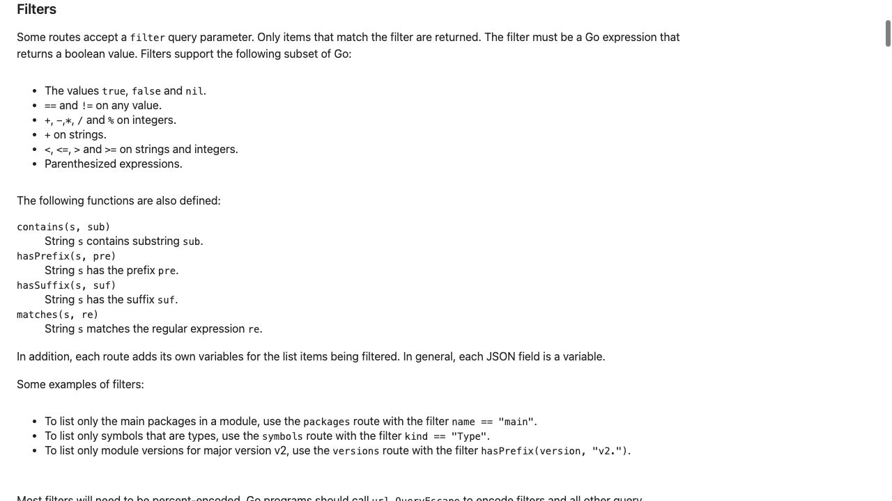
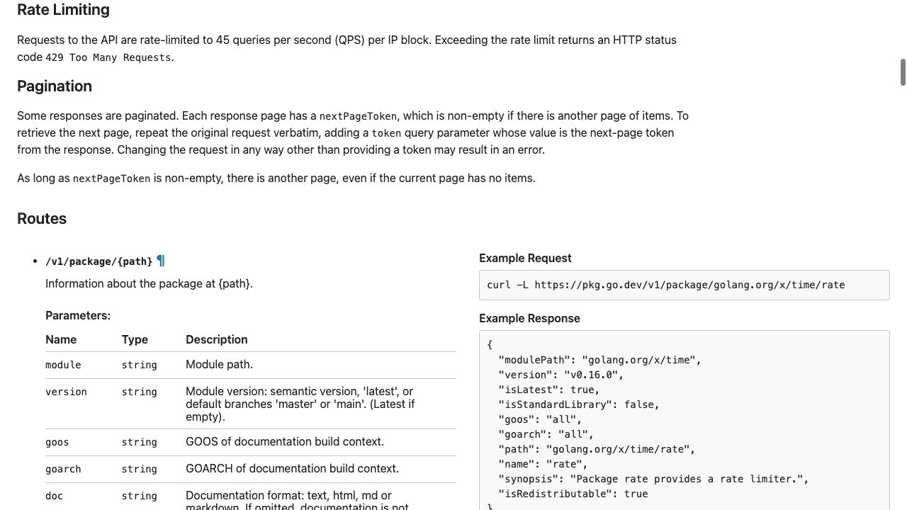

[問題へ戻る](README.md) | [カテゴリの調べ方](../../README.md)

# 調査・回答例: API の契約と設計理由を分けて読む

問題文とカテゴリ README の入口から、疑問が残った箇所を順に調べた例です。唯一の正解ルートではありません。先に問題を解き、資料から何を読み取ったかを比べるために使ってください。

画面は 2026-10-02 に実際のページを撮影したものです。本文・ソース・実行結果は 2026-10-13 に再確認しました。画面に写る範囲と、その後本文や手元で確認した範囲を分けて記します。実測は Go 1.27.1 / darwin/arm64 です。

## 設問 1: パラメータの表だけで判断しない

問題の「調査の入り口」にある [Go Documentation](https://go.dev/doc/) → Packages → Docs → [API](https://pkg.go.dev/v1/api) と進む。問題にある `/v1/search` を本文から探し、説明と Parameters の両方を読む。

**分かったこと。** 検索は一致度順と説明され、`q`、`symbol`、`limit`、`token`、`filter` の表に任意のソート指定はない。ただし、この事実だけから「性能のため採用しなかった」などの設計者の理由までは確定できない。

`filter` は表に古い “regular expression” という表現も残る一方、共通の Filters 節では `Go expression` に `boolean value` を返すことを要求し、その後に対応する演算子と関数を列挙している。つまり列挙された Go 式の部分集合を使い、各項目を残すかどうかを真偽値で判定するという契約である。`matches` が式の中で使える関数であることも読むと、「フィルター全体が生の正規表現」とは異なることが分かる。問題の `hasPrefix(packagePath, "github.com")` による問い合わせを実行し、結果あり・全件が GitHub のパスという二条件がともに true だった。

**解釈と回答。** 実際の契約を述べるなら「式が true になる結果だけを残し、一致度順で返す」。自分の一覧を別の基準で比較する案は立てられるが、未提供のソート機能や Go 式を選んだ作者の理由は、この API 文書だけから断定しない。理由を確定したいときは、問題のソース入口から関連実装とその履歴へ進むという次の問いが残る。

---

## 設問 2: パスを文字列の見た目だけで決めない

前の文書の共通説明に Package paths are ambiguous とある。これはすべての問い合わせが失敗するという意味ではない。`a/b/c` が module `a/b` 内の `c` にも、module `a` 内の `b/c` にもなりうる例を、module と package の境界の問題として読む。

通常例 `golang.org/x/time/rate` は module `golang.org/x/time` として返った。問題にある曖昧な `github.com/hashicorp/consul/api` では HTTP 400 と、`github.com/hashicorp/consul/api`、`github.com/hashicorp/consul` の二候補が返った。JSON の候補一覧だけでなくステータスも確認することで、通常の成功応答と取り違えない。

**回答。** エラーと候補を返す説明には `If both exist`（両方が存在する場合）という条件がある。パスを分解する可能性だけでなく、複数候補が実在するときに選択が必要になる。文書の指示は `module` パラメータを付けて再問い合わせすること。UI は最長の一致 module を選ぶが、API は候補を返して選択を求める。今回の例で確かめた挙動と、その理由になるパスの構造を別々に説明できる。

**続きの動線。** module とは何かがまだ曖昧なら、問題の [Go Modules Reference](https://go.dev/ref/mod) に戻り、module path と package path の定義を読む。特定のライブラリ名を検索するより先に、曖昧になる単位を理解する。

---

## 設問 3: ページの件数と終端条件を分ける

**読んだ箇所。** 45 QPS は IP block 単位の制限で、超過時は 429。Pagination は `nextPageToken` が空でなければ続きがあること、元の条件を変えず `token` だけ追加することを指定する。本文は `nextPageToken` に対する `non-empty` を条件とし、`no items` のページにも続きがありうると明記する。つまり判定対象は取得件数ではなくトークンである。問題の繰り返し処理も `items` の件数を終了条件にすると、途中で止まる可能性がある。

問題の `limit=1` を実行すると、`items` は 1、`hasNext` は true だった。この小さな応答から、全件が1件だとは判断できない。

**次の疑問。** トークンは数値のページ番号か。API 文書の Response から [internal/api](https://pkg.go.dev/golang.org/x/pkgsite/internal/api) の型を開き、そこにリンクされた [v0.6.0 の api.go](https://cs.opensource.google/go/x/pkgsite/+/refs/tags/v0.6.0:internal/api/api.go) と [params.go](https://cs.opensource.google/go/x/pkgsite/+/refs/tags/v0.6.0:internal/api/params.go) へ進む。`pageParams` と `paginate` には offset を符号化したトークン、imported-by の処理には次のパスを符号化したトークンがある。同じ名前のトークンでも route によって実装は異なる。呼び出し側で値を作るより、返却値をそのまま引き継ぐべきだと理解できる。

**回答。** 利用側はトークンを再開位置のための不透明な値として扱い、空になるまで元の条件のまま進む。内部の符号化形式を恒久 API として使わない。負荷を制御し大量結果を分割できるという利点は説明できるが、なぜ数値がちょうど 45 なのかはこの文書に根拠がないため未確認とする。

---

## 設問 4: 除外条件と人気の解釈を区別する

`/v1/imported-by/{path}` の説明では、返す対象は `packages importing`、つまり指定したパッケージを import する側のパッケージである。続く `not including` の除外対象は、指定したパッケージと同じ module に属するものだと読む。問題の問い合わせでは最初のページは 100 件、そのうち `golang.org/x/time/` から始まるものは 0 件、次ページありだった。

**解釈。** この実測は最初のページの確認にすぎない。一方、全体への除外条件は API の仕様に書かれている。件数を「利用者の人数」や「採用企業数」と読み替えてはいけない。インポート元パッケージという計測単位を保つ。

**回答と残る問い。** 同一 module 内部の参照を外した一覧なので、外部からの依存を調べる目的には合う。ただし「人気を水増しさせないために設計された」という作者の意図は、この説明だけでは確定できない。確定事実と利用者としての解釈を区別して報告し、さらに理由が必要なら `imported-by` の処理と関連する変更履歴へ進む。

---

[問題へ戻る](README.md)
