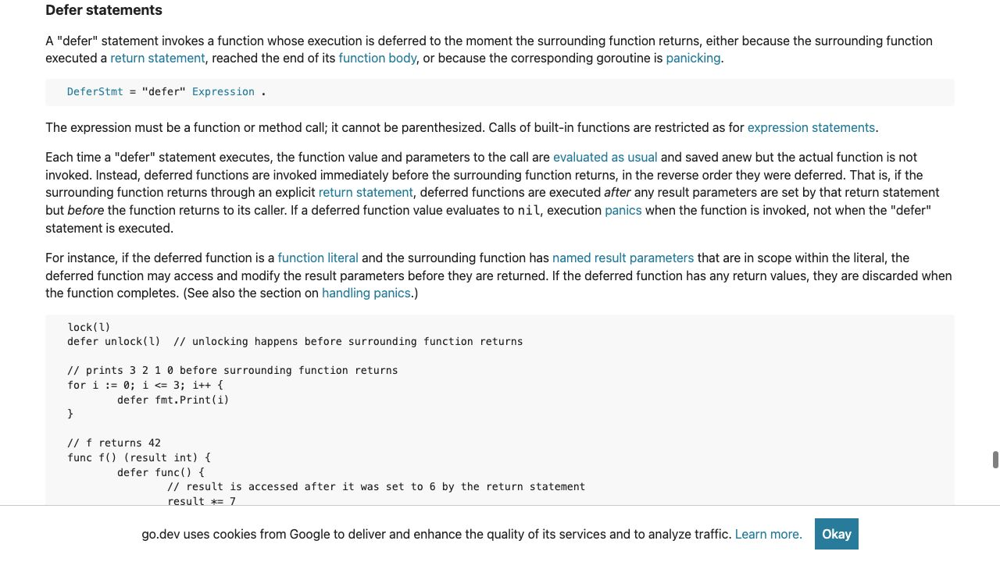
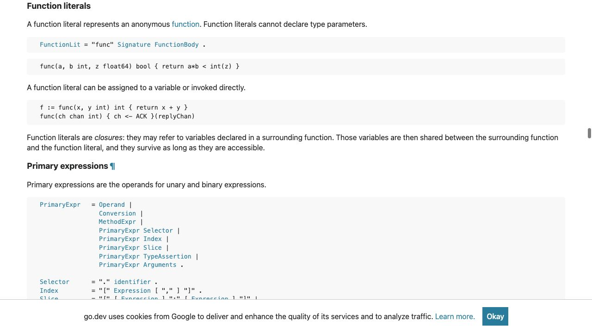

[問題へ戻る](README.md) | [カテゴリの調べ方](../../README.md) | [調査例の一覧](../../../RESEARCH_GUIDE.md)

# 調査・回答例: 引数を保存する時点と、関数を呼ぶ時点を分ける

問題文とカテゴリ README に見えている情報を出発点に、資料のどこを読み、どう解釈して次へ進むかを示します。問題のヒント・答えを検索語の出所にはしていません。唯一の正解ルートではありません。

画面は 2026-10-02 の調査時に取得したものです。本文と実行結果は 2026-10-13 に再確認しました。原文の語句と識別子に沿う読解補足は、2026-10-14 に一次資料を再取得して確認しました。画面の一部だけで判断せず、リンク先の本文と対象版の実装も読みます。実行環境は Go 1.27.1 / darwin/arm64。実装を Go 1.27.0 に固定している箇所は、問題で指定された版の調査です。

## 最初に分かっていること

問題にある名前は `defer`、`status`、`fmt.Println` です。出力は二つの違いを含みます。値が違うことと、表示順が逆になることです。この二つを一度に推測せず、問題の「調査の入り口」に書かれた `Defer statements` を [言語仕様](https://go.dev/ref/spec#Defer_statements) で探します。

<a id="question-1"></a>

## 設問 1: 引数を評価する時点と、関数を呼ぶ時点を分けて読む

Defer statements の冒頭では、`whose` は直前の `function` を受けています。その関数の `execution`（実行）が `deferred`（後に延ばされる）のであって、defer 文そのものの実行が後になる、という説明ではありません。延ばす先は周囲の関数が戻る時点です。ただし、これだけでは引数を読む時点までは決まりません。

そこで `Each time` で始まる段落を読みます。時点は「defer 文が実行されるたび」で、評価・保存の対象は `function value`（呼び出す関数の値）と `parameters`（呼び出しに渡す引数）です。`evaluated as usual` は通常の呼び出しと同じようにその場で評価すること、`saved anew` はそのたびに評価結果を保存することです。続く `but` の後では対象が `actual function` に変わり、`not invoked` は関数の実際の呼び出しはまだ行わない、という意味です。**今行う評価・保存と、後で行う呼び出しを分けた規則**として読みます。



画面の中央にある段落をコードへ当てはめます。最初の `defer` 文に到達した時点の `status` は `started` なので、その値が `fmt.Println` の引数として保存されます。後の代入が変更するのは変数 `status` です。すでに保存した引数を、関数終了時に読み直すという規則ではありません。

**回答例:** `defer` 文の実行時に引数が評価・保存され、関数を呼ぶのは周囲の関数が戻る直前です。そのため、直接渡した引数には代入前の `started` が残ります。

ここで残る疑問は「無名関数の中にも `status` があるのに、なぜ同じ結果ではないのか」です。仕様のこの段落には `function literal` へのリンクがあります。問題の「無名関数」と結び付けて、そこへ進みます。

<a id="question-2"></a>

## 設問 2: 外の変数を共有する規則と、逆順の規則を合わせる

[Function literals](https://go.dev/ref/spec#Function_literals) の末尾の文では、`Those variables` が直前の「周囲の関数で宣言された変数」を指し、それを `shared`（共有される）と説明しています。共有する対象は変数そのもので、関数リテラルを作った時点の値のコピーではありません。



この無名関数には引数がありません。`fmt.Println` と `status` の読み取りは無名関数の本体の中です。その本体が動くときには、外側で `status = "completed"` が済んでいます。

順番は先ほどの Defer statements に戻ります。`reverse order` は、後に defer された関数から先に呼び出すという意味です。そのため、後で登録した無名関数が先、直接の `fmt.Println` が後です。これは、無名関数だから優先されたという規則ではありません。

[問題のコード](https://go.dev/play/p/XEEZ1ax4se2) を `go run` した結果も、二つの規則から導いた順序と値になりました。

```text
closure: completed
direct: started
```

**回答例:** 無名関数は共有された `status` を実行時に読み、変更後の値を表示します。また `defer` の呼び出し順は逆順なので、無名関数のログが先に出ます。

## さらに調べるなら

[問題に挙がっている公式記事](https://go.dev/blog/defer-panic-and-recover) では、引数の評価、逆順、名前付き戻り値という三つの規則が並びます。次の疑問を「戻り値も外の変数として読めるか」に絞り、記事の例と仕様の名前付き戻り値の段落を照合できます。今回のログの結果だけでは、panic 中の動作まで検証したことにはなりません。
