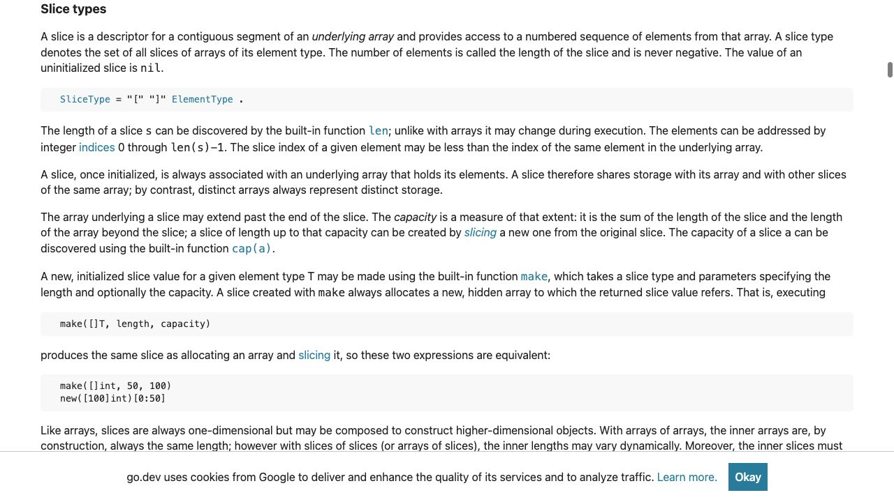
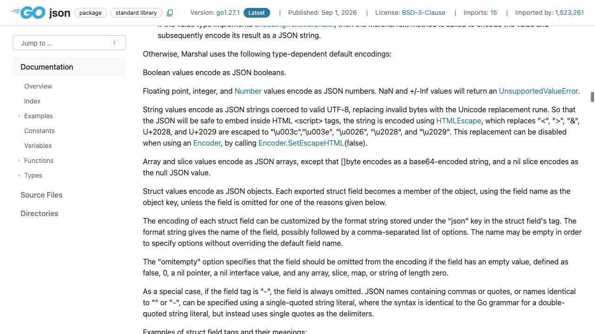

[問題へ戻る](README.md) | [カテゴリの調べ方](../../README.md) | [調査例の一覧](../../../RESEARCH_GUIDE.md)

# 調査・回答例: 空に見える値を、言語と JSON の二段階で読む

問題文とカテゴリ README に見えている情報を出発点に、資料のどこを読み、どう解釈して次へ進むかを示します。問題のヒント・答えを検索語の出所にはしていません。唯一の正解ルートではありません。

画面は 2026-10-02 の調査時に取得したものです。本文と実行結果は 2026-10-13 に再確認しました。画面の一部だけで判断せず、リンク先の本文と対象版の実装も読みます。実行環境は Go 1.27.1 / darwin/arm64。実装を Go 1.27.0 に固定している箇所は、問題で指定された版の調査です。

## 最初に分かっていること

問題は `len` が同じ二つの値から `null` と `[]` が出る、という観測です。「長さ 0 なら同じ値」とは決めず、問題の「調査の入り口」にある [Slice types](https://go.dev/ref/spec#Slice_types) を読みます。

<a id="question-1"></a>

## 設問 1: 長さの説明だけで読み終えない

冒頭の段落には、初期化していないスライスの値は `nil` とあります。その下には長さ、背後の配列、容量の説明が続きます。長さはスライスの一つの性質であり、長さだけで `nil` かどうかは決まりません。



`response{}` はフィールドに値を指定していません。仕様の [Composite literals](https://go.dev/ref/spec#Composite_literals) に進むと、省略した構造体フィールドはゼロ値、空のスライスリテラルは初期化された空スライスだと確かめられます。これで、問題の二つの値の区別は説明できます。**JSON の文字列は言語仕様だけではまだ説明できません。**

次は問題の import に書かれた `encoding/json` を、カテゴリの「標準パッケージ一覧」から開きます。`f` の移動先に指定する語も、コードにある `Marshal` です。[Marshal](https://pkg.go.dev/encoding/json@go1.27.1#Marshal) の型ごとの規則で、通常のスライスと `nil` スライスの例外を一緒に読みます。



撮影時の説明は、スライスを配列へ変換する規則に続いて `nil` を `null` にする例外を示しています。2026-10-13 のドキュメントでは構成や宣言リンクが変わっていますが、`encoding/json` の互換動作として同じ区別を確認しました。

宣言リンクから読んだ [Go 1.27.1 の v2_encode.go](https://cs.opensource.google/go/go/+/refs/tags/go1.27.1:src/encoding/json/v2_encode.go) は、`Marshal` を `jsonv2.Marshal` と `DefaultOptionsV1()` へ渡しています。問題の版の [Go 1.27.0 の encode.go](https://cs.opensource.google/go/go/+/refs/tags/go1.27.0:src/encoding/json/encode.go) では、`sliceEncoder.encode` が `IsNil` を先に判定し、そうでなければ配列用のエンコーダーへ進みます。なお、この `encode.go` は `!goexperiment.jsonv2` という条件付きの実装です。現在の宣言先からは [v2_options.go](https://cs.opensource.google/go/go/+/refs/tags/go1.27.1:src/encoding/json/v2_options.go) の `DefaultOptionsV1` も読み、nil スライスを null とする V1 互換オプションを確かめました。公開契約と、版・ビルド条件で分かれる実装経路は区別して読みます。

**回答例:** `nil` スライスと、初期化された長さ 0 のスライスは違う値です。`Marshal` は前者を `null`、後者を要素数 0 の JSON 配列 `[]` にします。

<a id="question-2"></a>

## 設問 2: 「フィールドを消す」と「空配列を入れる」を区別する

画面の `omitempty` の段落を読むと、長さ 0 のスライスはフィールドを省略する条件に入っています。問題の契約は `values` を残すことなので、この設定は目的に合いません。

そこで問題に既にある二つ目の組み立て方、`Values: []string{}` を採用します。`nil` が入る可能性のある結果をそのまま渡さず、返却時に非 `nil` の空スライスとして用意する、という意図です。`[]byte` などの別の型には特別な規則もあるため、今回の `[]string` から無条件に一般化しません。

[問題のコード](https://go.dev/play/p/jz0RLXHZtWU) を `go run` した結果です。

```text
nil: {"values":null}
empty: {"values":[]}
```

**回答例:** フィールドを省略せず、非 `nil` の空の `[]string` を設定してレスポンスを作ります。`omitempty` では空配列を残す契約を満たせません。

## さらに調べるなら

次の疑問は「ほかの型の空の値も同じか」です。Marshal の型ごとの規則で、今回実際に見えた `[]byte` の例外、map、ポインターへ範囲を広げられます。また宣言リンク先の実装が違って見えたら、ファイル先頭のビルド条件と版を先に確認します。ファイル名の違いだけで公開 API の意味が変わったとは判断しません。
