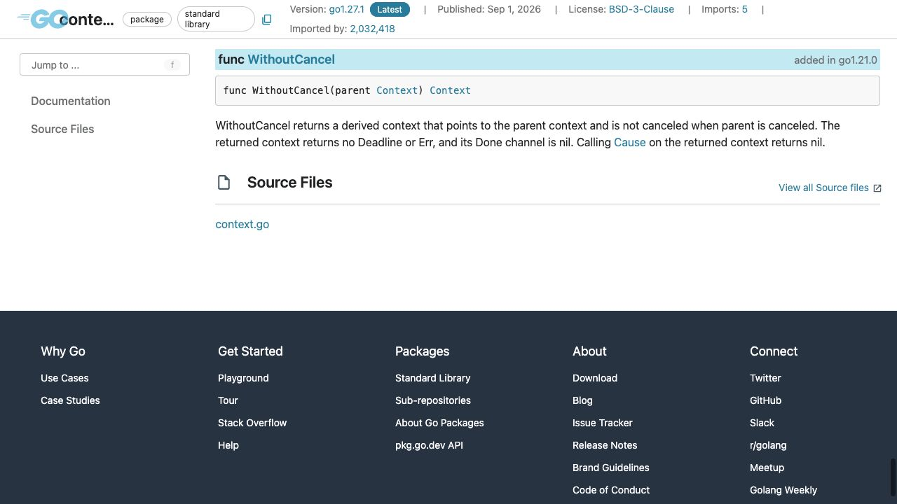
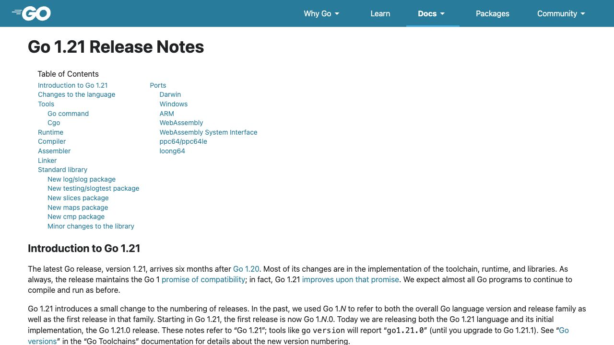

[問題へ戻る](README.md) | [カテゴリの調べ方](../../README.md) | [調査例の一覧](../../../RESEARCH_GUIDE.md)

# 調査・回答例: 値の継承とキャンセルの継承を切り分ける

問題文とカテゴリ README に見えている情報を出発点に、資料のどこを読み、どう解釈して次へ進むかを示します。問題のヒント・答えを検索語の出所にはしていません。唯一の正解ルートではありません。

画面は 2026-10-02 の調査時に取得したものです。本文と実行結果は 2026-10-13 に再確認しました。原文の語句と識別子に沿う読解補足は、2026-10-14 に一次資料を再取得して確認しました。画面の一部だけで判断せず、リンク先の本文と対象版の実装も読みます。実行環境は Go 1.27.1 / darwin/arm64。実装を Go 1.27.0 に固定している箇所は、問題で指定された版の調査です。

## 最初に分かっていること

問題の条件は、値を残す、親のキャンセルで止めない、独自の期限では止める、の三つです。コードにある `WithoutCancel` を、カテゴリの「標準ライブラリの契約を読む」に従って [context](https://pkg.go.dev/context@go1.27.1#WithoutCancel) の `f` で探します。名前だけから「キャンセルの一部分だけを取り消す」とは判断しません。

<a id="question-1"></a>

## 設問 1: 説明に列挙されたメソッドを一つずつ読む



説明の `The returned context` は親ではなく、WithoutCancel が返す派生 context を指します。親をキャンセルしてもその派生側は取り消されず、`no Deadline or Err` は派生側に期限もエラーもないという意味です。さらに `its Done channel is nil` の `its` も派生側を指すので、親の Done が閉じるかどうかとは分けて読みます。`Cause` を派生側で呼んだ結果も nil と明記されています。`Done` は「まだ閉じていないチャンネル」ではなく、`nil` そのものです。

値の継承を確かめるため、宣言から [context.go](https://cs.opensource.google/go/go/+/refs/tags/go1.27.0:src/context/context.go) を開きます。`withoutCancelCtx` は親を保持し、`Deadline`、`Done`、`Err` のメソッドはキャンセル情報を返しません。`Value` は `value(c, key)` を呼び、その `case withoutCancelCtx` 内の `c = ctx.c` により、保存していた親へ探索を続けます。問題の `markerKey{}` の値を親から取り出せる根拠はこの分岐です。ただしキャンセル原因の内部キーについては `nil` にする分岐があります。「すべてを複製する」のではなく、必要な情報の伝え方を変えるラッパーとして読めます。

**回答例:** `markerKey{}` に対応する値を親から取得できますが、親のキャンセルと期限を継承しません。`Deadline` の有無は false、`Done` と `Err` は nil です。

背景を知る入口は問題に示された [Go 1.21 のリリースノート](https://go.dev/doc/go1.21#contextpkgcontext) です。撮影した次の画面は版を確認するための冒頭で、API の根拠は上の説明画面とリンク先の context 節です。



カテゴリの HTML コメントの読み方に従うと、context 節の `WithoutCancel` の直前に `40221` が見つかります。[Issue #40221](https://github.com/golang/go/issues/40221) の本文と全 58 コメントを読み、値を失う `Background` への置き換え、タスク API を別に設ける案、値の寿命の問題、命名、採用、実装 CL の順を確認しました。[命名の説明](https://github.com/golang/go/issues/40221#issuecomment-1398365853) は、親との差分を名前に表す、という読み方を支えます。これは Go 1.21 追加の機能であり、Go 1.27 の新機能ではありません。

<a id="question-2"></a>

## 設問 2: 切り離した後に、誰が止めるのかを決める

問題に既にある `WithTimeout` を同じパッケージで調べます。[WithTimeout](https://pkg.go.dev/context@go1.27.1#WithTimeout) の冒頭には `WithDeadline(parent, time.Now().Add(timeout))` とあります。`time.Now()` に `timeout` を足すので、ここで新しい期限を付けると読めます。続く `releases resources` はキャンセル時に関連資源を解放する意味で、例の `defer cancel()` は処理が期限より早く終わった場合にも解放するためです。

したがって、先に `WithoutCancel(parent)`、その結果に `WithTimeout` を適用します。順を逆にすると、付けた期限まで WithoutCancel で取り除くことになるため、要件を満たしません。返された `stop` は処理終了時に呼びます。

`nil` の `Done` の影響は、カテゴリから言語仕様へ移り [Select statements](https://go.dev/ref/spec#Select_statements) で確認します。`never proceed` は nil チャンネルでの通信が「決して進行しない」という意味です。そのため、その受信ケースが親のキャンセルによって選ばれることはありません。直接受信だけで待てば止まったままになります。

**回答例:** 切り離した context に独自の `WithTimeout` を重ねます。処理側もその `Done` や API のキャンセル契約に従う必要があります。context を作るだけで任意の処理を強制停止する仕組みではありません。

<a id="question-3"></a>

## 設問 3: 二つの停止条件を別々に観測する

[問題のコード](https://go.dev/play/p/r-de7RWWAPE) を `go run` した結果です。

```text
parent: context canceled
detached: <nil>
value: kept
detached has deadline: false
detached Done is nil: true
limited: context deadline exceeded
```

前半では、親を明示的にキャンセルしても派生側の `Err` は nil で、値は `kept` のままです。後半では、派生側に付けた期限により `Done` が閉じて `DeadlineExceeded` になります。どちらか一方の成功だけでは三つの要件を確認できません。

**回答例:** 親のキャンセル後にも値を取得でき派生側が取り消されないことと、独自の期限では派生側が取り消されることを検証します。この小さな実測は実際の処理全体や完了の保証まで検証したものではありません。

## さらに調べるなら

Issue の [値の寿命の議論](https://github.com/golang/go/issues/40221#issuecomment-660131164) では、親の処理終了時に閉じるトレース等も話題になります。次は「取り出せる値が、処理終了後も利用可能な資源か」を個々のライブラリの契約で確認できます。今回の文字列値を取得できたという結果から、すべての値の寿命が延長されるとは言えません。
