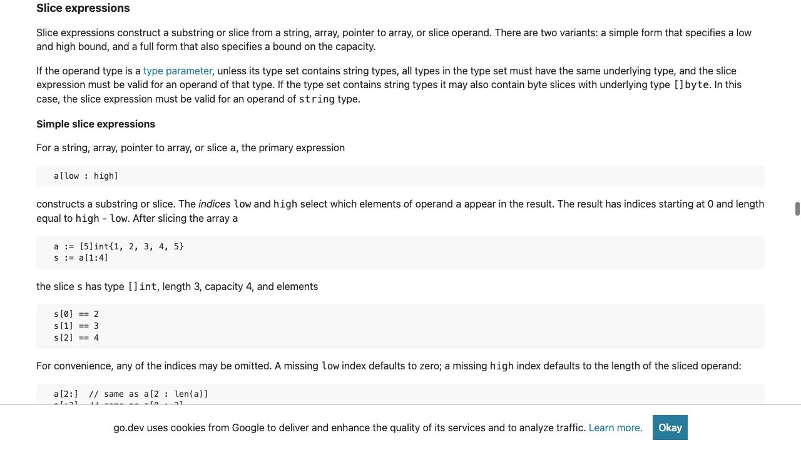
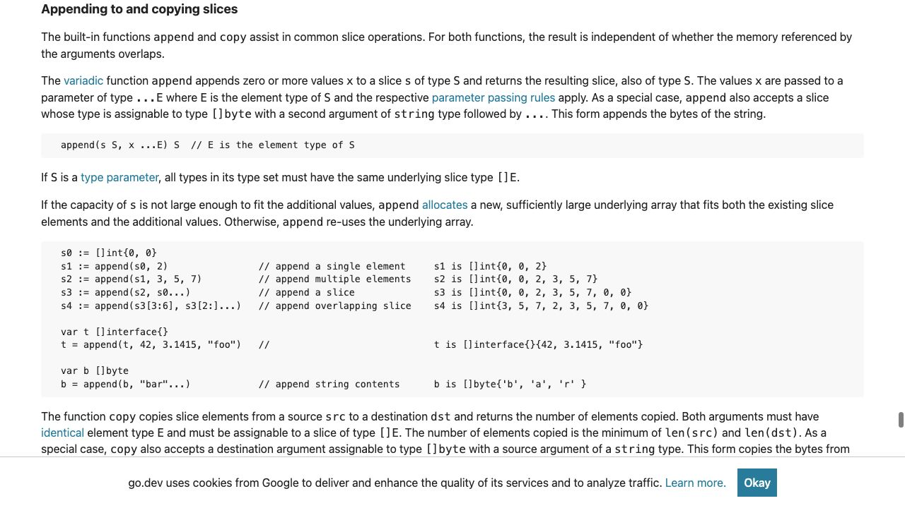

[問題へ戻る](README.md) | [カテゴリの調べ方](../../README.md) | [調査例の一覧](../../../RESEARCH_GUIDE.md)

# 調査・回答例: 長さ・容量・共有を別々に確認する

問題文とカテゴリ README に見えている情報を出発点に、資料のどこを読み、どう解釈して次へ進むかを示します。問題のヒント・答えを検索語の出所にはしていません。唯一の正解ルートではありません。

画面は 2026-10-02 の調査時に取得したものです。本文と実行結果は 2026-10-13 に再確認しました。画面の一部だけで判断せず、リンク先の本文と対象版の実装も読みます。実行環境は Go 1.27.1 / darwin/arm64。実装を Go 1.27.0 に固定している箇所は、問題で指定された版の調査です。

## 最初に分かっていること

問題の二つの違いは `[:2]` と `[:2:2]` です。問題の「調査の入り口」にある [Slice expressions](https://go.dev/ref/spec#Slice_expressions) を開き、「二つの形式があり、完全な形式では容量の上限も指定する」という導入を読みます。ここで初めて三つ目の添字を容量と結び付けます。



<a id="question-1"></a>

## 設問 1: 切り出した直後と、追加した後を分ける

単純なスライス式の説明を続けて読むと、結果は元の配列と記憶域を共有し、容量は元の容量から下限を引いた値になるとあります。今回の `shared` は要素が 3 個で、下限は省略した 0。`view` は長さ 2、容量 3 です。「先頭 2 要素を見る」という操作から、コピーされた別の配列だとは言えません。

まだ、共有しているだけで 3 番目が変わる理由は分かりません。次は問題の `append` を、入口の [Appending and copying slices](https://go.dev/ref/spec#Appending_and_copying_slices) で確認します。



中央の条件文を両側とも読みます。追加する要素が容量に収まらなければ新しい配列を確保し、収まれば元の配列を再利用します。今回は長さ 2 に 1 要素追加して 3 となり、容量 3 に収まるので、共有している配列の 3 番目へ書きます。

**回答例:** `view` と `shared` は配列を共有し、`view` には追加に足りる容量が残っています。`append` がその配列を再利用するので `shared[2]` も `x` に変わります。

<a id="question-2"></a>

## 設問 2: 三つ目の添字の式を数値に置き換える

[Slice expressions](https://go.dev/ref/spec#Slice_expressions) へ戻って小見出し `Full slice expressions` を探し、容量を `max - low` とする規則を読みます。`[:2:2]` なら長さも容量も 2。次の `append` は 3 要素分を必要とするので、今度は仕様の「容量不足」の側になります。

**回答例:** 第三の添字で容量を 2 に制限します。配列のコピーはこのスライス式自体では起こりませんが、1 要素を追加すると容量を超えるため新しい配列へ移ります。その結果、追加先だけに追加値が入ります。

ここで「追加で配列が替わるなら、追加前の要素変更も安全か」という別の疑問が残ります。スライス式の共有の説明は、第三の添字がある場合にも消えていません。この点を設問 3 で確認します。

<a id="question-3"></a>

## 設問 3: テストしたい契約を操作ごとに定める

[問題のコード](https://go.dev/play/p/Jv12vdzjqXX) を `go run` すると、次の結果でした。

```text
shared=["a" "b" "x"]
view=["a" "b" "x"]
isolatedSource=["a" "b" "c"]
isolated=["a" "b" "x"]
```

この実測が確かめたのは、**今回の追加後**に元の一覧が維持されることです。テストでも、追加後の追加先スライスが 3 要素であることと、元の一覧全体が変更前と同じであることを別々に確認します。

完全スライス式は、追加の余地をなくす意図を表します。一方、追加前から既存要素の代入も独立させたいなら、同じ仕様節の `copy` の説明に進み、新しいスライスへコピーする方法が候補になります。`copy` は要素をコピーする操作なので、要素がポインター等なら参照先まで複製する意味ではありません。

**回答例:** 追加後の元データと追加先データを両方検査します。追加による共有配列の上書きだけを防ぎたいなら容量制限、既存要素の変更も分けたいなら新しいスライスへのコピーが意図に合います。

## さらに調べるなら

次の実験は「追加する前に先頭要素を変更する」に絞れます。共有に関する規則が予測する結果を先に書き、その後実行して照合します。今回の画面と実測から、任意の要素型の深いコピーまで確認できたと広げないことが大切です。
