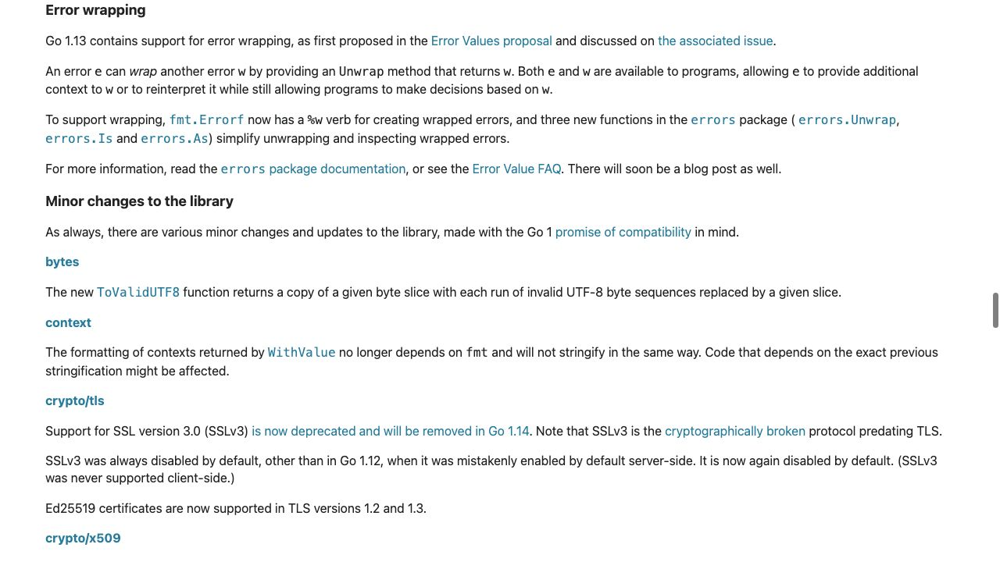
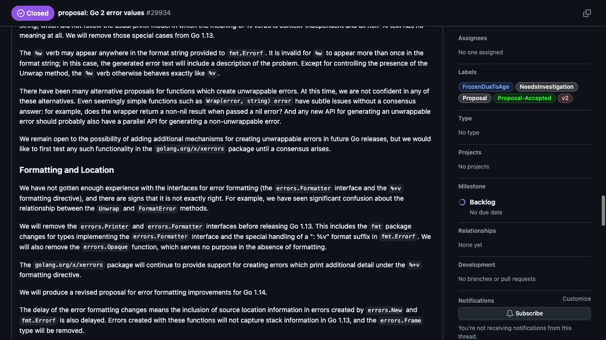

[問題へ戻る](README.md) | [カテゴリの調べ方](../../README.md) | [調査例の一覧](../../../RESEARCH_GUIDE.md)

# 調査・回答例: エラーの値、Wrapping、位置情報を別々の設計判断として読む

問題文とカテゴリ README に見えている情報を出発点に、資料のどこを読み、どう解釈して次へ進むかを示します。問題のヒント・答えを検索語の出所にはしていません。唯一の正解ルートではありません。

画面は 2026-10-02 の調査時に取得したものです。本文と実行結果は 2026-10-13 に再確認しました。原文の語句と識別子に沿う読解補足は、2026-10-14 に一次資料を再取得して確認しました。画面の一部だけで判断せず、リンク先の本文と対象版の実装も読みます。実行環境は Go 1.27.1 / darwin/arm64。実装を Go 1.27.0 に固定している箇所は、問題で指定された版の調査です。

## 最初に分かっていること

問題の実測には、エラー文へ文脈が加わる、元のエラーを検査できる、`%+v` でもスタックが出ない、という三つの観測があります。カテゴリは Go Blog の一覧を案内しています。問題の「調査の入り口」にある `Errors are values` をそこで探せるので、結論から推測した検索語は必要ありません。

<a id="question-1"></a>

## 設問 1: 哲学の標語を、記事の例で読む

[Errors are values](https://go.dev/blog/errors-are-values) を読むと、単に `if err != nil` を繰り返す以外にも、エラーという値をプログラムで扱えることが主題です。Scanner が反復の途中のエラーを記録し、あとで `Err` を問い合わせる例や、最初のエラーを保持する writer の例が続きます。後者の `errWriter` では `err` フィールドに値を保存し、`if ew.err != nil` なら次の書き込みをせず戻ります。呼び出し側は最後にそのフィールドを検査します。つまり記事の「値として扱う」は、エラーの保存と検査の時点をコードで組み立てられる、という具体例で読めます。

ここから読めるのは、エラーの値を保持し、返し、後から検査できる設計です。この記事だけで「スタックを付けると遅いから禁止された」という採否の理由までは導けません。仕様の [Errors](https://go.dev/ref/spec#Errors) も読むと、`error` は `Error() string` を要求するインターフェースです。スタックを必須の構成要素にはしていません。

[問題のコード](https://go.dev/play/p/m3PMRBAE_rq) を `go run` した結果です。

```text
error: load config: not found
is not found: true
detailed format: load config: not found
```

**回答例:** エラーはプログラムが明示的に受け渡し・加工・検査する値です。標準の error インターフェースが要求するものに、例外機構やスタックの自動取得は含まれていません。ただし独自の型が追加情報を持つことまで禁止する設計ではありません。

<a id="question-2"></a>

## 設問 2: 追加されたものを、リリースノートで限定する

次は問題が版を指定する [Go 1.13 の Error wrapping](https://go.dev/doc/go1.13#error-wrapping) を開きます。



この節は、外側の文脈と内側のエラーの両方を利用できること、`Unwrap`、`errors.Is`、`errors.As`、`%w` を導入したことを説明しています。画面の提案と Issue へのリンクから、決定まで調べる動線が得られます。

[Working with Errors in Go 1.13](https://go.dev/blog/go1.13-errors) も読むと、文字列へ文脈を付けただけでは元の値の情報を失うことや、ラップしたエラーを検査する API の役割が説明されています。問題の `load config:` は外側の文脈、`errors.Is` の true は内側の原因に到達できたという別の性質に対応します。

公開 API の根拠は [errors](https://pkg.go.dev/errors@go1.27.1) と [fmt.Errorf](https://pkg.go.dev/fmt@go1.27.1#Errorf) で確認できます。宣言先の [errors/wrap.go](https://cs.opensource.google/go/go/+/refs/tags/go1.27.1:src/errors/wrap.go) の `Is` が呼ぶ `is` では、`err == target` の検査と `err = x.Unwrap()` による次の値への移動を読めます。[fmt/errors.go](https://cs.opensource.google/go/go/+/refs/tags/go1.27.1:src/fmt/errors.go) では `wrapError` の `msg` が表示用文字列、`err` が元の値です。`Error()` は `msg`、`Unwrap()` は `err` を返すため、表示に文脈を足しても検査用の値を残せると分かります。

**回答例:** 人間向けの文脈を追加しながら、プログラムが元のエラーを検査できるよう、ラップと探索の共通規約を標準化したものです。詳細表示やスタックの取得と同じ機能ではありません。

<a id="question-3"></a>

## 設問 3: 提案本文と最終決定の差を読む

[提案 #29934](https://github.com/golang/go/issues/29934) の本文には、議論中の変更をまとめた Update と、[採用範囲を整理した決定コメント](https://github.com/golang/go/issues/29934#issuecomment-489682919) へのリンクがあります。最初の提案に含まれているからといって、そのままリリースされたとは判断せず、この決定を読みます。



**Formatting and Location** の最初の `not gotten enough experience` は、整形用インターフェースや `%+v` について「十分な利用経験をまだ得ていない」という判断です。続く `confusion` が指すのは `Unwrap` と `FormatError` の関係についての混乱です。次の段落の `remove` は Go 1.13 から Printer / Formatter 等を外す決定、末尾の `also delayed` は整形の延期に伴って位置情報も延期するという関係を表します。`errors.New` と `fmt.Errorf` は Go 1.13 でスタック情報を取得しない、という範囲が明示されています。

冒頭の箇条書きで `Unwrap`・`Is`・`As`・`%w` には `keep`（残す）、整形と位置情報には `remove`（外す）が対応していることも確認し、この判断と Wrapping の採用を一緒に記録します。元のエラーをたどる仕組みは入った一方、整形と位置情報は同じ時点では入っていません。コメントにある将来版への再提案予定は、現在実装済みという意味ではありません。

**回答例:** Go 1.13 の決定では、整形 API の経験不足と設計上の混乱を踏まえ、整形機構と、それに結び付く位置情報を延期しました。これを「Go はスタックを持つエラーを一切許さない」「性能だけが理由だった」という一般論へ広げる根拠はありません。

## 調査の範囲と、次に読むところ

この例では、公式記事、仕様、提案本文から直接リンクされた決定コメント、リリースされた API と実装を照合しました。Issue の全 435 コメントをすべて読んだ調査ではありません。議論全体を評価する場合は、カテゴリの手順どおり省略されたコメントも開き、代案と、その後の変更を追加確認する必要があります。

次の疑問を「自分の用途で位置情報を持たせるには、どこで何を採取するか」に絞るなら、提案の設計文書と標準ライブラリの公開 API を別々に読むと、当時の案と現在利用できるものを混同せずに進められます。
