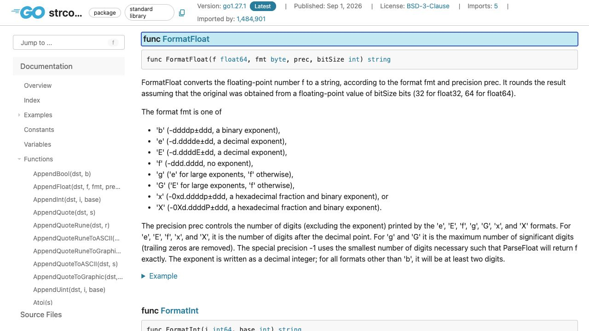
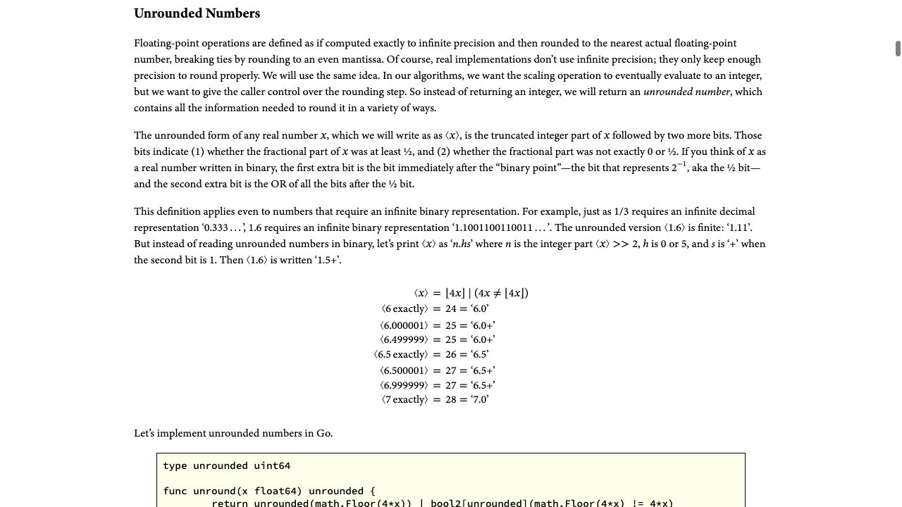

[問題へ戻る](README.md) | [カテゴリの調べ方](../../README.md) | [調査例の一覧](../../../RESEARCH_GUIDE.md)

# 調査・回答例: 公開契約を固定してから、変換経路の入れ替えを読む

問題文とカテゴリ README に見えている情報を出発点に、資料のどこを読み、どう解釈して次へ進むかを示します。問題のヒント・答えを検索語の出所にはしていません。唯一の正解ルートではありません。

画面は 2026-10-02 の調査時に取得したものです。本文と実行結果は 2026-10-13 に再確認しました。原文の語句と識別子に沿う読解補足は、2026-10-14 に一次資料を再取得して確認しました。画面の一部だけで判断せず、リンク先の本文と対象版の実装も読みます。実行環境は Go 1.27.1 / darwin/arm64。実装を Go 1.27.0 に固定している箇所は、問題で指定された版の調査です。

## 最初に分かっていること

問題が示す API は `FormatFloat` と `ParseFloat`、比較する版は Go 1.26.0 と 1.27.0 です。内部のアルゴリズム名を先に決めず、カテゴリの入口に従って [FormatFloat](https://pkg.go.dev/strconv@go1.27.1#FormatFloat) を読みます。

<a id="question-1"></a>

## 設問 1: 「最短」の後に付いた条件まで読む



下の段落では `smallest number of digits` が最小桁数、続く `such that` がその桁数を選ぶ条件を導きます。条件の `return f exactly` は「ParseFloat が元の引数 f と正確に同じ値を返す」です。短ければ何でもよいのではなく、読み戻しの一致を満たす中で最短だと読めます。そこで [ParseFloat](https://pkg.go.dev/strconv@go1.27.1#ParseFloat) の `nearest`（最も近い値）と `IEEE754 unbiased rounding`（同点では偶数側を選ぶ丸め）、`bitSize` が指定する 32 / 64 bit の精度を確認します。「見た目がきれいな小数」を選ぶ規則ではありません。

[問題のコード](https://go.dev/play/p/lFFIIE8DDSc) を `go run` すると、次の結果でした。

```text
shortest: 0.1
17 digits: 0.10000000000000001
next float: 1.0000000000000002
round-trip: true
without last digit: 1.000000000000000 (false)
```

**回答例:** 指定された精度の浮動小数点数として読み戻したとき、元の値へ戻るために必要な最小の桁数です。`0.1` は短い表記でその条件を満たしますが、`1` の次の値は末尾の `2` を落とすと満たしません。この実測は二つの入力の確認であり、アルゴリズム全体の正しさの証明ではありません。

<a id="question-2"></a>

## 設問 2: API の宣言から内部の三つの経路へ分ける

FormatFloat の宣言リンクを読むと、[strconv/number.go](https://cs.opensource.google/go/go/+/refs/tags/go1.27.1:src/strconv/number.go) は内部パッケージへ委譲しています。問題が指定する `internal/strconv` の版比較へ進む理由がここで分かります。

同じファイルの同じ分岐を比べるため、[Go 1.26.0 の ftoa.go](https://cs.opensource.google/go/go/+/refs/tags/go1.26.0:src/internal/strconv/ftoa.go) と [Go 1.27.0 の ftoa.go](https://cs.opensource.google/go/go/+/refs/tags/go1.27.0:src/internal/strconv/ftoa.go) を開きます。`prec < 0`、桁数指定、読み込み、の三つを分けて記録しました。

| 経路 | Go 1.26.0 で読んだ処理 | Go 1.27.0 で読んだ処理 |
| --- | --- | --- |
| 最短幅の出力 | `dboxFtoa`。コメントは Dragonbox | `shortFloat`。fast unrounded scaling を使う |
| 桁数を指定した出力 | `fixedFtoa`。高速経路に桁数の条件がある | `fixedWidthFloat`。18 桁以下の経路と大きい精度の経路を分ける |
| 十進文字列からの読み込み | `atof32exact` / `atof64exact`、Eisel-Lemire、低速 fallback | `parseFloat32` / `parseFloat64`、必要に応じた低速 fallback |

読み込み側の根拠は [Go 1.26.0 の atof.go](https://cs.opensource.google/go/go/+/refs/tags/go1.26.0:src/internal/strconv/atof.go) と [Go 1.27.0 の atof.go](https://cs.opensource.google/go/go/+/refs/tags/go1.27.0:src/internal/strconv/atof.go) です。Go 1.27.0 の読み込みでは、`trunc` が追加の桁を切り詰めたことを表します。`d` と上限側の `d+1` を両方 `parseFloat64` で変換し、`f == f1` なら省いた桁が結果を変えないと判定して戻ります。一致しなければ `Slow fallback` の処理が続きます。この条件と戻り先まで読むことで、高速経路に全入力を押し込んだ変更ではないと判断できます。

**回答例:** 最短出力、指定桁数の出力、読み込みの高速経路が共通の unrounded scaling を使う構成へ替わっています。ただし任意の長い入力や大きい精度まで、すべての低速処理が消えたわけではありません。

<a id="question-3"></a>

## 設問 3: 共通部品が捨てずに残す情報を理解する

問題にある [uscale.go](https://cs.opensource.google/go/go/+/refs/tags/go1.27.0:src/internal/strconv/uscale.go) の冒頭は、[Floating-Point Printing and Parsing Can Be Simple And Fast](https://research.swtch.com/fp) を直接参照しています。ソースの `unrounded` という名前を手掛かりに、記事の **Unrounded Numbers** 節へ進みます。



整数部の後の二つのビットは、半分以上か、そして 0 またはちょうど半分以外の端数が残るか、を表します。記事では最下位の追加ビットを `sticky bit` と呼び、一度端数があったという情報を残す役割を説明しています。ソースの `floor` は切り捨て、`ceil` は切り上げ、`round` は最近接偶数丸めに対応します。`round` の `(u>>2)&1` は整数部の偶奇を調べるため、同点を常に切り上げる処理とは区別できます。記事の `6.5` と `6.500001` が違う表現になる例を読むと、「細かい桁を省く」と「丸めに必要な情報を失う」は同じでないと理解できます。

次に記事の **Shortest-Width Printing** とソースの `shortFloat` を対応させます。元の値へ丸め戻される範囲の下限・上限を求め、その中に入る十進表現を選びます。`uscale.go` の `shortFloat` では下限側を `ceil()`、上限側を `floor()` で十進整数の範囲 `dmin` から `dmax` へ変えています。その後の `dmax / 10` と `d*10 >= dmin` は、一桁短くした候補を元の桁へ戻しても下限内か、という検査です。範囲内なら短い候補を返し、そうでなければ元の桁数を使い、その範囲に複数の候補がある場合は中央の値を丸めます。境界での偶奇や、2 のべき乗付近の非対称な区間も分けており、「単に末尾のゼロを消す」だけではありません。

**回答例:** 有効な整数部分と、丸め方向・同点処理を決める追加情報を残します。その共通表現を、指定桁数の丸め、読み込み、元へ戻る範囲からの最短表記の選択に使います。

## ここから設計判断を調べる理由

仕組みが共通化されたことは読み取れましたが、それだけで採用理由が速度だとは断定できません。ここで問題に示された変更コミットへ進みます。

<a id="question-4"></a>

## 設問 4: 性能表の良い行だけを拾わない

[変更コミット 71300e8](https://go.dev/change/71300e80113c6ca56105aac524e9c1b0db43910f) には、約 900 行を削除し、出力を速くし、読み込みは簡潔になる一方で速度はおおむね同じ、という説明があります。末尾の Reviewed-on から [CL 743860](https://go-review.googlesource.com/c/go/+/743860) へ進むと、同じ比較表をレビューの変更として確認できます。

比較表はホスト別・入力別です。たとえば出力の多くには改善がある一方、特定の短い区間や 32 bit の列などには悪化する行もあります。負の値だけを抜き出し、すべての変換が一律に速くなると説明するのは表に合いません。

**回答例:** 公開する読み戻しの契約を保ちつつ、複数経路を共通化してコードを減らし、特に出力の性能を改善するためです。性能の効果は入力と環境に依存するので、自分たちの用途の速度を保証する数値とは扱いません。

## さらに調べるなら

今回残った問いは、境界の計算が全入力で正しいとどう確かめるかです。記事が案内する証明と、対象版の変換テストへ進めます。この調査例では公開契約・経路・丸め情報・採用理由を確認しましたが、記事の形式的証明を独立に再実行したり、CL のベンチマークを再計測したりはしていません。
