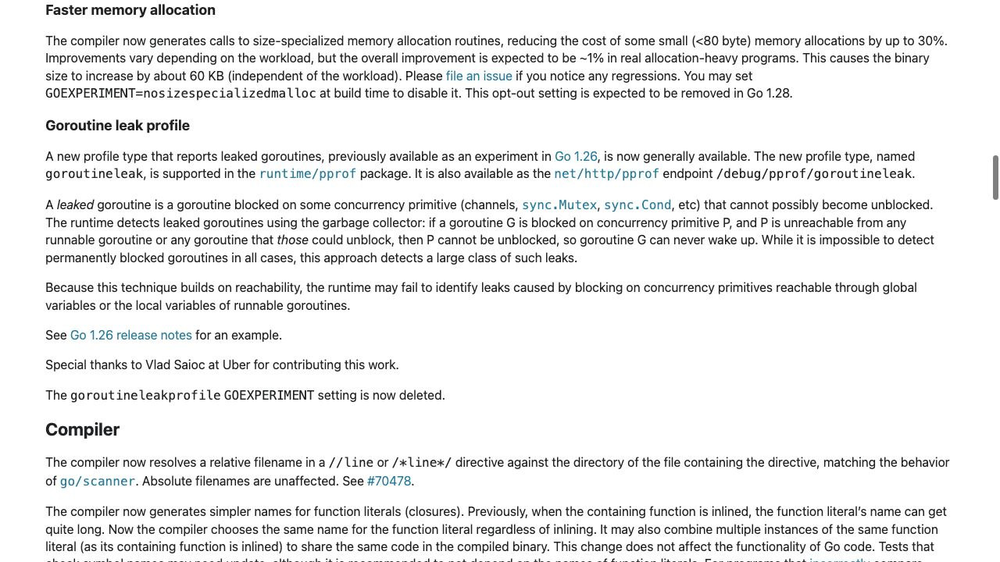
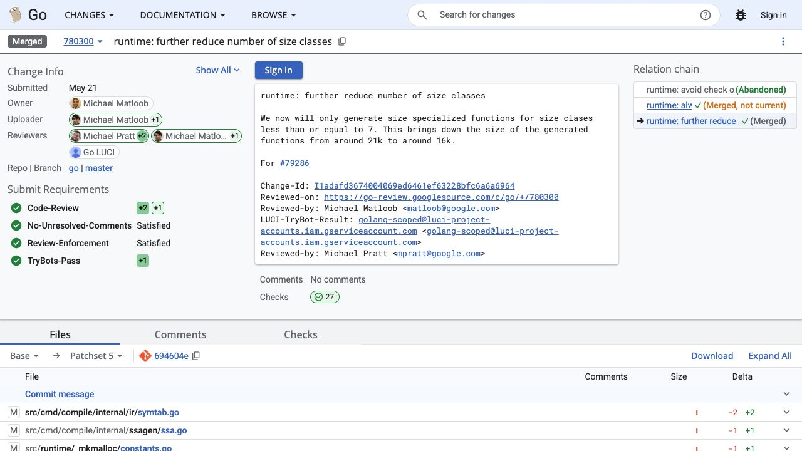

[問題へ戻る](README.md) | [カテゴリの調べ方](../../README.md) | [調査例の一覧](../../../RESEARCH_GUIDE.md)

# 調査・回答例: 80 という境界を、要約・実装・変更理由で確かめる

問題文とカテゴリ README に見えている情報を出発点に、資料のどこを読み、どう解釈して次へ進むかを示します。問題のヒント・答えを検索語の出所にはしていません。唯一の正解ルートではありません。

画面は 2026-10-02 の調査時に取得したものです。本文と実行結果は 2026-10-13 に再確認しました。画面の一部だけで判断せず、リンク先の本文と対象版の実装も読みます。実行環境は Go 1.27.1 / darwin/arm64。実装を Go 1.27.0 に固定している箇所は、問題で指定された版の調査です。

## 最初に分かっていること

問題は `Faster Memory Allocation`、`80`、`size-specialized` という語と、リリースノート・CL・二つのソースへの入口を示しています。まず [Go 1.27 リリースノート](https://go.dev/doc/go1.27#faster-memory-allocation) の該当節を読みます。



一段落の中に、速度向上だけでなく、ワークロードによる差、バイナリサイズ増加、回帰の報告先、無効化方法が並んでいます。これを「すべての割り当てが 30% 速くなる」と読み替えないことから始めます。

<a id="question-1"></a>

## 設問 1: 専用化の説明を呼び出し先までつなげる

問題にある [CL 707856](https://go-review.googlesource.com/c/go/+/707856) の commit message は、コンパイル時にサイズを知っている場合、`newObject` を経由する呼び出しを専用の割り当て関数へ変えると説明しています。先に名前の定義を読み、次に [Go 1.27.0 の ssa.go](https://cs.opensource.google/go/go/+/refs/tags/go1.27.0:src/cmd/compile/internal/ssagen/ssa.go) で問題にある `specializedMallocSym` を探します。

この関数ではサイズとポインターの有無から、サイズクラスに対応する専用シンボルや tiny 向けのシンボルを選びます。その前に有効化条件の判定があり、上限を超えれば nil を返します。呼び出す側も読むと、専用のシンボルを選べない場合に通常の割り当て経路を残していると分かります。

**回答例:** 実行時に毎回サイズから分岐する処理の一部を、コンパイル時に決まるサイズクラス等へ専用化しています。サイズが分からない割り当てに、この選択をそのまま適用することはできません。さらにサイズ既知だけで必ず対象になるわけではなく、有効化条件や実際のヒープ割り当ての有無も関係します。

[問題の実行例](https://go.dev/play/p/YnvY6u0c87E) を `go run` した結果は次のとおりです。

```text
{1 2}, size=16 bytes
```

これはこの環境の型サイズと値の確認です。出力だけから専用関数が呼ばれた、あるいは速くなったと断定はできません。

<a id="question-2"></a>

## 設問 2: 境界の数字と、境界を選んだ理由を別々に確かめる

`specializedMallocMax = 80` の後の条件は `size > specializedMallocMax` です。ここを読むと **80 自体は除外されない** と分かります。リリースノートの `<80 byte` という要約とは境界の書き方が異なるため、対象版の条件式を根拠にします。

次に問題の [runtime/_mkmalloc/constants.go](https://cs.opensource.google/go/go/+/refs/tags/go1.27.0:src/runtime/_mkmalloc/constants.go) を読みます。同じ上限の直前には、大きいサイズクラスでの利益は限られ、ラッパーを経由すると通常版より遅い場合もある、とあります。80 は言語仕様による限界ではなく、専用化の利益とコストの判断です。

それでも「なぜ以前から 80 だったのか」は分かりません。カテゴリにある HTML コメントの調べ方でリリースノートの直前を読むと、`go.dev.issue/79286` という表記があり、[Issue #79286](https://github.com/golang/go/issues/79286) に進めます。本文と全 21 コメントを確認すると、128 バイト超を削除する変更の後に [CL 780300](https://go-review.googlesource.com/c/go/+/780300) が続いています。



この CL の説明は、専用化するクラスをさらに絞り、生成関数の大きさが約 21 KB から約 16 KB へ減ったことを示します。これはリリースノートの「最終バイナリが約 60 KB 増える」という別の比較対象と混同しません。

**回答例:** 大きなクラスで得られる利益が小さく、かえって遅くなる場合もあり、専用コードの量も増えるためです。対象版は 80 バイトを含む上限を設けています。コメントと実測を伴う変更の経緯が根拠であり、80 に普遍的な性能の法則があるわけではありません。

<a id="question-3"></a>

## 設問 3: opt-out の役割を、既定値と予定から切り分ける

Issue に記録された [既定有効化の CL](https://go-review.googlesource.com/c/go/+/773941) を読み、[Go 1.27.0 の buildcfg](https://cs.opensource.google/go/go/+/refs/tags/go1.27.0:src/internal/buildcfg/exp.go) の `SizeSpecializedMalloc: true` と照合します。新機能を使うために実験設定を足す必要がある、とは読めません。

リリースノートが回帰の報告先と無効化を隣に書いているため、問題が生じた際に最適化を外し、比較や切り分けをするための一時的な逃げ道と解釈できます。[Issue の末尾](https://github.com/golang/go/issues/79286#issuecomment-4894881302) では、削除予定を追跡する Issue を求めるやり取りもあります。「Go 1.28 で削除予定」は計画であり、現在削除済みという意味ではありません。

**回答例:** 既定では最適化を使い、回帰が疑われる場合はビルド時の `nosizespecializedmalloc` で比較できます。一時的な opt-out を恒久的な互換性設定と考えず、今後のリリースノートで実際の削除を確認します。

## さらに調べるなら

次は、問題で使っている型をヒープへ逃がした場合の生成コードを、通常設定と opt-out で比べる調査ができます。比較対象の関数名は今回読んだコンパイラの選択先から得られます。今回の作業では性能ベンチマークを実施していないため、リリースノートや CL の数値は著者らの計測として扱います。
