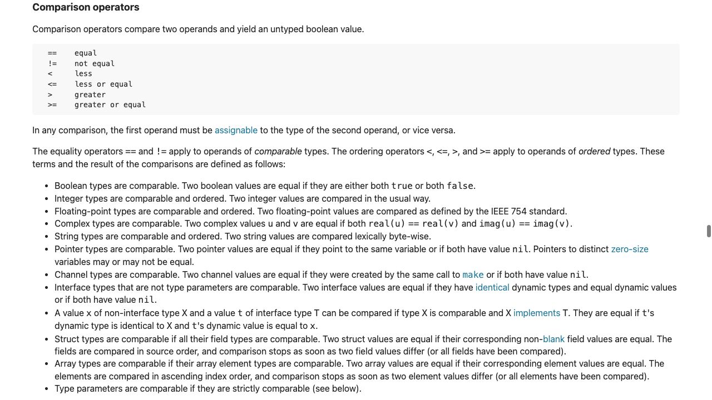
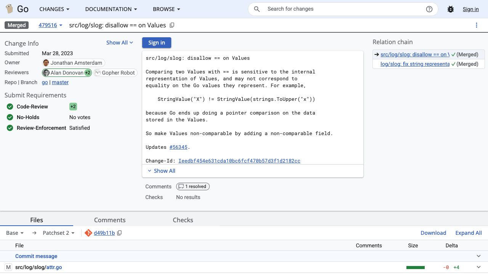

[問題へ戻る](README.md) | [カテゴリの調べ方](../../README.md) | [調査例の一覧](../../../RESEARCH_GUIDE.md)

# 調査・回答例: 比較不能の理由を、型・仕様・設計意図に分ける

問題文とカテゴリ README に見えている情報を出発点に、資料のどこを読み、どう解釈して次へ進むかを示します。問題のヒント・答えを検索語の出所にはしていません。唯一の正解ルートではありません。

画面は 2026-10-02 の調査時に取得したものです。本文と実行結果は 2026-10-13 に再確認しました。画面の一部だけで判断せず、リンク先の本文と対象版の実装も読みます。実行環境は Go 1.27.1 / darwin/arm64。実装を Go 1.27.0 に固定している箇所は、問題で指定された版の調査です。

## 最初に分かっていること

問題にはコンパイルエラー、`slog.Value` の型定義へのリンク、言語仕様、比較を禁止した CL が示されています。エラー文の `[0]func()` を覚えた解法として扱わず、まず [型定義](https://cs.opensource.google/go/go/+/refs/tags/go1.27.0:src/log/slog/value.go) のフィールドとコメントを読みます。

<a id="question-1"></a>

## 設問 1: エラーの型を、構造体の中で見つける

先頭のフィールドは `_ [0]func()` で、コメントは比較を禁止する意図を示しています。`num` と `any` という実データ用のフィールドも続きます。エラー文と一致する型は見つかりましたが、コメントが意図を表しているだけでは言語規則の説明にはなりません。

[問題のコード](https://go.dev/play/p/MPeWX_kJChR) を `go run` したところ、コンパイル段階で終了し、次の診断になりました（パスと行番号を除いた診断本文）。

```text
invalid operation: v1 == v2 (struct containing [0]func() cannot be compared)
```

**回答例:** `_ [0]func()` フィールドが比較不能の仕掛けです。名前が `_` なので値としては使いませんが、構造体の型を構成するフィールドではあります。

<a id="question-2"></a>

## 設問 2: 配列の長さでなく、要素型の条件を読む

問題の `==` をカテゴリの仕様入口から [Comparison operators](https://go.dev/ref/spec#Comparison_operators) で探します。



画面の末尾付近には、構造体は全フィールド型が比較可能な場合、配列は要素型が比較可能な場合、という条件があります。その後の関数型についての説明まで読み、関数は同士を `==` で比較できないと確認します。これを内側から適用すると、`func()` → `[0]func()` → `Value` の順に比較不能だと導けます。

「構造体の値を比較するとき、blank フィールドの値は比べない」という説明と、「構造体の型が比較可能であるための条件」は別です。また配列の規則に長さ 0 の例外はありません。

**回答例:** 関数型が比較不能なので、その配列も比較不能です。その型のフィールドが一つでも含まれる Value は、構造体として比較可能性の条件を満たしません。

<a id="question-3"></a>

## 設問 3: サイズ 0 という型の性質と、配置の結果を分ける

「長さ 0」に役割があるのかを、仕様の [Size and alignment guarantees](https://go.dev/ref/spec#Size_and_alignment_guarantees) で読みます。要素数 0 の配列自体はサイズ 0 ですが、構造体のパディングまで一律にゼロになるとは書かれていません。

[問題のサイズ比較](https://go.dev/play/p/w9nhI8d9nnl) を `go run` した結果です。順に、配列自体、先頭に置いた構造体、フィールドなしの構造体、末尾に置いた構造体、実際の Value です。

```text
0
24
24
32
24
```

同じゼロサイズでも末尾の場合に違いが出たので、カテゴリのソース調査へ進みます。追調査では、仕様にある zero size と問題のコンパイラ実装という範囲を手掛かりに、手元の Go ソースの `src/cmd/compile` を `zero-sized` で検索しました。複数の候補のうち、`internal/types/size.go` に構造体の末尾フィールドを述べるコメントが見つかったので、前後のサイズ計算を読み、同じパスの Go 1.27.0 タグで照合しました。検索で見つけた行だけで結論にせず、計算全体を読むと、[size.go](https://cs.opensource.google/go/go/+/refs/tags/go1.27.0:src/cmd/compile/internal/types/size.go) は非ゼロサイズ構造体の末尾がゼロサイズのときに 1 バイトを加え、最後にアラインメントへ丸めています。末尾フィールドのアドレスが次のヒープオブジェクトを指さないため、という理由もコメントにあります。

**回答例:** ゼロ長配列なら要素の記憶域が不要なまま、比較不能という型の性質を持たせられます。Value ではそれが先頭にあり、この環境でサイズは増えていません。`24` や `32` をすべての環境に共通の言語仕様とは扱いません。

<a id="question-4"></a>

## 設問 4: 格納方法の一致と、表す値の一致を区別する

再び型定義のフィールドコメントに戻ります。文字列は長さを `num` に、データへのポインターを `any` に保存するとあります。この表現のフィールド同士を比較したら、文字列の内容でなくポインターの一致を見てしまうのではないか、という疑問が生まれます。ここで問題にある [CL 479516](https://go-review.googlesource.com/c/go/+/479516) を開きます。



CL はまさにその例を理由にしています。ただし現在は `==` 自体が禁止されているので、過去の問題をそのまま現在の実行可能コードだとは読みません。現在の [Value.Equal](https://pkg.go.dev/log/slog@go1.27.1#Value.Equal) と、その宣言先の `Equal` 全体を読むと、種類を確認してから、文字列なら文字列の内容を比較する経路へ進みます。一方 `KindAny` では中の値を `==` で比較するため、比較不能な値なら panic し得ます。

[問題の比較例](https://go.dev/play/p/d6m0c3sgC6F) の実測です。

```text
strings equal: true
data pointers equal: false
Value.Equal string: true
Value.Equal slice panicked: true
```

**回答例:** 内部表現の一致と値の意味上の一致が異なるため、`==` を許して誤用されるのを防いでいます。Value 同士は `Equal` を使いますが、任意の AnyValue を常に安全に深い比較できる API ではありません。

## さらに調べるなら

`Equal` に列挙された分岐から、時刻やグループではどんな比較を選ぶかを追えます。`==` 禁止の仕掛け、サイズ、意味上の比較は別々の問いです。一つのエラー文だけですべての設計理由が分かったとせず、それぞれに対応する根拠を残します。
